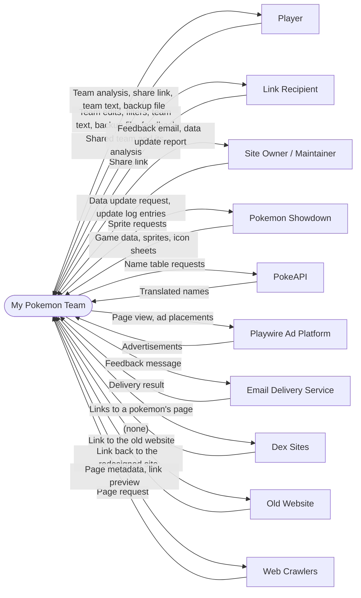

# 1. Vision and Scope

Requirement level: business. This document states why My Pokemon Team exists, what it could become, and which part of that the current release and the next one cover. The user and system requirements in the later documents must each help one of the business requirements here.

Statements marked **[A-n]** are assumptions made from the repository alone. They are listed with the question that would settle each one in [08-assumptions-and-interview.md](08-assumptions-and-interview.md).

## 1.1 Business opportunity

Pokemon players plan a team of six before they play: in the main games, on Pokemon Showdown, and in official formats such as VGC and Pokemon Champions. The planning question is always the same: which types hit this team hard, and which types can this team hit hard? Answering it by hand means reading an 18 by 18 type chart for six pokemon and up to 24 moves, then correcting for abilities, items, and moves that break the chart.

The tools a player can turn to fall into two groups ([11-existing-systems-analysis.md](11-existing-systems-analysis.md)). Competitive builders such as Pokemon Showdown's hold full sets and read Showdown's team text, but give little type analysis, or none. Type planners total a team's weaknesses, most of them counting abilities, but hold no full sets and read no team text. None of the six examined explains where a total comes from, checks a team against the roles a competitive team needs, or carries a team from one generation to another **[A-1]**. My Pokemon Team does both jobs in one place and adds those three.

The Site Owner made the site in 2019 because good teambuilders were lacking. The site is free to use. Advertising managed by Playwire is meant to pay for its hosting and for the time its owner spends building and maintaining it.

## 1.2 Problem statement

> **The problem of** judging a six-pokemon team's type weaknesses and move coverage by hand, across nine generations with different type charts, abilities, items, and move rules, **affects** Pokemon players who plan teams for the main games and for competitive formats, **the impact of which is** teams with weaknesses their builders did not see, time lost to cross-checking reference sites, and totals that cannot be checked, because no tool says where they come from. **A successful solution would be** a teambuilder that scores the whole team's defence and coverage as the player edits it, counts abilities, items, and special moves, follows the rules of the chosen generation and game, and exchanges teams with Pokemon Showdown and with other players by text and by link.

## 1.3 Business requirements

Business objectives are written to be measured. Where the target value is an assumption, it carries a marker.

| ID   | Business objective and success criterion                                                                                                                                                                                                                                                                                                                                                                                                      | Kind         |
| ---- | --------------------------------------------------------------------------------------------------------------------------------------------------------------------------------------------------------------------------------------------------------------------------------------------------------------------------------------------------------------------------------------------------------------------------------------------- | ------------ |
| BR-1 | Advertising revenue shall cover the site's hosting, domain, and email costs in every calendar month, and shall pay the Site Owner for the hours spent building and maintaining the site at a rate the Site Owner sets **[A-2]**.                                                                                                                                                                                                              | Financial    |
| BR-2 | Every share link and every saved team created by any released version shall load the same team in every later version.                                                                                                                                                                                                                                                                                                                        | Nonfinancial |
| BR-3 | Game data shall be live on the site within 2 days of Pokemon Showdown publishing it for a major change (a new game, or a new Pokemon Champions regulation), and within 7 days for a minor change (such as one pokemon losing one move). Data for a new game that Pokemon Showdown has not published within 7 days of the game's release shall be taken from another source **[A-3]**.                                                         | Nonfinancial |
| BR-4 | The site shall be usable in each of the nine languages of the Pokemon games and in Brazilian Portuguese.                                                                                                                                                                                                                                                                                                                                      | Nonfinancial |
| BR-5 | The redesigned site shall replace the old website as the version players choose. It has done so once all four hold: (a) fewer than 10% of its sessions switch to the old website; (b) fewer than five reports a month through feedback concern a defect of the redesign; (c) its visits and its advertising revenue are at or above the old website's; (d) every function of the old website works on it and has an automated test **[A-4]**. | Nonfinancial |
| BR-6 | The site shall run without a backend service other than hosting and feedback email, a constraint the Site Owner lifts only for the site's survival or for a feature the Site Owner rates extremely important. It shall need no more than one maintainer **[A-5]**.                                                                                                                                                                            | Nonfinancial |
| BR-7 | A wrong analysis result reported through feedback shall be corrected in production within 7 days of the report.                                                                                                                                                                                                                                                                                                                               | Nonfinancial |
| BR-8 | The site shall comply with the terms of its data and advertising providers: Pokemon Showdown (data, sprites), PokeAPI (names), and Playwire (ad placement, `ads.txt`, crawlers).                                                                                                                                                                                                                                                              | Nonfinancial |
| BR-9 | The site shall be the teambuilder that non-competitive players reach for: players who plan a team for a playthrough, a fan-made game, or for fun. The Site Owner would be proud of the site, a year from now, with team, language, and full generation support complete and a large share of that community using it. No measure of that share is set yet **[A-23]**.                                                                         | Nonfinancial |

### Business rules

Application-domain requirements that the later documents must respect. They come from the games and from Pokemon Showdown, not from a choice made for this site.

| ID     | Business rule                                                                                                                                                                     |
| ------ | --------------------------------------------------------------------------------------------------------------------------------------------------------------------------------- |
| RULE-1 | A team has at most six pokemon, and a pokemon has at most four moves, one held item, and one ability.                                                                             |
| RULE-2 | The pokemon, formes, moves, items, abilities, base stats, and type chart available to a team are those of the team's generation and game.                                         |
| RULE-3 | Team text follows Pokemon Showdown's export format, so that text copied from either tool can be pasted into the other.                                                            |
| RULE-4 | Format (tier) membership follows Smogon's tiers as Pokemon Showdown publishes them, and the Pokemon Champions format follows the current regulation in Showdown's Champions data. |
| RULE-5 | Training values follow the game's system: DVs and stat experience in Generations 1 and 2, IVs and EVs from Generation 3, and stat points (SPs) in Pokemon Champions.              |

## 1.4 Vision statement

> **For** Pokemon players, most of them not competitive, **who** want to know how well a team of six covers and resists the eighteen types before they commit to it, **the** My Pokemon Team website **is** a free teambuilder **that** scores a team's type defence and type coverage as it is built, for any generation from 1 to 9 and for Pokemon Champions. It checks the team against a checklist of competitive roles, narrows the choice of pokemon by format, type, region, and ability, keeps several teams in the browser, and exchanges them with Pokemon Showdown as text and with other players as a link, in ten languages. **Unlike** Pokemon Showdown's own teambuilder, which gives no team analysis, and other team planners, which give totals without saying where they come from, **our product** explains each score, checks the team against a checklist of competitive roles, and carries a team from one generation to another, while counting the abilities, items, and moves that change type matchups, such as Levitate, Thick Fat, and Freeze-Dry.

## 1.5 Scope

### Releases

| Release        | Contents                                                                                                                                                                                                                                                 | State                  |
| -------------- | -------------------------------------------------------------------------------------------------------------------------------------------------------------------------------------------------------------------------------------------------------- | ---------------------- |
| R0 Old website | Generations 6 to 9, one unsaved team, type defence and coverage, checklist, filters by format, type, and region, Showdown import and export, share link. English only.                                                                                   | Live at `old.` host    |
| Ash            | Everything in the feature model marked as-is: Generations 1 to 9, saved teams, set details, matrix, backups, generation transfer, ten languages, feedback, site version switch.                                                                          | `major-added-features` |
| Brock          | The GitHub milestone "Brock": the planned features PF1 to PF7 in [04-feature-model.md](04-feature-model.md) (battle format for the checklist, team transfer to the old website, the remaining games, and others) and the other work scheduled with them. | Proposed               |

### In scope for Ash

The work the system does itself:

- Holding a team of up to six pokemon with their moves, item, ability, and set details, for one chosen generation or game.
- Offering only the pokemon, moves, items, and abilities that exist in that generation or game, narrowed by the player's filters and ordered by the player's sort.
- Scoring the team's type defence and type coverage, checking the team checklist, and showing the matrix of every type against every pokemon, with the reason for each cell.
- Keeping any number of named teams in the browser, each with its generation, format, and filters.
- Exchanging teams as Pokemon Showdown text, as a share link, and as a backup file.
- Previewing and applying the changes a team needs when its generation or game changes.
- Presenting the site in ten languages, in a light or dark colour scheme, on screens from 320 pixels wide.
- Sending a player's feedback to the site owner by email.
- Reference material: a manual, three type charts, an update log, credits, a privacy policy, and each pokemon's base stats, abilities, weaknesses, and links to four dex sites.

### Not part of the plan

Not intended for Ash or Brock. None of these is ruled out for good; each would first need a business requirement of its own.

- Battling, damage calculation, and speed tiers. Pokemon Showdown and its damage calculator do these.
- Player accounts and server-side storage of teams. Teams stay in the browser; a backup file moves them between devices.
- Editing or hosting game data. Pokemon Showdown is the source, and the site ships a projection of it.
- Moderating or hosting shared teams. A share link holds the whole team; nothing is stored on a server.

### Open for a later release

The Site Owner wants these, for a release after Brock, and with one constraint on all three: many players are children and teenagers **[A-24]**, so the site should stay simple and not try to be too clever.

- Suggesting teammates, moves, items, or abilities to fix a weakness (issue 37). Today the site shows the weakness and leaves the choice to the player.
- Analysis that looks beyond types, such as how a team fares against commonly used pokemon (issue 44).
- A chart of how often each pokemon is used (issue 36). It needs usage statistics the site does not have.

### Limitations and dependencies

- Pokemon sprites load from Pokemon Showdown's servers. When those are unreachable, pokemon show without sprites.
- Pokemon, move, item, and ability names in languages other than English come from PokeAPI. A name PokeAPI lacks appears in English. PokeAPI has no Portuguese names until the games do (2027).
- The feedback function sends from Resend's shared address, which can deliver only to the owner's own address. That is enough: feedback goes only to the owner, and the owner's reply goes from the owner's own mail to the player's reply address.
- Saved teams depend on the browser keeping its site storage. Clearing it, or a full disk, loses teams that were not backed up.

## 1.6 Context diagram

The ellipse is the work: the site as served to a browser, together with its feedback function and its data update scripts. Rectangles are the users and interacting systems outside it. Every user appears here directly; a Link Recipient is a Player who arrives through a share link.

| External entity         | Flow into My Pokemon Team                             | Flow out of My Pokemon Team                       |
| ----------------------- | ----------------------------------------------------- | ------------------------------------------------- |
| Player                  | Team edits, filters, team text, backup file, feedback | Team analysis, share link, team text, backup file |
| Link Recipient          | Share link                                            | Shared team and its analysis                      |
| Site Owner / Maintainer | Data update request, update log entries               | Feedback email, data update report                |
| Pokemon Showdown        | Game data, sprites, icon sheets                       | Sprite requests                                   |
| PokeAPI                 | Translated names                                      | Name table requests                               |
| Playwire Ad Platform    | Advertisements                                        | Page view, ad placements                          |
| Email Delivery Service  | Delivery result                                       | Feedback message                                  |
| Dex Sites               | (none)                                                | Links to a pokemon's page                         |
| Old Website             | Link back to the redesigned site                      | Link to the old website                           |
| Web Crawlers            | Page request                                          | Page metadata, link preview                       |

Notes on the boundary:

- Pokemon Showdown appears twice in a player's work. As an interacting system it supplies data and sprites. As a tool the player also uses, it exchanges team text with the site, but that text travels through the Player's clipboard, so the flow is drawn on Player.
- The Dex Sites are Smogon, Bulbapedia, Serebii, and the Showdown dex. The site only links to them.
- The browser's storage, clipboard, and file system are part of the Player's device. The site reads and writes them on the Player's behalf, so they are not separate entities.
- The hosting platform (Vercel) is inside the ellipse: it runs the work, it does not exchange information with it.

## 1.7 Business risks

Exposure is probability times impact, each on a scale of 1 (low) to 5 (high). The values are the analyst's estimates **[A-10]**.

| ID      | Risk                                                                                                                                                                                                 | P   | I   | Exposure | Mitigation in the requirements                                                                                 |
| ------- | ---------------------------------------------------------------------------------------------------------------------------------------------------------------------------------------------------- | --- | --- | -------- | -------------------------------------------------------------------------------------------------------------- |
| RISK-1  | A data update renames or removes a pokemon, move, or item, and old share links silently lose that entry.                                                                                             | 4   | 3   | 12       | REQ-DATA-6 (update report), REQ-INFO-1 (link compatibility), REQ-INFO-8 (notice to the visitor, planned)       |
| RISK-2  | A player's browser clears site storage and the saved teams are lost.                                                                                                                                 | 3   | 4   | 12       | REQ-BKUP-1 to REQ-BKUP-5 (backups), REQ-COLL-9 (save failure notice)                                           |
| RISK-3  | Pokemon Showdown stops serving sprites to other sites, or changes its data layout.                                                                                                                   | 2   | 5   | 10       | REQ-INTF-1 and REQ-INTF-2 (pictures that match the site's data), REQ-DATA-5 (projection script)                |
| RISK-4  | A page structure change removes the top ad banner and revenue drops unnoticed.                                                                                                                       | 2   | 5   | 10       | REQ-INTF-5 (banner above the content)                                                                          |
| RISK-5  | The single maintainer is unavailable, or does not hear of it, when a new game or regulation is released, and the 2-day target of BR-3 is missed.                                                     | 3   | 4   | 12       | REQ-MAINT-1 to REQ-MAINT-3 (scripted updates, automated checks), REQ-DATA-12 (notice of data changes, planned) |
| RISK-6  | A wrong analysis result goes unreported and players stop trusting the scores.                                                                                                                        | 2   | 4   | 8        | REQ-FEED-1 (feedback), REQ-REL-1 (rule tests), REQ-ANLY-7 (reasons shown)                                      |
| RISK-7  | The feedback function or sprite rewrite is abused to send spam or to proxy other sites' requests.                                                                                                    | 3   | 2   | 6        | REQ-SEC-1 to REQ-SEC-4                                                                                         |
| RISK-8  | The rights holders object to the use of Pokemon names and artwork and have the site taken down. This is the Site Owner's one real worry; the rights holders have not acted against comparable sites. | 1   | 5   | 5        | REQ-POL-3 (credits), no bundled artwork beyond icon sheets and the local sprites recorded with their source    |
| RISK-9  | Players of the old website do not find the features they used and leave.                                                                                                                             | 2   | 2   | 4        | REQ-SITE-1 (switch to the old website), PF2 (team transfer)                                                    |
| RISK-10 | Data taken from another source for a new game is wrong, or differs from Pokemon Showdown's when that arrives, and teams built on it change.                                                          | 3   | 3   | 9        | REQ-DATA-10 and REQ-DATA-11 (fallback source, replaced by Showdown's data, planned), REQ-FEED-1                |
