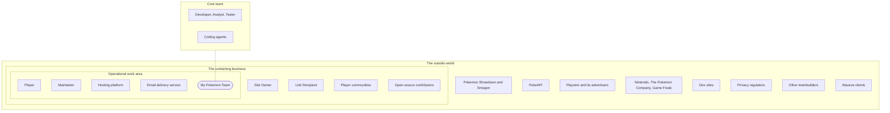

# 2. Stakeholders and Personas

Requirement level: business and user. This document names everyone with a stake in My Pokemon Team, what each one values, how the users differ, and five personas that stand in for the users who cannot all be interviewed.

This was first drawn from the repository alone. The Site Owner was then interviewed ([08-assumptions-and-interview.md](08-assumptions-and-interview.md)) and about 105 player emails were analysed ([12-feedback-analysis.md](12-feedback-analysis.md)); no other stakeholder has been consulted. What those sources do not support, including personas P-2 to P-4, remains an assumption **[A-11]**.

## 2.1 Stakeholders

Stakeholders are placed in the rings of the onion model: the operational work area around the product, the containing business, and the outside world, with the core team cutting across them.

Each stakeholder's values are particular human values from two or three of Schwartz's top-level categories, given in parentheses.

### Operational work area

- **SH-1 Player (normal operator).** Anyone who builds or studies a team on the site. Players are the reason the site exists and the source of its advertising revenue. They differ widely; see the user classes below. Values: Capable (Achievement), Enjoying life (Hedonism), Independent (Self-direction).
- **SH-2 Maintainer (maintenance operator and operational support).** The person who runs the data and translation updates, reads the update reports, deploys, and answers feedback. Today this is the Site Owner. Values: Responsible (Benevolence), Self-discipline (Conformity), Capable (Achievement).
- **SH-3 Hosting platform (interfacing automated system).** Vercel serves the site, runs the feedback function, and deploys `master` once CI passes. It constrains what the backend may be. Values, as an organization: Successful (Achievement), Social order (Security).
- **SH-4 Email delivery service (interfacing automated system).** Resend delivers feedback emails. It limits who can be emailed until a sending domain is verified. Values: Reciprocation of favours (Security), Successful (Achievement).

### Core team

- **SH-5 Developer, Analyst, and Tester.** One person, the Site Owner, plays every project role: project manager, business analyst, designer, programmer, and tester. Values: Creativity (Self-direction), Capable (Achievement), Curious (Self-direction).
- **SH-10 Coding agents.** AI coding assistants that write and review code under the owner's direction, following `AGENTS.md`. They need requirements that are explicit, testable, and traceable to code and tests, because they cannot ask a player what was meant. Values, as designed into them: Obedient (Conformity), Helpful (Benevolence), Honest (Benevolence).

### The containing business

- **SH-6 Site Owner (client, sponsor, and financial beneficiary).** Jeffery Tang, who made the site in 2019 because good teambuilders were lacking, runs it alone, pays for it, and receives its advertising revenue. The owner has the last say on what the product does, puts what helps players first, and wants the site complete and widely used by non-competitive players. Values: Creativity (Self-direction), Helpful (Benevolence), Successful (Achievement).
- **SH-7 Link Recipient (functional beneficiary).** A friend, teammate, or forum reader who opens a share link someone else made. They may never have seen the site, and they judge it by whether the link shows the team at once. Values: True friendship (Benevolence), Curious (Self-direction).
- **SH-8 Player communities (functional beneficiary, special interest groups).** Communities where teams are posted and discussed, such as r/stunfisk, Smogon's forums, and Discord servers. They spread the site by word of mouth and expect its terms and results to match the community's. Values: Sense of belonging (Security), Wisdom (Universalism), Helpful (Benevolence).
- **SH-9 Open-source contributors.** Readers of the public GitHub repository who report issues or send changes. Values: Helpful (Benevolence), Freedom (Self-direction).

### The outside world

- **SH-11 Pokemon Showdown and Smogon (interfacing technology, subject matter experts).** They maintain the simulator whose data, sprites, team text format, and tiers the site uses, by their generosity. A change on their side can break the site. Values: Helpful (Benevolence), Equality (Universalism), Influential (Achievement).
- **SH-12 PokeAPI.** The community project that supplies translated names. Values: Helpful (Benevolence), Broadminded (Universalism).
- **SH-13 Playwire and its advertisers (financial beneficiary, customer).** Playwire manages the advertising, pays the owner, and sets rules for ad placement, `ads.txt`, and crawlers. Advertisers want their ads seen by real visitors. Values: Wealth (Power), Successful (Achievement), Preserving my public image (Power).
- **SH-14 Nintendo, The Pokemon Company, and Game Freak (rights holders).** They own Pokemon. They decide which games, pokemon, and languages exist, and they could object to how the site uses their property. Values: Preserving my public image (Power), Authority (Power), Respect for tradition (Tradition).
- **SH-15 Dex sites.** Smogon's dex, Bulbapedia, Serebii, and the Showdown dex, which the site links to for each pokemon. They gain visitors and can change their addresses without notice. Values: Wisdom (Universalism), Helpful (Benevolence).
- **SH-16 Privacy regulators (regulator).** Authorities whose laws govern advertising data and the email addresses and screenshots sent with feedback. Values: Social order (Security), Social justice (Universalism), Privacy (Self-direction).
- **SH-17 Other teambuilders (competitor, negative stakeholder).** Competitive builders (Pokemon Showdown's teambuilder, Pikalytics, PokeSynergy) and type planners (Marriland, richi3f, PKMN.help), analysed in [11-existing-systems-analysis.md](11-existing-systems-analysis.md). They compete for the same players and set what players expect. Values: Successful (Achievement), Influential (Achievement).
- **SH-18 Abusive clients (negative stakeholder, disfavoured user).** Scripts that send spam through the feedback function, use the sprite rewrite as a proxy, or load pages to inflate ad counts. They must be kept from succeeding. Values: Daring (Stimulation), Wealth (Power).

## 2.2 User classes

Users of the site differ in ways that change which requirements matter to them.

| Difference                     | Classes                                                                                                                                                      |
| ------------------------------ | ------------------------------------------------------------------------------------------------------------------------------------------------------------ |
| Domain experience              | In-game players who know types but not competitive terms; competitive singles players (Smogon tiers); competitive doubles players (VGC, Pokemon Champions).  |
| Tasks performed                | Building a new team; checking an existing team pasted from Showdown; opening a team someone shared; keeping a collection of teams.                           |
| Features used                  | Name, moves, item, and ability only; or also set details (nature, EVs, IVs), filters, the matrix, and exporting every team.                                  |
| Frequency of use               | First-time visitors from a share link or a search; occasional visitors before a playthrough; regular visitors who return to saved teams.                     |
| Platform                       | Phones from 320 pixels wide (touch, small screen); tablets; laptops and desktops (keyboard, wide screen).                                                    |
| Language                       | English, Japanese, Korean, Simplified Chinese, Traditional Chinese, Spanish, French, German, Italian, Brazilian Portuguese.                                  |
| Age                            | Children and teenagers, who the Site Owner believes are a large part of the audience **[A-24]**; adults.                                                     |
| Generation played              | Current games (Generation 9, Pokemon Champions); older generations with different rules (Generations 1 to 5); several at once (Generations 6 to 9 combined). |
| Site version history           | Players new to the site; players of the old website with bookmarked links and habits from it.                                                                |
| Direct or indirect interaction | Players and Link Recipients interact directly. Readers of a pasted team text or a posted screenshot benefit indirectly.                                      |
| Access needs                   | Keyboard-only users; screen reader users; users who need the dark colour scheme or larger touch targets.                                                     |
| Software agents, or bots       | Search and link-preview crawlers, and the advertising crawler that `robots.txt` allows.                                                                      |
| Disfavoured users              | Abusive clients (SH-18).                                                                                                                                     |

## 2.3 Personas

Each persona is a fictitious but probable user, one per important user class. P-1 and P-5 are supported by the feedback players have sent ([12-feedback-analysis.md](12-feedback-analysis.md)); P-2, P-3, and P-4 are still assumed **[A-11]**. They have no photographs, because no real users have been observed yet; a persona should be rebuilt from real encounters, such as feedback emails, when those exist.

### P-1 Maya / planning her next playthrough on the bus

> "I just want to know if my team has a giant hole in it before I get to the Elite Four."

Maya is 19 and studies nursing in Winnipeg. She has played every main Pokemon game since Black and White on a handheld, always on her own, and she is replaying HeartGold between classes. She knows the type chart by heart, but she has never played online and words such as "phazer" or "OU" mean nothing to her. She picks pokemon she likes first and worries about balance second. She uses her phone for almost everything, usually one-handed on the bus with patchy data, and she closes any site that makes her read instructions.

| Trait               | Rating |
| ------------------- | ------ |
| Domain knowledge    | 5 / 10 |
| Technical knowledge | 4 / 10 |
| Experience          | 2 / 10 |

Typical activities:

- Picking six pokemon for an in-game playthrough, by name or by browsing sprites.
- Checking which types hit her team hardest.
- Looking up where a pokemon is from and what it is weak to.
- Sending the team to a friend who is playing the same game.

Drivers:

- Wanting a team she likes that will not get stuck late in the game.
- Enjoying the planning as much as the playing.

Goals:

- See her team's worst weaknesses at a glance, on a phone.
- Limit the choice to pokemon that exist in the game she is playing.
- Come back tomorrow and find the team still there.

Pain points:

- Competitive jargon with no explanation.
- Inputs too small to tap, and lists of a thousand names to scroll through.
- Losing a team because she closed the tab.

### P-2 Daniel / tuning an OU team before a tournament

> "If the tool says I resist Ground and I don't, I lose a game finding out."

Daniel is 27, a software tester in Leeds, and has played Smogon singles on Pokemon Showdown for eight years. He builds on a desktop with Showdown open in the next tab and pastes teams back and forth many times an evening. He knows every tier, every common set, and exactly which abilities and items change a matchup, so he notices at once when a tool gets one wrong, and he stops trusting it when it does. He keeps a dozen teams in progress and posts them to a Discord server for comment. He reads changelogs.

| Trait               | Rating  |
| ------------------- | ------- |
| Domain knowledge    | 10 / 10 |
| Technical knowledge | 8 / 10  |
| Experience          | 8 / 10  |

Typical activities:

- Pasting a team from Showdown, adjusting it, and copying it back.
- Checking the matrix for the one type no team member resists.
- Filtering by tier, type, and ability to find a replacement for one slot.
- Posting a share link to Discord and reading the replies.

Drivers:

- Winning, and understanding why a team wins.
- Saving time between an idea and a tested team.

Goals:

- Analysis that counts abilities, items, and special moves correctly for the generation he is playing.
- A round trip with Showdown that changes nothing he did not change: nicknames, EVs, IVs, natures, tera types.
- The reason behind any score he doubts.

Pain points:

- Tools that count types only.
- Links that break after a data update.
- Having to re-enter a spread or a nature after importing.

### P-3 Sofía / building doubles teams with her team-mates

> "Hago el equipo en el móvil y lo termino en el portátil. Que no se me pierda por el camino."

Sofía is 23 and works in a bookshop in Valencia. She plays VGC and now Pokemon Champions with three friends who meet online twice a week, and she reads and types Pokemon names in Spanish, the language of her games. She starts teams on her phone during breaks and finishes them on a laptop at home, and she is the one who keeps the group's teams: about forty of them, named by date and idea. She has lost teams once before, when her phone's browser cleared its data, and she has not forgiven the site she was using.

| Trait               | Rating |
| ------------------- | ------ |
| Domain knowledge    | 8 / 10 |
| Technical knowledge | 5 / 10 |
| Experience          | 6 / 10 |

Typical activities:

- Building a team under the current Pokemon Champions regulation.
- Naming, duplicating, and comparing variants of one team.
- Moving her teams from her phone to her laptop.
- Sending links to her team-mates and opening theirs.

Drivers:

- Preparing with her friends, in her own language.
- Keeping a record of what the group has tried.

Goals:

- Only the pokemon the current regulation allows.
- Names of pokemon, moves, items, and abilities in Spanish, while typing either Spanish or English finds them.
- A way to carry every team to another device without losing a detail.

Pain points:

- Singles terms and checks applied to a doubles team.
- Sites that keep nothing, or keep it only on one device.
- Half-translated pages.

### P-4 Kenji / returning with a folder of old bookmarks

> "前のサイトで作ったリンク、まだ開けますか？"

Kenji is 34, an accountant in Osaka, and collects and plays the older games, mostly Generations 3 and 4, on original hardware. He used the old website for years and has a folder of bookmarked team links, one for each playthrough he finished. He visits a few times a year, when he starts a new run, and he does not follow the site between visits. He reads Japanese and some English, uses a desktop at home, and is suspicious of redesigns: when a site he knew changes, he looks first for the way back.

| Trait               | Rating |
| ------------------- | ------ |
| Domain knowledge    | 7 / 10 |
| Technical knowledge | 6 / 10 |
| Experience          | 9 / 10 |

Typical activities:

- Opening a bookmarked team from years ago.
- Building a team for an older generation, where abilities, the type chart, and moves differ.
- Moving a team from one generation to another to see what survives.
- Reading what changed since his last visit.

Drivers:

- Finishing every game with a team he planned.
- Keeping his record of past teams.

Goals:

- Every old link opens the team it always opened.
- The rules of the generation he is playing: its type chart, its move list, its training values.
- A way back to the old website while he gets used to the new one.

Pain points:

- A redesign that hides what he used to do in one click.
- Modern rules applied to old games.
- Not knowing what changed, or whether his links are safe.

### P-5 Leo / building a dream team for a game that is not on the list

> "Eu só quero juntar os meus favoritos. Por que o site não deixa?"

Leo is 14 and in his first year of secondary school in Curitiba. He plays a fan-made Pokemon game on the family computer, one that is built on an older generation and adds pokemon from newer ones, and he also makes teams for characters he invents with his friends. He has never played a ranked battle and does not know what a tier is. He picks pokemon because he likes them, from any game, and he wants to see them: a pokemon with no picture looks broken to him. He reads English slowly and uses the site in Portuguese. When something is missing or a list will not let him pick what he wants, he either writes to the owner or leaves.

| Trait               | Rating |
| ------------------- | ------ |
| Domain knowledge    | 4 / 10 |
| Technical knowledge | 5 / 10 |
| Experience          | 3 / 10 |

Typical activities:

- Putting his favourite pokemon from several generations into one team.
- Building a team for a fan-made game whose pokemon list matches no official game.
- Checking that the newest pokemon and mega evolutions are there, and what they look like.
- Tapping the random button to see what comes up.

Drivers:

- Playing with pokemon he likes, without rules he did not ask for.
- Showing a team to friends.

Goals:

- Any pokemon, whatever game it is from, in the same team.
- A picture for every pokemon and forme.
- New pokemon and formes on the site as soon as they exist.

Pain points:

- A game or generation choice that hides the pokemon he wants.
- Missing sprites and icons.
- Waiting weeks for new mega evolutions to be added.

This persona comes from the feedback analysis in [12-feedback-analysis.md](12-feedback-analysis.md), not from assumption.

## 2.4 Stakeholder availability and proxies

| Stakeholder                        | How their requirements are obtained                                                                             |
| ---------------------------------- | --------------------------------------------------------------------------------------------------------------- |
| Site Owner, Maintainer, Developer  | Interview ([08-assumptions-and-interview.md](08-assumptions-and-interview.md)); `AGENTS.md`; the GitHub issues. |
| Player, Link Recipient             | Feedback emails; personas P-1 to P-5 as proxies; the old website's behaviour as the existing system.            |
| Player communities                 | Their published terms (Smogon's tiers and dictionary), which the manual cites.                                  |
| Pokemon Showdown, PokeAPI          | Their published data formats and repositories, read by the update scripts.                                      |
| Playwire                           | Its help-centre documentation, kept locally in `playwire-docs/` when present.                                   |
| Rights holders, privacy regulators | Their published terms and laws; no direct contact.                                                              |
| Abusive clients                    | Misuse scenarios, considered in the security requirements.                                                      |
