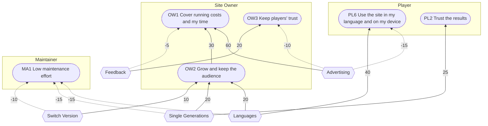

# 3. Goal Model

Requirement level: business and user. A goal is not yet a requirement: it conveys what a stakeholder intends, and it is used to find and judge the requirements in the later documents. This model, in the Goal-oriented Requirement Language (GRL), records why the site has the features it has, where stakeholders' goals pull against each other, and how the old website, the redesign, and the next release compare for each stakeholder.

The course built goal models in the jUCMNav tool. This one is written as text, in the form the course material uses for its own figures. Its evaluation was computed by a script with the course's standard propagation rules, not by the tool.

Every importance and contribution value below is the analyst's estimate **[A-15]**. As the course notes, such values serve to rank alternatives and to argue for decisions; a difference of a few points between two results means nothing.

## 3.1 Actors and intentional elements

The model has three stakeholder actors, each holding softgoals, and one system actor holding the tasks. Features from [04-feature-model.md](04-feature-model.md) are used directly as tasks. The number in parentheses after a softgoal is its importance to its actor, from 0 to 100.

### Actor: Player (SH-1)

| ID  | Softgoal                                     | Importance |
| --- | -------------------------------------------- | ---------- |
| PL1 | Know my team's weaknesses                    | 100        |
| PL2 | Trust the results                            | 90         |
| PL3 | Find suitable pokemon quickly                | 60         |
| PL4 | Keep my teams                                | 80         |
| PL5 | Move teams between tools and people          | 70         |
| PL6 | Use the site in my language and on my device | 50         |

### Actor: Site Owner (SH-6)

| ID  | Softgoal                        | Importance |
| --- | ------------------------------- | ---------- |
| OW1 | Cover running costs and my time | 100        |
| OW2 | Grow and keep the audience      | 80         |
| OW3 | Keep players' trust             | 90         |
| OW4 | Learn what players need         | 50         |

### Actor: Maintainer (SH-2)

| ID  | Softgoal               | Importance |
| --- | ---------------------- | ---------- |
| MA1 | Low maintenance effort | 100        |
| MA2 | Keep game data current | 70         |

### Actor: My Pokemon Team (the system)

The system's goal "Support team planning" is AND-decomposed into the mandatory features F1 Team Building, F2 Game Data, F3 Pokemon Search, F4 Team Analysis, F6 Team Exchange, and F8 Presentation. The tasks below are those features and the optional ones, at the level of detail the contributions need.

| Task                 | Feature                                            | Task                 | Feature                            |
| -------------------- | -------------------------------------------------- | -------------------- | ---------------------------------- |
| Team Defence         | F4.1                                               | Saved Teams          | F5.1                               |
| Coverage             | F4.2                                               | Tab Sync             | F5.2                               |
| Explanations         | F4.3                                               | Backups              | F5.3                               |
| Checklist            | F4.4                                               | Share Link           | F6 Share Link                      |
| Matrix               | F4.5                                               | Showdown Text        | F6 Showdown Text                   |
| Legality Warnings    | F4.6 (PF6)                                         | Export All           | F6 Export All                      |
| Battle Format        | F4.4.1 (PF1)                                       | Pokemon Info         | F7 Pokemon Info, F7.1              |
| Combined Generations | F2.1 Generations 6-9 Combined                      | Update Log           | F7 Update Log                      |
| Single Generations   | F2.1 Single Generation, Pokemon Champions          | Privacy Policy       | F7 Privacy Policy                  |
| More Games           | F2.1 Let's Go, Legends: Arceus, Legends: Z-A (PF3) | Languages            | F8.1, languages other than English |
| Generation Transfer  | F2.2                                               | Translated Names     | F8.1.1                             |
| Data Update          | F2.3.1                                             | Portuguese Names     | PF4                                |
| Translation Update   | F2.3.2                                             | Colour Scheme        | F8.2                               |
| Search by Name       | F3.1                                               | Responsive Layout    | F8.3                               |
| Filters              | F3.2                                               | Feedback             | F9                                 |
| Sort                 | F3.3                                               | Feedback Attachments | F9.1, F9.2, F9.3                   |
| Grid Views           | F3.4 Grid, Big Grid                                |                      |                                    |
| Randomize            | F1.3                                               | Switch Version       | F10.1                              |
| Undo                 | F1.4                                               | Version Transfer     | F10.2 (PF2)                        |
| Set Details          | F1.2                                               | Advertising          | F11                                |

## 3.2 Contributions

`<- 30  X` means "receives a contribution of 30 from X". Contributions are quantitative, from -100 to 100. A negative contribution is a side effect that hurts the softgoal.

```
Player
  PL1 Know my team's weaknesses (softgoal)
    <- 30   Team Defence (task)
    <- 25   Coverage (task)
    <- 15   Matrix (task)
    <- 15   Checklist (task)
    <- 10   Explanations (task)
    <- 5    Legality Warnings (task)
  PL2 Trust the results (softgoal)
    <- 25   Single Generations (task)
    <- 25   Explanations (task)
    <- 15   Feedback (task)
    <- 10   Combined Generations (task)
    <- 10   Battle Format (task)
    <- 10   Update Log (task)
    <- 5    Legality Warnings (task)
  PL3 Find suitable pokemon quickly (softgoal)
    <- 30   Filters (task)
    <- 25   Search by Name (task)
    <- 15   Sort (task)
    <- 10   Grid Views (task)
    <- 10   Translated Names (task)
    <- 5    Randomize (task)
    <- 5    Pokemon Info (task)
  PL4 Keep my teams (softgoal)
    <- 45   Saved Teams (task)
    <- 25   Backups (task)
    <- 15   Share Link (task)
    <- 10   Undo (task)
    <- 5    Tab Sync (task)
  PL5 Move teams between tools and people (softgoal)
    <- 30   Showdown Text (task)
    <- 30   Share Link (task)
    <- 10   Set Details (task)
    <- 10   Backups (task)
    <- 10   Version Transfer (task)
    <- 5    Export All (task)
    <- 5    Generation Transfer (task)
  PL6 Use the site in my language and on my device (softgoal)
    <- 40   Languages (task)
    <- 25   Responsive Layout (task)
    <- 20   Translated Names (task)
    <- 10   Colour Scheme (task)
    <- 5    Portuguese Names (task)
    <- -15  Advertising (task)

Site Owner
  OW1 Cover running costs and my time (softgoal)
    <- 60   Advertising (task)
    <- 30   OW2 Grow and keep the audience (softgoal)
    <- 10   Data Update (task)
    <- -5   Feedback (task)
  OW2 Grow and keep the audience (softgoal)
    <- 20   Share Link (task)
    <- 20   Languages (task)
    <- 20   Single Generations (task)
    <- 15   Saved Teams (task)
    <- 10   Switch Version (task)
    <- 10   More Games (task)
    <- 5    Version Transfer (task)
  OW3 Keep players' trust (softgoal)
    <- 20   Explanations (task)
    <- 20   Feedback (task)
    <- 20   Backups (task)
    <- 10   Update Log (task)
    <- 10   Privacy Policy (task)
    <- 10   Switch Version (task)
    <- -10  Advertising (task)
  OW4 Learn what players need (softgoal)
    <- 60   Feedback (task)
    <- 20   Feedback Attachments (task)

Maintainer
  MA1 Low maintenance effort (softgoal)
    <- 40   Data Update (task)
    <- 20   Translation Update (task)
    <- 10   Feedback Attachments (task)
    <- -15  Single Generations (task)
    <- -15  Languages (task)
    <- -10  Switch Version (task)
    <- -10  More Games (task)
    <- -5   Tab Sync (task)
    <- -5   Battle Format (task)
  MA2 Keep game data current (softgoal)
    <- 60   Data Update (task)
    <- 20   Translation Update (task)
    <- 10   Update Log (task)
    <- 10   Feedback (task)
```

The same model as a diagram, limited to the links that carry a conflict. Softgoals are rounded boxes and tasks are hexagons; a dashed arrow is a negative contribution.



## 3.3 Dependencies

A dependency link caps the depender's satisfaction at the dependee's. In all three strategies below, the dependees are taken as fully satisfied (100), so they do not change the results. If one fails, the softgoal that depends on it can be no better satisfied than the dependee.

| Depender (actor: element)                       | Dependum               | Dependee (actor)              |
| ----------------------------------------------- | ---------------------- | ----------------------------- |
| Site Owner: OW1 Cover running costs and my time | Advertisements served  | Playwire (SH-13)              |
| Maintainer: MA2 Keep game data current          | Game data published    | Pokemon Showdown (SH-11)      |
| System: Translated Names                        | Names in each language | PokeAPI (SH-12)               |
| System: Feedback                                | Email delivered        | Email delivery service (SH-4) |
| System: Animated Sprites                        | Sprites served         | Pokemon Showdown (SH-11)      |
| Player: PL4 Keep my teams                       | Site storage kept      | The Player's browser          |

## 3.4 Strategies

A strategy sets the initial satisfaction of the tasks: 100 for a selected feature and 0 otherwise. The three strategies are the feature configurations of [04-feature-model.md](04-feature-model.md).

| Strategy         | Tasks set to 100                                                                                                                                                                                                                                                                          |
| ---------------- | ----------------------------------------------------------------------------------------------------------------------------------------------------------------------------------------------------------------------------------------------------------------------------------------- |
| "R0 Old website" | Team Defence, Coverage, Explanations, Checklist, Combined Generations, Data Update, Search by Name, Filters, Share Link, Showdown Text, Update Log, Privacy Policy, Colour Scheme, Responsive Layout, Advertising                                                                         |
| "Ash"            | Those of "R0 Old website", and Matrix, Single Generations, Generation Transfer, Translation Update, Sort, Grid Views, Randomize, Undo, Set Details, Saved Teams, Tab Sync, Backups, Export All, Pokemon Info, Languages, Translated Names, Feedback, Feedback Attachments, Switch Version |
| "Brock"          | Those of "Ash", and Legality Warnings, Battle Format, More Games, Version Transfer                                                                                                                                                                                                        |

## 3.5 Evaluation

Propagation follows the course's standard rules: a softgoal's value is the sum of each contributor's value times its contribution, divided by 100, limited to the range -100 to 100, with the fraction dropped. An actor's value is the importance-weighted average of its softgoals, with the fraction dropped.

| Element                                          | "R0 Old website" | "Ash"  | "Brock" |
| ------------------------------------------------ | ---------------- | ------ | ------- |
| PL1 Know my team's weaknesses                    | 80               | 95     | 100     |
| PL2 Trust the results                            | 45               | 85     | 100     |
| PL3 Find suitable pokemon quickly                | 55               | 100    | 100     |
| PL4 Keep my teams                                | 15               | 100    | 100     |
| PL5 Move teams between tools and people          | 60               | 90     | 100     |
| PL6 Use the site in my language and on my device | 20               | 80     | 80      |
| **Player**                                       | **48**           | **92** | **97**  |
| OW1 Cover running costs and my time              | 76               | 90     | 95      |
| OW2 Grow and keep the audience                   | 20               | 85     | 100     |
| OW3 Keep players' trust                          | 30               | 80     | 80      |
| OW4 Learn what players need                      | 0                | 80     | 80      |
| **Site Owner**                                   | **37**           | **84** | **89**  |
| MA1 Low maintenance effort                       | 40               | 25     | 10      |
| MA2 Keep game data current                       | 70               | 100    | 100     |
| **Maintainer**                                   | **52**           | **55** | **47**  |

Worked example, OW1 under "Ash": `(100 x 60 + 85 x 30 + 100 x 10 + 100 x -5) / 100 = 90.5`, shown as 90.

## 3.6 Discussion

- **The redesign is an improvement for the Player and the Site Owner.** The Player's largest gains are in keeping teams (15 to 100) and in using the site in their own language (20 to 80); the old website kept nothing between visits and was in English only. The Site Owner's gain comes mostly from the audience softgoal, which the new generations, languages, and saved teams all feed.
- **The Maintainer pays for it.** Low maintenance effort falls from 40 to 25 with the redesign and to 10 with the next release, because every generation, language, and game added is more data and more rules to keep correct. The Maintainer's total holds at 55 for the redesign only because the translation script and feedback improve data currency. This is the main conflict in the model, and the reason the maintainability and testability requirements (REQ-MAINT, REQ-REL) are rated essential.
- **Advertising is the second conflict.** It is the largest contribution to covering costs and the owner's time (60) and a negative one for the Player's device experience (-15) and for trust (-10). The requirements resolve it by constraint, not by removal: REQ-INTF-5 fixes where the banner goes, and REQ-PERF-4 limits how long the page takes to become usable.
- **PF3 (more games) is the costliest planned feature for the Maintainer**, and its benefit is to one softgoal alone (audience, 10). PF1, PF2, and PF6 are cheaper for what they return. Its issue's Risk rating on the board should reflect this.
- **OW1 was widened after the interview.** The Site Owner's financial goal is to cover the running costs and to be paid for the time spent on the site, not only to break even. The softgoal was renamed; its contribution values and results were not estimated again, so the 90 and 95 above overstate how well advertising alone meets the wider goal.
- **How the Site Owner settles the first conflict.** Asked which wins when a feature helps players and burdens maintenance, the Site Owner put players first, with one exception: where the burden is of a kind that would stop the site being improved at all, such as a backend to run. So the Maintainer's falling score is accepted for generations, languages, and games, and is a veto only for that kind of cost.
- **What the model does not show.** It treats a feature as fully present or absent, so it cannot show that the old website's filters were fewer than the redesign's, or that an analysis is more or less accurate. It also leaves out the rights holders and the ad platform as actors with softgoals of their own.

## 3.7 Indicators

An indicator measures how well a softgoal is met. The three below were system requirements until 14 October 2026 (REQ-USE-1, 2, and 9). Each needs sessions or a survey with players, which the Site Owner has set aside for now, so a requirement on them could not be verified. They are kept here for when players can be asked, and take no part in the evaluation of Section 3.5. Their values are proposed **[A-16]**.

| Softgoal                                | Indicator                                                                                                               | Outstanding | Target    | Minimum   |
| --------------------------------------- | ----------------------------------------------------------------------------------------------------------------------- | ----------- | --------- | --------- |
| PL1 Know my team's weaknesses           | Time in which 80% of first-time players, without training, place six pokemon and name the type their team is weakest to | 1 minute    | 2 minutes | 5 minutes |
| PL5 Move teams between tools and people | Time in which 80% of Pokemon Showdown users, without training, import a team from Showdown and copy it back             | 30 seconds  | 1 minute  | 2 minutes |
| OW2 Grow and keep the audience          | Share of the players answering a survey after three months of use who rate the site "good" or better                    |             |           | 80%       |
