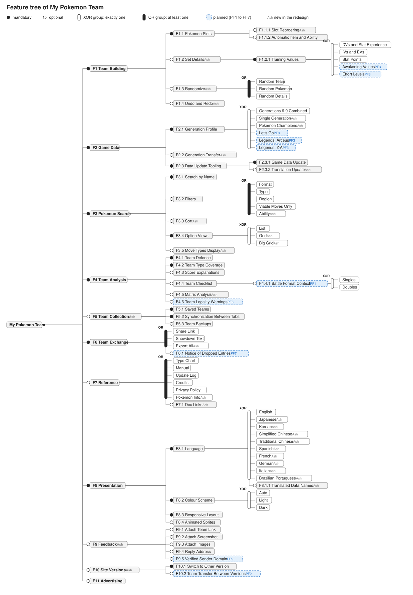

# 4. Feature Model

Requirement level: user. The feature model names what is inside the bubble of the context diagram, and shows which features every version of the site has (commonality) and which ones differ between versions (variability).

My Pokemon Team is one product, not a product line. The model is still useful because the site exists in several members at once: the old website, the redesigned site in production, the same site on a development machine, and the next release. Each is a configuration of this model. A second kind of variability is chosen by the player while using the site, such as the generation or the language; those choices are the XOR groups under Generation Profile, Language, Colour Scheme, and Option Views.

The course built feature models in the jUCMNav tool. This one is written as text, in the form the course material uses for its own figures, so that it can be reviewed and versioned with the code. It has not been evaluated by a tool; the configurations below were checked by hand against the constraints.

## 4.1 Notation

- `(mandatory)`: a child that every configuration containing the parent must select.
- `(optional)`: a child that a configuration containing the parent may select.
- `XOR group`: exactly one of the children is selected when the parent is.
- `OR group`: at least one of the children is selected when the parent is.
- `[R0]`, `[Ash]`, `[Brock]`: the first release that has the feature (the old website, the redesign, the next release). A feature with no mark has been there since R0.
- `[PF1]` to `[PF7]`: planned features, all proposed for Brock except PF4, which waits for PokeAPI's Portuguese names and is not scheduled. PF4 has no mark, because it adds no feature: it removes constraint C4.

## 4.2 Feature tree



The picture is drawn from the text tree below by [`figures/generate-feature-tree.py`](figures/generate-feature-tree.py). The text is the source: change it, then run the script from this folder to redraw the picture.

```
My Pokemon Team
+-- F1 Team Building                              (mandatory)
|   +-- F1.1 Pokemon Slots                        (mandatory)
|   |   +-- F1.1.1 Slot Reordering                (optional)   [Ash]
|   |   +-- F1.1.2 Automatic Item and Ability     (optional)
|   +-- F1.2 Set Details                          (optional)   [Ash]
|   |   +-- F1.2.1 Training Values                (mandatory)
|   |         XOR group: DVs and Stat Experience | IVs and EVs | Stat Points
|   |                    | Awakening Values [PF3] | Effort Levels [PF3]
|   +-- F1.3 Randomize                            (optional)   [Ash]
|   |     OR group: Random Team | Random Pokemon | Random Details
|   +-- F1.4 Undo and Redo                        (optional)   [Ash]
+-- F2 Game Data                                  (mandatory)
|   +-- F2.1 Generation Profile                   (mandatory)
|   |     XOR group: Generations 6-9 Combined | Single Generation [Ash]
|   |                | Pokemon Champions [Ash] | Let's Go [PF3]
|   |                | Legends: Arceus [PF3] | Legends: Z-A [PF3]
|   +-- F2.2 Generation Transfer                  (optional)   [Ash]
|   +-- F2.3 Data Update Tooling                  (mandatory)
|       +-- F2.3.1 Game Data Update               (mandatory)
|       +-- F2.3.2 Translation Update             (optional)   [Ash]
+-- F3 Pokemon Search                             (mandatory)
|   +-- F3.1 Search by Name                       (mandatory)
|   +-- F3.2 Filters                              (optional)
|   |     OR group: Format | Type | Region | Viable Moves Only | Ability [Ash]
|   +-- F3.3 Sort                                 (optional)   [Ash]
|   +-- F3.4 Option Views                         (mandatory)
|   |     XOR group: List | Grid [Ash] | Big Grid [Ash]
|   +-- F3.5 Types Display                        (optional)   [Ash]
+-- F4 Team Analysis                              (mandatory)
|   +-- F4.1 Team Defence                         (mandatory)
|   +-- F4.2 Team Type Coverage                   (mandatory)
|   +-- F4.3 Score Explanations                   (optional)
|   +-- F4.4 Team Checklist                       (optional)
|   |   +-- F4.4.1 Battle Format Context          (optional)   [PF1]
|   |         XOR group: Singles | Doubles
|   +-- F4.5 Matrix Analysis                      (optional)   [Ash]
|   +-- F4.6 Team Legality Warnings               (optional)   [PF6]
+-- F5 Team Collection                            (optional)   [Ash]
|   +-- F5.1 Saved Teams                          (mandatory)
|   +-- F5.2 Synchronization Between Tabs         (mandatory)
|   +-- F5.3 Team Backups                         (optional)
+-- F6 Team Exchange                              (mandatory)
|   |  OR group: Share Link | Showdown Text | Export All [Ash]
|   +-- F6.1 Notice of Dropped Entries            (optional)   [PF7]
+-- F7 Reference                                  (optional)
|   |  OR group: Type Chart | Manual | Update Log | Credits | Privacy Policy
|   |            | Pokemon Info [Ash]
|   +-- F7.1 Dex Links                            (optional)   [Ash]
+-- F8 Presentation                               (mandatory)
|   +-- F8.1 Language                             (mandatory)
|   |   |  XOR group: English | Japanese [Ash] | Korean [Ash]
|   |   |             | Simplified Chinese [Ash] | Traditional Chinese [Ash]
|   |   |             | Spanish [Ash] | French [Ash] | German [Ash] | Italian [Ash]
|   |   |             | Brazilian Portuguese [Ash]
|   |   +-- F8.1.1 Translated Data Names          (optional)   [Ash]
|   +-- F8.2 Colour Scheme                        (mandatory)
|   |     XOR group: Auto | Light | Dark
|   +-- F8.3 Responsive Layout                    (mandatory)
|   +-- F8.4 Animated Sprites                     (optional)
+-- F9 Feedback                                   (optional)   [Ash]
|   +-- F9.1 Attach Team Link                     (optional)
|   +-- F9.2 Attach Screenshot                    (optional)
|   +-- F9.3 Attach Images                        (optional)
|   +-- F9.4 Reply Address                        (optional)
|   +-- F9.5 Verified Sender Domain               (optional)   [PF5]
+-- F10 Site Versions                             (optional)   [Ash]
|   +-- F10.1 Switch to Other Version             (mandatory)
|   +-- F10.2 Team Transfer to Old Website        (optional)   [PF2]
+-- F11 Advertising                               (optional)
```

What each top-level feature means:

| ID  | Feature         | Description                                                                                                                                                     |
| --- | --------------- | --------------------------------------------------------------------------------------------------------------------------------------------------------------- |
| F1  | Team Building   | Six slots, each holding a pokemon, up to four moves, an item, and an ability, with optional set details, random filling, and undo.                              |
| F2  | Game Data       | The pokemon, moves, items, abilities, and rules of the chosen generation or game, the conversion of a team between them, and the scripts that refresh the data. |
| F3  | Pokemon Search  | Finding a pokemon, move, item, or ability to place in a slot: by typing, by filters, in a chosen order and view.                                                |
| F4  | Team Analysis   | The type defence and coverage scores, their explanations, the checklist, and the matrix.                                                                        |
| F5  | Team Collection | Several named teams kept in the browser and kept consistent between tabs, with backup files.                                                                    |
| F6  | Team Exchange   | Moving one team or all teams out of and into the site as a link or as Showdown text.                                                                            |
| F7  | Reference       | Material the player reads rather than edits.                                                                                                                    |
| F8  | Presentation    | Language, colour scheme, layout for the screen width, and sprites.                                                                                              |
| F9  | Feedback        | Sending a message to the site owner, with optional attachments.                                                                                                 |
| F10 | Site Versions   | Moving between the redesigned site and the old website.                                                                                                         |
| F11 | Advertising     | Advertisements placed by the ad platform.                                                                                                                       |

## 4.3 Planned features

| ID  | Feature                            | Source                                                                               | Notes                                                                                                              |
| --- | ---------------------------------- | ------------------------------------------------------------------------------------ | ------------------------------------------------------------------------------------------------------------------ |
| PF1 | F4.4.1 Battle Format Context       | Issue 118; deferred during bug fixing on 2026-10-11                                  | Lets the checklist judge Defog correctly in Generations 4 and 5 singles and doubles.                               |
| PF2 | F10.2 Team Transfer to Old Website | `README.md`, issue 111                                                               | Today the current team and saved teams stay on the site version they were made on.                                 |
| PF3 | Let's Go and the Legends games     | The generation menu lists them as "Coming soon"; issue 122                           | Brings Awakening Values and Effort Levels with them.                                                               |
| PF4 | Portuguese data names              | `AGENTS.md`, Languages; issue 124                                                    | Blocked until PokeAPI has Portuguese names (the games gain the language in 2027). Removes the constraint C4 below. |
| PF5 | F9.5 Verified Sender Domain        | `AGENTS.md`, Feedback; issue 115                                                     | Until then the feedback function can reach only the owner's own address.                                           |
| PF6 | F4.6 Team Legality Warnings        | `src/store/validation.ts` holds the rules; no part of the page shows them; issue 117 | The Site Owner wants them shown (interview, Q10). Where they appear is still to be decided.                        |
| PF7 | F6.1 Notice of Dropped Entries     | `AGENTS.md`, Share Links: old links silently lose renamed entries; issue 119         | Proposed by the analyst; the Site Owner agreed (interview, Q10).                                                   |

## 4.4 Cross-tree constraints

| ID  | Constraint                                                   | Reason                                                                             |
| --- | ------------------------------------------------------------ | ---------------------------------------------------------------------------------- |
| C1  | Export All «implies» F5 Team Collection                      | There is more than one team to export only when teams are kept.                    |
| C2  | Stat Points «implies» Pokemon Champions                      | Stat points are that game's training system.                                       |
| C3  | DVs and Stat Experience «implies» Single Generation          | They are the training system of Generations 1 and 2 only.                          |
| C4  | F8.1.1 Translated Data Names «excludes» Brazilian Portuguese | PokeAPI has no Portuguese names yet.                                               |
| C5  | F8.1.1 Translated Data Names «excludes» English              | English names are the data's own.                                                  |
| C6  | F9.2 Attach Screenshot «implies» F8.4 Animated Sprites       | The screenshot draws the sprites, which it fetches through the site's own address. |
| C7  | F10.2 Team Transfer to Old Website «implies» Share Link      | The old website holds one team, which a link can carry **[A-14]**.                 |
| C8  | Awakening Values «implies» Let's Go                          | Awakening values are that game's training system.                                  |
| C9  | Effort Levels «implies» Legends: Arceus                      | Effort levels are that game's training system.                                     |

## 4.5 Configurations

A configuration is a feature selection. Each of the four below is valid: the root is selected, every mandatory child of a selected parent is selected, every XOR group has exactly one selected child, every OR group has at least one, and no constraint is violated. Features chosen by the player at run time are shown with one example choice.

### Configuration "R0 Old website"

Selected: F1 Team Building (F1.1 Pokemon Slots, F1.1.2 Automatic Item and Ability); F2 Game Data (Generations 6-9 Combined, F2.3.1 Game Data Update); F3 Pokemon Search (F3.1, Filters: Format, Type, Region, Viable Moves Only; Option Views: List); F4 Team Analysis (F4.1, F4.2, F4.3, F4.4); F6 Team Exchange (Share Link, Showdown Text); F7 Reference (Type Chart, Manual, Update Log, Credits, Privacy Policy); F8 Presentation (Language: English; Colour Scheme: Auto; F8.3; F8.4); F11 Advertising.

Not selected: F1.1.1, F1.2, F1.3, F1.4, F2.2, F2.3.2, F3.3, F3.5, F4.5, F5, F7.1, F8.1.1, F9, F10, and every planned feature.

### Configuration "Ash, production"

Selected: every feature without a `[PF1]` to `[PF7]` mark. Example run-time choices: Generation Profile: Generations 6-9 Combined; Training Values: IVs and EVs; Option Views: List; Language: Spanish with F8.1.1 Translated Data Names; Colour Scheme: Auto.

Not selected: PF1 to PF7.

### Configuration "Ash, local development"

As "Ash, production" without F9 Feedback and its children, and without F11 Advertising. The development server does not run the feedback function, and the ad script is added to production builds only.

### Configuration "Brock"

As "Ash, production" with F4.4.1 Battle Format Context (example choice: Doubles), F10.2 Team Transfer to Old Website, F9.5 Verified Sender Domain, F4.6 Team Legality Warnings, and F6.1 Notice of Dropped Entries. PF3 adds three choices to the Generation Profile group and two to the Training Values group. PF4 is not part of Brock; when PokeAPI has Portuguese names, it removes constraint C4.

## 4.6 Features and use cases

A use case often relates to a feature. The table gives the relation used by the use case model in [05-system-requirements-specification.md](05-system-requirements-specification.md).

| Feature                                  | Use cases                                                                                          |
| ---------------------------------------- | -------------------------------------------------------------------------------------------------- |
| F1.1 Pokemon Slots, F3.1, F3.4, F3.5     | UC1 Build Team                                                                                     |
| F1.2 Set Details                         | UC2 Set Pokemon Details                                                                            |
| F1.3 Randomize                           | UC3 Randomize Team                                                                                 |
| F1.4 Undo and Redo                       | UC4 Undo Change                                                                                    |
| F3.2 Filters, F3.3 Sort                  | UC5 Narrow Pokemon Choices                                                                         |
| F4.1, F4.2, F4.3, F4.4, F4.5             | UC6 Analyze Team                                                                                   |
| F2.1 Generation Profile, F2.2            | UC7 Change Generation                                                                              |
| F5.1 Saved Teams, F5.2                   | UC8 Manage Saved Teams                                                                             |
| F5.3 Team Backups                        | UC9 Back Up Teams, UC10 Restore Teams                                                              |
| F6 Share Link                            | UC11 Share Team by Link, UC12 Open Shared Team                                                     |
| F6 Showdown Text, Export All             | UC13 Import Team Text, UC14 Export Team Text                                                       |
| F7 Reference                             | UC15 Look Up Reference                                                                             |
| F8.1 Language                            | UC16 Change Language                                                                               |
| F8.2 Colour Scheme                       | UC17 Change Colour Scheme                                                                          |
| F9 Feedback                              | UC18 Send Feedback                                                                                 |
| F10.1 Switch to Other Version            | UC19 Switch Site Version                                                                           |
| F2.3 Data Update Tooling                 | UC20 Update Game Data, UC21 Update Translations                                                    |
| F4.4.1 Battle Format Context (PF1)       | UC22 Set Battle Format                                                                             |
| F10.2 Team Transfer to Old Website (PF2) | UC23 Transfer Team to Old Website                                                                  |
| F4.6 Team Legality Warnings (PF6)        | UC24 Check Team Legality                                                                           |
| F6.1 Notice of Dropped Entries (PF7)     | UC12 Open Shared Team (alternative 2c)                                                             |
| F8.3, F8.4, F11                          | None: these are qualities and constraints, specified as non-functional and interface requirements. |
