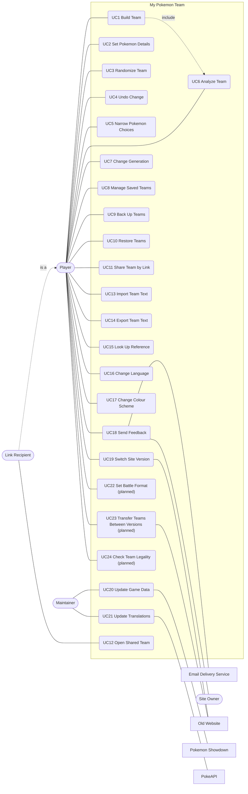
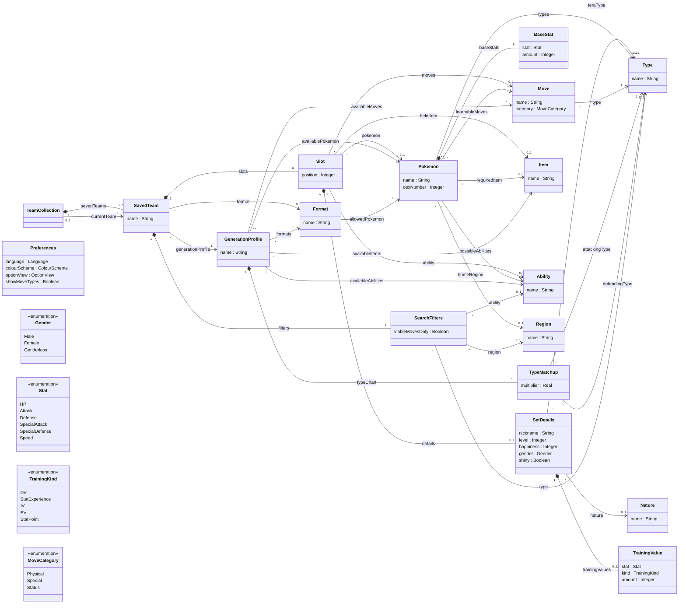
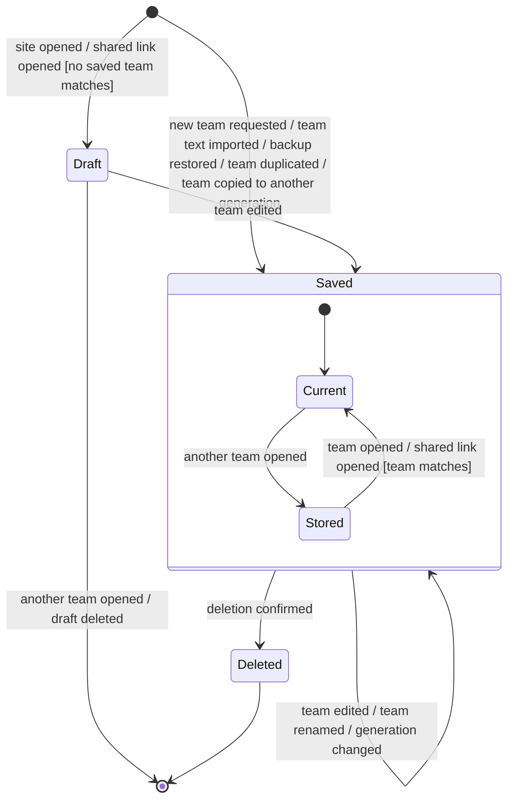

# 5. System Requirements Specification (SyRS)

Requirement level: system. This document follows the System Requirements Specification outline of ISO/IEC/IEEE 29148:2018. Functional requirements are organized by use case: each use case is preceded by a user story with acceptance criteria and followed by the requirements derived from it. The domain model, the state machine, and the use case model are placed in Section 3.1.

Baseline: branch `major-added-features` at commit `629b75f`, 13 October 2026. A requirement with status Implemented describes what that baseline does. A requirement with status Proposed describes planned work.

## 1) Introduction

### 1.1) System purpose

My Pokemon Team lets a Pokemon player plan a team of six and see, as the team is built, how well it resists and covers the eighteen types. It exists because working that out by hand is slow and error-prone, and because tools that count types alone give wrong answers for sets whose ability, item, or moves change the matchup.

### 1.2) System scope

The system is the My Pokemon Team website at `mypokemonteam.com` as a browser runs it, together with the feedback function that emails a player's message to the site owner and the scripts that refresh its game data and translations. This document calls all of it "the site".

The site shall do the following (business requirements, from [01-vision-and-scope.md](01-vision-and-scope.md)):

- Pay for itself and for the Site Owner's time through advertising (BR-1).
- Keep every share link and saved team loading (BR-2).
- Follow major game data within 2 days and minor data within 7 (BR-3).
- Serve players in ten languages (BR-4).
- Replace the old website as the version players choose (BR-5).
- Run without a backend beyond hosting and feedback email, unless survival or an extremely important feature needs one (BR-6).
- Correct reported analysis errors within 7 days (BR-7).
- Respect its data and advertising providers' terms (BR-8).

The site is not intended to simulate battles, calculate damage, hold player accounts, or store teams on a server. These are not part of the plan; Section 1.5 of the vision and scope document gives the reasons. Suggesting pokemon to fix a weakness is open for a later release.

### 1.3) System overview

#### 1.3.1) System context

The site exchanges information with ten external entities: the Player, the Link Recipient, the Site Owner and Maintainer, Pokemon Showdown, PokeAPI, the Playwire ad platform, the email delivery service, the dex sites, the old website, and web crawlers. The context diagram and the flows are in Section 1.6 of [01-vision-and-scope.md](01-vision-and-scope.md).

The site is a single-page application. All team data stays in the Player's browser. The only information that leaves it is what the Player chooses to send as feedback, the sprite and advertising requests the page makes, and the links the Player follows.

#### 1.3.2) System functions

The site's functions are the features F1 to F11 of [04-feature-model.md](04-feature-model.md): team building, game data, pokemon search, team analysis, team collection, team exchange, reference, presentation, feedback, site versions, and advertising.

#### 1.3.3) User characteristics

Users are Pokemon players of any age who can read one of the site's ten languages. They range from in-game players with no competitive vocabulary to tournament players who will notice a single wrong matchup. They use phones from 320 pixels wide, tablets, and desktops, with touch, mouse, or keyboard. No training is provided or assumed. The user classes and the personas P-1 to P-4 are in [02-stakeholders-and-personas.md](02-stakeholders-and-personas.md).

### 1.4) Definitions

| Term               | Definition                                                                                                                                                      |
| ------------------ | --------------------------------------------------------------------------------------------------------------------------------------------------------------- |
| Ability            | A passive trait of a pokemon that can change type matchups, such as Levitate.                                                                                   |
| Backup file        | A file the site writes that holds every saved team, the unsaved draft, and each team's settings.                                                                |
| Checklist          | The list of roles a competitive team usually fills, such as an entry hazard or reliable recovery, each marked as present or absent for the team.                |
| Coverage           | How hard a team's damaging moves hit each type. A type is covered by a move that is super effective against it.                                                 |
| Current team       | The team the Player is editing.                                                                                                                                 |
| Defence            | How hard each attacking type hits the pokemon of a team.                                                                                                        |
| Draft              | A current team that is not yet in the saved teams: a fresh team, or one opened from a share link, before its first edit.                                        |
| Format             | A set of rules that bans some pokemon, also called a tier: Smogon's tiers and the Pokemon Champions regulation.                                                 |
| Generation profile | The set of games a team is built for: one of Generations 1 to 9, Generations 6 to 9 combined, or Pokemon Champions.                                             |
| Matrix             | A table of every type against every pokemon of the team, for defence or for coverage.                                                                           |
| Saved team         | A named team kept in the browser with its generation profile, format, and filters.                                                                              |
| Set details        | A pokemon's nickname, level, gender, shiny flag, happiness, tera type, nature, and training values.                                                             |
| Share link         | A web address that holds a whole team and its generation profile.                                                                                               |
| Slot               | One of a team's six positions, holding at most one pokemon.                                                                                                     |
| STAB               | Same-type attack bonus: the extra power of a move whose type matches its user's.                                                                                |
| Team text          | A team written in Pokemon Showdown's export format.                                                                                                             |
| Training values    | The numbers that adjust a pokemon's stats: DVs and stat experience (Generations 1 and 2), IVs and EVs (Generations 3 to 9), or stat points (Pokemon Champions). |
| Type               | One of the eighteen elemental types of pokemon and moves.                                                                                                       |

## 2) References

- ISO/IEC/IEEE 29148:2018, Systems and software engineering, Life cycle processes, Requirements engineering. Used for this document's outline.
- [01-vision-and-scope.md](01-vision-and-scope.md), [02-stakeholders-and-personas.md](02-stakeholders-and-personas.md), [03-goal-model.md](03-goal-model.md), [04-feature-model.md](04-feature-model.md): the higher-level requirements this document refines.
- [`AGENTS.md`](../../AGENTS.md) and [`README.md`](../../README.md): the project's conventions and constraints, from which many of the non-functional requirements are taken.
- [`TODO.md`](../../TODO.md): deferred work, the source of the battle format requirements.
- Pokemon Showdown's team export format and data files, at `github.com/smogon/pokemon-showdown`.
- Material Design 2, at `m2.material.io`.
- Web Content Accessibility Guidelines (WCAG) 2.1.

## 3) System requirements

Each requirement has an identifier, an importance, and a status.

- Importance: **E** essential (the product is unacceptable without it), **C** conditional (it enhances the product, which is acceptable without it), **O** optional (it may or may not be worthwhile).
- Status: Proposed, Approved, Implemented, Verified, Rejected, Deleted. Section 6.2 of [06-traceability-and-prioritization.md](06-traceability-and-prioritization.md) defines them.

### 3.1) Functional requirements

#### 3.1.1) Use case model

The system boundary is the site. Player is the primary actor of most use cases. Link Recipient is a specialization of Player: a Link Recipient can do everything a Player can, and arrives through Open Shared Team. Maintainer is the primary actor of the two data use cases. The secondary actors are interacting systems.



The diagram is a flowchart standing in for a UML use case diagram: rounded boxes inside the frame are use cases, the frame is the system boundary, stadium shapes are human actors, and rectangles are system actors. UC1 Build Team includes UC6 Analyze Team, because every change to the team ends with its analysis. No other include or extend relation is used.

Ten use cases are specified in full below: the central one (UC1), those with the highest risk to players' data (UC7, UC8, UC10, UC12, UC13), those that carry the product's distinguishing value (UC5, UC6), the only one that leaves the browser (UC18), and the first planned one (UC22). The others are simple or familiar, so each has a user story, acceptance criteria, and requirements, but no filled-in template.

#### 3.1.2) Domain model

The concepts of the application domain, their attributes, and their relationships. Names on association ends are roles. There are no operations.



Constraints that the diagram cannot show:

1. The `position` of the six `slots` of a SavedTeam are the integers 1 to 6, each used once.
2. A Slot with no `pokemon` has no `moves`, no `heldItem`, no `ability`, and no `details`.
3. The `pokemon` of a Slot is one of the `availablePokemon` of its SavedTeam's `generationProfile`; the same holds for `moves`, `heldItem`, and `ability`.
4. Each of a Slot's `moves` is one of its `pokemon`'s `learnableMoves` in that generation profile, and no move appears twice in one Slot.
5. A Slot's `ability` is one of its `pokemon`'s `possibleAbilities` in that generation profile.
6. The `format` of a SavedTeam is one of the `formats` of its `generationProfile`.
7. The `kind` of every TrainingValue of a SetDetails belongs to the training system of the SavedTeam's `generationProfile` (business rule RULE-5).
8. The `teraType` of a SetDetails is set only in a generation profile that includes Generation 9.
9. A GenerationProfile's `typeChart` has exactly one TypeMatchup for each pair of an attacking type and a defending type that exist in that profile.
10. `Preferences` is a single object for the browser and is not part of any SavedTeam.

The team's analysis (defence scores, coverage scores, checklist marks, and matrix cells) is derived from a SavedTeam and its GenerationProfile, so it is not modelled as stored concepts.

#### 3.1.3) State machine: lifecycle of a team

A team is the artefact a Player creates, keeps, and discards. The state machine shows its life from creation to deletion.



- **Draft**: the team is the current team and is not kept. Nothing is written to the browser for it until its first edit.
- **Saved**: the team is one of the saved teams and is written to the browser after each change. Its substate is **Current** while it is the team being edited and **Stored** otherwise.
- **Deleted**: the team has been removed from the saved teams. Deleting the last saved team creates a new empty saved team, so the collection is never empty.

#### 3.1.4) UC1 Build Team

**User story**

US1. As a player, I want to choose the pokemon, moves, item, and ability for each of my team's six slots from the ones that exist in my game, so that the team I plan is one I can actually use.

**Acceptance criteria (Verify that...)**

- a) A team has six slots, and each slot takes one pokemon, up to four moves, one item, and one ability.
- b) Only pokemon available in the team's generation profile are offered.
- c) Only moves the chosen pokemon can learn in that generation profile are offered.
- d) Only abilities the chosen pokemon can have in that generation profile are offered.
- e) Typing part of a name, in the site's language or in English, narrows the options to those that match.
- f) Choosing a pokemon that requires one item or has one ability fills them in.
- g) Choosing another pokemon for a slot clears that slot's moves and details.
- h) A pokemon can be moved to another slot with everything set on it.
- i) The team's analysis changes with every choice.

**Use case**

```
Title: Build Team
Actors: Player
Intention: The intention of the Player is to put together a team of up to six pokemon,
each with its moves, item, and ability, for the games of the team's generation profile.
Precondition: A team is the current team.
Main Scenario:
1: Player requests System to list the pokemon for a slot, optionally providing part of a name.
2: System presents the pokemon of the team's generation profile that match the Player's
   filters and the name provided, in the Player's sort order.
3: Player selects a pokemon for the slot.
4: System records the pokemon in the slot, together with its required item and its only
   ability where it has them, and removes the slot's previous moves and details.
5: Analyze Team.
6: Player selects a move, an item, or an ability for the pokemon from those the System
   offers for that pokemon.
7: System records the selection.
8: Analyze Team.
Player repeats steps 6 to 8 for the pokemon's other moves, item, and ability, and steps 1 to 8
for the team's other slots.
Alternatives/Exceptions:
2a: No pokemon matches the Player's filters and the name provided:
2a.1: System informs Player that no pokemon match; use case continues at step 1.
3a: Player selects no pokemon for a slot that holds one:
3a.1: System removes the pokemon, its moves, its item, its ability, and its details from
      the slot; use case continues at step 5.
6a: System could not obtain the lists of moves that pokemon can learn:
6a.1: System informs Player that the move lists could not be loaded; use case ends in failure.
6b: Player requests System to move a pokemon to another slot:
6b.1: System moves the pokemon, with everything set on it, to that slot; use case continues
      at step 8.
Postcondition (for success case): The current team holds the Player's selections, and the
System has kept the team in the Player's browser.
Postcondition (for fail case): The current team holds the selections made before the failure.
```

**Requirements**

| ID          | Requirement                                                                                                                                                   | Imp. | Status      |
| ----------- | ------------------------------------------------------------------------------------------------------------------------------------------------------------- | ---- | ----------- |
| REQ-TEAM-1  | The site shall hold a current team of six slots, each with at most one pokemon, four moves, one held item, and one ability.                                   | E    | Implemented |
| REQ-TEAM-2  | The site shall offer for a slot only the pokemon that are available in the current team's generation profile and that match the current team's filters.       | E    | Implemented |
| REQ-TEAM-3  | The site shall offer for a pokemon only the moves that the pokemon can learn in the current team's generation profile.                                        | E    | Implemented |
| REQ-TEAM-4  | The site shall offer for a pokemon only the abilities that the pokemon can have in the current team's generation profile, marking a hidden ability as hidden. | E    | Implemented |
| REQ-TEAM-5  | The site shall offer for a pokemon only the items that are available in the current team's generation profile.                                                | E    | Implemented |
| REQ-TEAM-6  | The site shall match text typed into a slot's input against both the name in the site's language and the English name of each option.                         | E    | Implemented |
| REQ-TEAM-7  | The site shall record the required item of a newly selected pokemon that has exactly one applicable required item, such as Blastoisinite for Mega Blastoise.  | C    | Implemented |
| REQ-TEAM-8  | The site shall record the ability of a newly selected pokemon that has exactly one possible ability.                                                          | C    | Implemented |
| REQ-TEAM-9  | The site shall remove the moves and set details of a slot whose pokemon is replaced or removed.                                                               | E    | Implemented |
| REQ-TEAM-10 | The site shall reject the selection of a move that the same pokemon already has.                                                                              | E    | Implemented |
| REQ-TEAM-11 | The site shall allow the Player to move a pokemon, with its moves, item, ability, and set details, to any other slot.                                         | C    | Implemented |
| REQ-TEAM-12 | The site shall present the pokemon options as a list, a grid of sprites, or a grid of large sprites with names, as last chosen by the Player.                 | C    | Implemented |
| REQ-TEAM-13 | The site shall show the type of each selected move for a Player who has asked for move types to be shown.                                                     | O    | Implemented |
| REQ-TEAM-14 | The site shall inform the Player that no pokemon match the current filters on a request that yields no pokemon option.                                        | E    | Implemented |
| REQ-TEAM-15 | The site shall inform the Player that the move lists could not be loaded, and how to try again, after a failure to load them.                                 | E    | Implemented |

#### 3.1.5) UC2 Set Pokemon Details

**User story**

US2. As a competitive player, I want to set each pokemon's nickname, level, gender, shiny flag, tera type, nature, and training values, so that the team I exchange with Pokemon Showdown is complete.

**Acceptance criteria (Verify that...)**

- a) The details offered are those that exist in the team's generation profile: for example, no tera type before Generation 9, and DVs in place of IVs in Generations 1 and 2.
- b) A training value outside its game's limits cannot be entered: at most 252 EVs in one stat and 510 in total, IVs from 0 to 31, and at most 32 stat points in one stat and 66 in total in Pokemon Champions.
- c) The total of the training values entered is shown against its limit.
- d) A level outside 1 to 100 and a nickname longer than the game allows cannot be entered.
- e) Details left at their defaults do not appear in the team's text or link.
- f) A pokemon's details can be reset to their defaults in one action.

**Requirements**

| ID        | Requirement                                                                                                                                                               | Imp. | Status      |
| --------- | ------------------------------------------------------------------------------------------------------------------------------------------------------------------------- | ---- | ----------- |
| REQ-DET-1 | The site shall allow the Player to set a pokemon's nickname, level, gender, shiny flag, happiness, tera type, nature, and training values.                                | C    | Implemented |
| REQ-DET-2 | The site shall offer for a pokemon only the set details that exist in the current team's generation profile.                                                              | E    | Implemented |
| REQ-DET-3 | The site shall accept training values only in the system of the current team's generation profile (RULE-5) and within that system's limit for one stat and for the total. | E    | Implemented |
| REQ-DET-4 | The site shall show the total of a pokemon's training values together with the limit for that total.                                                                      | C    | Implemented |
| REQ-DET-5 | The site shall accept a level only from 1 to 100.                                                                                                                         | E    | Implemented |
| REQ-DET-6 | The site shall accept a nickname only up to the length the current team's generation profile allows.                                                                      | E    | Implemented |
| REQ-DET-7 | The site shall show the effect of each nature on the two stats it changes.                                                                                                | O    | Implemented |
| REQ-DET-8 | The site shall allow the Player to return all of a pokemon's set details to their defaults in one request.                                                                | O    | Implemented |

#### 3.1.6) UC3 Randomize Team

**User story**

US3. As a player looking for ideas, I want the site to fill my team, or one slot, with random pokemon and sets, so that I can try combinations I would not have thought of.

**Acceptance criteria (Verify that...)**

- a) A random team has six different pokemon, all of which match the current filters.
- b) Randomizing a slot that has a pokemon with an incomplete set fills in only what is missing.
- c) Randomizing an empty or complete slot replaces it with a random pokemon and set that match the current filters.
- d) No two pokemon of a random team hold the same item.
- e) A random team can be undone in one step.

**Requirements**

| ID         | Requirement                                                                                                                                                  | Imp. | Status      |
| ---------- | ------------------------------------------------------------------------------------------------------------------------------------------------------------ | ---- | ----------- |
| REQ-RAND-1 | The site shall fill all six slots of the current team, on the Player's request, with six different pokemon chosen at random from those matching the filters. | O    | Implemented |
| REQ-RAND-2 | The site shall give each randomly chosen pokemon moves it can learn, an ability it can have, and an item no earlier slot of the team holds.                  | O    | Implemented |
| REQ-RAND-3 | The site shall complete the missing moves, item, ability, and details of a slot whose set is incomplete, on the Player's request to randomize that slot.     | O    | Implemented |
| REQ-RAND-4 | The site shall replace an empty or complete slot with a random pokemon and set, on the Player's request to randomize that slot.                              | O    | Implemented |
| REQ-RAND-5 | The site shall tell the Player what a randomization changed.                                                                                                 | O    | Implemented |

#### 3.1.7) UC4 Undo Change

**User story**

US4. As a player, I want to step back and forward through the changes I made to my team, so that a mistake or an experiment costs me nothing.

**Acceptance criteria (Verify that...)**

- a) Undo returns the current team to its state before the last change, and redo restores the change.
- b) The last 50 changes to the current team can be undone.
- c) The site says what each undo or redo did, such as "Undo replace Earthquake with Surf for Swampert".
- d) A change made after an undo discards the changes that could have been redone.
- e) Each team has its own history, which starts empty when the team is opened.

**Requirements**

| ID         | Requirement                                                                                                                           | Imp. | Status      |
| ---------- | ------------------------------------------------------------------------------------------------------------------------------------- | ---- | ----------- |
| REQ-UNDO-1 | The site shall return the current team, on the Player's request, to its state before the most recent change that has not been undone. | C    | Implemented |
| REQ-UNDO-2 | The site shall reapply, on the Player's request, the most recently undone change to the current team.                                 | C    | Implemented |
| REQ-UNDO-3 | The site shall keep the 50 most recent changes to the current team available to undo.                                                 | C    | Implemented |
| REQ-UNDO-4 | The site shall describe to the Player the change that each undo and each redo made.                                                   | O    | Implemented |
| REQ-UNDO-5 | The site shall start an empty history of changes each time a team becomes the current team.                                           | C    | Implemented |

#### 3.1.8) UC5 Narrow Pokemon Choices

**User story**

US5. As a player choosing a pokemon, I want to limit the pokemon offered by format, type, region, and ability, to limit the moves offered to the viable ones, and to put the options in an order that suits me, so that I can find a pokemon that fills the gap in my team without scrolling through more than a thousand names.

**Acceptance criteria (Verify that...)**

- a) Each of the filters format, type, region, and ability, alone or together, limits the pokemon offered to those that satisfy all the filters set.
- b) Only the formats that exist in the team's generation are offered.
- c) The moves offered for every pokemon can be limited to the moves that are worth using in battle.
- d) The pokemon can be ordered by name, pokedex number, format, base stat total, or any single base stat, ascending or descending.
- e) The moves offered for a pokemon can be ordered by name or by type.
- f) The filters are kept with the team, and the sort order is kept for the browser.
- g) All filters can be cleared in one action.

**Use case**

```
Title: Narrow Pokemon Choices
Actors: Player
Intention: The intention of the Player is to limit and order the pokemon offered for a slot,
so that a suitable pokemon is found quickly.
Precondition: A team is the current team.
Main Scenario:
1: Player requests System to limit the pokemon offered, providing one or more of a format,
   a type, a region, and an ability.
2: System records the filters with the current team.
3: Player requests System to order the pokemon offered, providing a sort key and a direction.
4: System records the sort order.
5: Player requests System to list the pokemon for a slot.
6: System presents the pokemon of the team's generation profile that satisfy every filter,
   in the sort order.
Alternatives/Exceptions:
1a: Player requests System to remove all filters:
1a.1: System removes the filters from the current team; use case continues at step 3.
1b: Player requests that only moves worth using in battle be offered for a pokemon:
1b.1: System records the request with the current team's filters; use case continues at
      step 3.
3a: Player provides no sort order:
3a.1: Use case continues at step 5 with the sort order last recorded.
6a: No pokemon satisfies every filter:
6a.1: System informs Player that no pokemon match the current filters; use case continues
      at step 1.
Postcondition: The current team's filters and the Player's sort order are those requested.
```

**Requirements**

| ID          | Requirement                                                                                                                                                        | Imp. | Status      |
| ----------- | ------------------------------------------------------------------------------------------------------------------------------------------------------------------ | ---- | ----------- |
| REQ-FIND-1  | The site shall limit the pokemon offered to those allowed in the format set as the current team's format filter.                                                   | E    | Implemented |
| REQ-FIND-2  | The site shall limit the pokemon offered to those having the type set as the current team's type filter.                                                           | E    | Implemented |
| REQ-FIND-3  | The site shall limit the pokemon offered to those from the region set as the current team's region filter.                                                         | C    | Implemented |
| REQ-FIND-4  | The site shall limit the pokemon offered to those able to have the ability set as the current team's ability filter.                                               | C    | Implemented |
| REQ-FIND-5  | The site shall offer as type filters and ability filters only the types and abilities that exist among the pokemon of the current team's generation and format.    | E    | Implemented |
| REQ-FIND-6  | The site shall offer as format filters only the formats that exist in the current team's generation.                                                               | E    | Implemented |
| REQ-FIND-7  | The site shall limit the moves offered, for a Player who has asked for viable moves only, to the moves Pokemon Showdown's teambuilder treats as useful.            | C    | Implemented |
| REQ-FIND-8  | The site shall order the pokemon offered by name, pokedex number, format, base stat total, or one base stat, in ascending or descending order, as the Player sets. | C    | Implemented |
| REQ-FIND-9  | The site shall order the moves offered by name or by type, in ascending or descending order, as the Player sets.                                                   | O    | Implemented |
| REQ-FIND-10 | The site shall keep each saved team's filters with that team.                                                                                                      | C    | Implemented |
| REQ-FIND-11 | The site shall remove all of the current team's filters on a single request from the Player.                                                                       | C    | Implemented |

#### 3.1.9) UC6 Analyze Team

**User story**

US6. As a player, I want to see how hard each type hits my team and how hard my team hits each type, with my pokemon's abilities, items, and moves counted, so that I can find the weaknesses and gaps before a battle does.

**Acceptance criteria (Verify that...)**

- a) A defence score is shown for each type: for each pokemon, +1.5 for an immunity or a 0.25x matchup, +1 for 0.5x, 0 for 1x, -1 for 2x, and -1.5 for 4x, added over the team.
- b) A coverage score is shown for each type: for each pokemon, +1 for each type of damaging move it has that is super effective against the type, and a further +1 where that move has the same type as the pokemon.
- c) An ability or item that changes a matchup changes the score: a Bronzong with Levitate scores +1.5 against Ground.
- d) A move whose effectiveness differs from its type's changes the score: Freeze-Dry counts as super effective against Water.
- e) The scores use the type chart and rules of the team's generation.
- f) The reason for any score or matrix cell can be seen: which pokemon, which move or ability, and which multiplier.
- g) The checklist marks each of its nine roles as present or absent.
- h) The matrix shows every type against every pokemon of the team, for defence and for coverage.
- i) With no pokemon chosen, the analysis says to select a pokemon first.

**Use case**

```
Title: Analyze Team
Actors: Player
Intention: The intention of the Player is to learn which types threaten the current team,
which types the team threatens, and which competitive roles the team lacks.
Precondition: A team is the current team.
Main Scenario:
1: System presents, for each type, the current team's defence score and coverage score, and,
   for each role of the checklist, whether the team fills it.
2: Player requests System to explain the score of a type.
3: System presents, for that type, each pokemon of the team that the score counts, with the
   multiplier or the move that it counts.
4: Player requests System to present every type against every pokemon of the team.
5: System presents the defence matrix and the coverage matrix of the team.
6: Player requests System to explain a cell of a matrix.
7: System presents the reason for the cell: the type, the pokemon, the multiplier, and the
   ability, item, or move that determines it.
Alternatives/Exceptions:
1a: The current team has no pokemon:
1a.1: System informs Player that a pokemon must be selected first; use case ends in failure.
2a: Player requests no explanation:
2a.1: Use case continues at step 4.
4a: Player requests no matrix:
4a.1: Use case ends in success.
7a: The pokemon of the cell has no damaging move, in the coverage matrix:
7a.1: System informs Player that the pokemon has no damaging move; use case ends in success.
Postcondition: The current team is unchanged.
```

**Requirements**

| ID          | Requirement                                                                                                                                                                                                                      | Imp. | Status      |
| ----------- | -------------------------------------------------------------------------------------------------------------------------------------------------------------------------------------------------------------------------------- | ---- | ----------- |
| REQ-ANLY-1  | The site shall present, for each type of the current team's generation, a defence score equal to the sum over the team's pokemon of +1.5 (0x or 0.25x), +1 (0.5x), 0 (1x), -1 (2x), or -1.5 (4x).                                | E    | Implemented |
| REQ-ANLY-2  | The site shall present, for each type of the current team's generation, a coverage score equal to the sum, over each pokemon's damaging moves of distinct types, of +1 for a super effective move and +1 more for one with STAB. | E    | Implemented |
| REQ-ANLY-3  | The site shall compute each defensive multiplier from the pokemon's types, ability, and held item under the type chart and rules of the current team's generation.                                                               | E    | Implemented |
| REQ-ANLY-4  | The site shall compute each move's effectiveness from the move's own rules, the user's ability, and the user's held item under the rules of the current team's generation.                                                       | E    | Implemented |
| REQ-ANLY-5  | The site shall present the current team's analysis within the same interaction as each change to the team, without a request from the Player.                                                                                    | E    | Implemented |
| REQ-ANLY-6  | The site shall mark each of nine checklist roles as filled or unfilled by the current team: entry hazard, spinner or defogger, reliable recovery, cleric, status move, phazer, boosting move, volt-turn move, and choice item.   | C    | Implemented |
| REQ-ANLY-7  | The site shall present, on the Player's request for a type's score, each pokemon of the team that the score counts together with the multiplier or move counted.                                                                 | E    | Implemented |
| REQ-ANLY-8  | The site shall present a defence matrix and a coverage matrix of every type against every pokemon of the current team, each with a team score per type.                                                                          | C    | Implemented |
| REQ-ANLY-9  | The site shall present, on the Player's request for a matrix cell, the type, pokemon, multiplier, and the ability, item, or move that determine the cell.                                                                        | C    | Implemented |
| REQ-ANLY-10 | The site shall inform the Player that a pokemon must be selected first, in place of the scores of a team with no pokemon.                                                                                                        | C    | Implemented |
| REQ-ANLY-11 | The site shall judge a checklist role from the moves a pokemon can use with its held item and ability, so that a move blocked by Assault Vest is not counted.                                                                    | C    | Implemented |

#### 3.1.10) UC7 Change Generation

**User story**

US7. As a player of several games, I want to move my team to another generation or game and be told beforehand what will not carry over, so that I do not lose a pokemon or a move without knowing.

**Acceptance criteria (Verify that...)**

- a) The generation profile can be set to Generations 6 to 9 combined, any one of Generations 1 to 9, or Pokemon Champions.
- b) A first visit, and a link that names no generation, use Generations 6 to 9 combined.
- c) Before a team with pokemon changes generation profile, the site lists the pokemon that are unavailable there, and for each other pokemon the moves, item, ability, and details it would lose or have converted.
- d) The Player can then update the team, copy it to a new team and keep the original, or cancel.
- e) Where no pokemon would carry over, the choices are to create an empty team or to clear the existing one.
- f) Training values are converted to the new game's system, and the Player is told where a conversion is approximate.
- g) Changing the generation profile of a team with no pokemon needs no confirmation.
- h) The team's format filter is cleared where the format does not exist in the new generation.

**Use case**

```
Title: Change Generation
Actors: Player
Intention: The intention of the Player is to use the current team in another generation or
game, knowing beforehand which parts of the team do not exist there.
Precondition: A team is the current team.
Main Scenario:
1: Player requests System to change the current team's generation profile, providing the
   new generation profile.
2: System presents the pokemon of the team that are unavailable in the new generation
   profile, and for each other pokemon the moves, item, ability, and set details that would
   be removed or converted.
3: Player requests System to update the current team.
4: System removes the unavailable pokemon, moves, items, abilities, and set details from the
   current team, converts its training values, and records the new generation profile.
5: Analyze Team.
Alternatives/Exceptions:
2a: The current team has no pokemon, or nothing in it would be removed or converted:
2a.1: System records the new generation profile for the current team; use case continues at
      step 5.
2b: System could not obtain the availability data for the new generation profile:
2b.1: System informs Player that the generation data could not be loaded; use case ends in
      failure.
3a: Player requests System to copy the team to a new team:
3a.1: System creates a saved team in the new generation profile holding the parts of the
      current team that carry over, makes it the current team, and leaves the original team
      unchanged; use case continues at step 5.
3b: Player cancels the change:
3b.1: Use case ends in failure.
Postcondition (for success case): The current team has the new generation profile and holds
only pokemon, moves, items, abilities, and set details that exist in it.
Postcondition (for fail case): The current team and its generation profile are unchanged.
```

**Requirements**

| ID         | Requirement                                                                                                                                                                               | Imp. | Status      |
| ---------- | ----------------------------------------------------------------------------------------------------------------------------------------------------------------------------------------- | ---- | ----------- |
| REQ-GEN-1  | The site shall allow the Player to set a team's generation profile to Generations 6 to 9 combined, one of Generations 1 to 9, or Pokemon Champions.                                       | E    | Implemented |
| REQ-GEN-2  | The site shall give a new visitor's first team the generation profile Generations 6 to 9 combined.                                                                                        | C    | Implemented |
| REQ-GEN-3  | The site shall offer in Generations 6 to 9 combined every pokemon, ability, move, and held item available in any game of those generations, with the mechanics and stats of Generation 9. | E    | Implemented |
| REQ-GEN-4  | The site shall apply to a team in one of Generations 1 to 8 the abilities, base stats, type chart, and move rules of that generation.                                                     | E    | Implemented |
| REQ-GEN-5  | The site shall present, before changing the generation profile of a team, each pokemon unavailable in the new profile and each move, item, ability, and set detail that would be removed. | E    | Implemented |
| REQ-GEN-6  | The site shall change a team's generation profile only after the Player confirms the changes presented under REQ-GEN-5.                                                                   | E    | Implemented |
| REQ-GEN-7  | The site shall offer the Player, in place of changing the team, a copy of the team in the new generation profile that leaves the original team unchanged.                                 | C    | Implemented |
| REQ-GEN-8  | The site shall convert a team's training values to the training system of its new generation profile, telling the Player which conversions are approximate.                               | C    | Implemented |
| REQ-GEN-9  | The site shall clear the format of a team whose new generation has no such format.                                                                                                        | E    | Implemented |
| REQ-GEN-10 | The site shall list games that are not yet supported as coming soon, without allowing their selection.                                                                                    | O    | Implemented |
| REQ-GEN-11 | The site shall allow the Player to set a team's generation profile to Let's Go, Pikachu! and Let's Go, Eevee!, to Legends: Arceus, and to Legends: Z-A.                                   | O    | Proposed    |

#### 3.1.11) UC8 Manage Saved Teams

**User story**

US8. As a player with several teams in progress, I want each one kept in my browser under a name, with its own generation, format, and filters, so that I can leave and come back to any of them.

**Acceptance criteria (Verify that...)**

- a) A team is kept from its first change, without a save action, and is there on the next visit.
- b) The saved teams are listed with their names, pokemon, generation, and format, and any of them can be opened.
- c) A new empty team, and a new random team, can be created in the current generation and format.
- d) A team can be renamed, duplicated, and given another generation or format.
- e) A team is deleted only after the Player confirms, and the confirmation says it cannot be undone.
- f) There is always at least one saved team.
- g) An empty team cannot be duplicated.
- h) Teams changed in one tab appear in the site's other tabs, and neither tab undoes the other's changes.
- i) The Player is told when the browser could not save, and is pointed to a backup.

**Use case**

```
Title: Manage Saved Teams
Actors: Player
Intention: The intention of the Player is to keep several teams and to open, name, copy,
and remove them.
Precondition: None
Main Scenario:
1: Player requests System to present the saved teams.
2: System presents each saved team with its name, its pokemon, its generation profile, and
   its format, and identifies the current team.
3: Player requests System to open a saved team.
4: System makes that team the current team.
5: Analyze Team.
Alternatives/Exceptions:
3a: Player requests System to create a team:
3a.1: System creates an empty saved team with the generation profile and format of the
      current team and makes it the current team; use case continues at step 5.
3b: Player requests System to rename a saved team, providing the new name:
3b.1: System records the name; use case continues at step 2.
3c: Player requests System to duplicate a saved team:
3c.1: System creates a saved team with the same pokemon and settings under a name that no
      other saved team has, and makes it the current team; use case continues at step 5.
3d: Player requests System to delete a saved team:
3d.1: System asks Player to confirm, stating that the deletion cannot be undone.
3d.2: Player confirms.
3d.3: System removes the team from the saved teams; use case continues at step 2.
3d.2a: Player does not confirm:
3d.2a.1: Use case continues at step 2.
3c.1a: The team to duplicate has no pokemon:
3c.1a.1: System informs Player that an empty team cannot be duplicated; use case continues
         at step 2.
1-5a: System could not keep the saved teams in the Player's browser:
1-5a.1: System informs Player that the teams could not be saved and that a backup will keep
        them; use case continues at the step that was interrupted.
Postcondition: The saved teams are those the Player created and did not delete, and at least
one saved team exists.
```

**Requirements**

| ID          | Requirement                                                                                                                                                           | Imp. | Status      |
| ----------- | --------------------------------------------------------------------------------------------------------------------------------------------------------------------- | ---- | ----------- |
| REQ-COLL-1  | The site shall keep each team in the Player's browser from the team's first change, without a save request from the Player.                                           | E    | Implemented |
| REQ-COLL-2  | The site shall keep with each saved team its name, generation profile, format, and filters.                                                                           | E    | Implemented |
| REQ-COLL-3  | The site shall present the saved teams with their names, pokemon, generation profiles, and formats, identifying the current team.                                     | E    | Implemented |
| REQ-COLL-4  | The site shall make any saved team the current team on the Player's request.                                                                                          | E    | Implemented |
| REQ-COLL-5  | The site shall create, on the Player's request, an empty saved team with the generation profile and format of the current team.                                       | E    | Implemented |
| REQ-COLL-6  | The site shall allow the Player to rename any saved team.                                                                                                             | C    | Implemented |
| REQ-COLL-7  | The site shall create, on the Player's request, a copy of a saved team that has at least one pokemon, under a name no other saved team has.                           | C    | Implemented |
| REQ-COLL-8  | The site shall delete a saved team only after the Player confirms a prompt stating that the deletion cannot be undone.                                                | E    | Implemented |
| REQ-COLL-9  | The site shall inform the Player that the browser could not save the teams, and that a backup will keep them, after a failed attempt to save.                         | E    | Implemented |
| REQ-COLL-10 | The site shall hold at least one saved team at all times, creating an empty one after the deletion of the last.                                                       | E    | Implemented |
| REQ-COLL-11 | The site shall take into each open tab the teams that the site's other tabs in the same browser save, merging team by team so that no tab discards another's changes. | E    | Implemented |
| REQ-COLL-12 | The site shall keep saved teams without an expiry date.                                                                                                               | E    | Implemented |
| REQ-COLL-13 | The site shall restore, after a reload of the page, the team that was the current team before the reload.                                                             | C    | Implemented |

#### 3.1.12) UC9 Back Up Teams and UC10 Restore Teams

**User stories**

US9. As a player who keeps many teams, I want to save all of them to a file, so that clearing my browser does not lose them.

US10. As a player with two devices, I want to add the teams from a backup file to the teams I already have, so that I can carry my collection from one device to the other.

**Acceptance criteria (Verify that...)**

- a) A backup file holds every saved team and the unsaved draft, with each team's name, generation profile, format, filters, and every pokemon's details.
- b) Restoring a backup adds its teams and leaves the existing teams and the current team unchanged.
- c) Restoring the same backup twice adds nothing the second time, and the Player is told the teams are already there.
- d) Before restoring, the Player is told how many teams the file holds.
- e) A file that is not a backup written by the site is refused with a message saying so.
- f) The backup file is read on the Player's device and is not sent anywhere.
- g) A backup keeps a pokemon's values even where they are not legal in its game.

**Use case**

```
Title: Restore Teams
Actors: Player
Intention: The intention of the Player is to add the teams held in a backup file to the
saved teams, without losing any team already saved.
Precondition: Player has a backup file.
Main Scenario:
1: Player provides System with a backup file.
2: System validates the file and informs Player of the number of teams it holds.
3: Player requests System to add the teams.
4: System adds to the saved teams each team of the file that is not already among them, and
   informs Player that the teams were added.
Alternatives/Exceptions:
2a: The file is not a backup written by the site, or exceeds the size the System accepts:
2a.1: System informs Player that the file could not be read; use case continues at step 1.
4a: Every team of the file is already among the saved teams:
4a.1: System informs Player that the teams are already in the collection; use case ends in
      success.
4b: The saved teams with the added teams would exceed the size the System can keep:
4b.1: System informs Player that the backup has too many teams to add; use case ends in
      failure.
Postcondition (for success case): The saved teams are those saved before, followed by the
teams of the file that were not among them. The current team is unchanged.
Postcondition (for fail case): The saved teams and the current team are unchanged.
```

**Requirements**

| ID         | Requirement                                                                                                                                                       | Imp. | Status      |
| ---------- | ----------------------------------------------------------------------------------------------------------------------------------------------------------------- | ---- | ----------- |
| REQ-BKUP-1 | The site shall write, on the Player's request, a backup file holding every saved team and the draft, each with its name, generation profile, format, and filters. | E    | Implemented |
| REQ-BKUP-2 | The site shall add the teams of a backup file to the saved teams without changing or removing any saved team or the current team.                                 | E    | Implemented |
| REQ-BKUP-3 | The site shall add no team from a backup file that equals a team already among the saved teams.                                                                   | E    | Implemented |
| REQ-BKUP-4 | The site shall refuse a file that is not a backup written by the site, informing the Player that the file could not be read.                                      | E    | Implemented |
| REQ-BKUP-5 | The site shall inform the Player of the number of teams in a backup file before adding them.                                                                      | C    | Implemented |
| REQ-BKUP-6 | The site shall keep in a backup file every set value of every pokemon, including values that are not legal in the team's game.                                    | C    | Implemented |
| REQ-BKUP-7 | The site shall accept a backup file of up to 10 megabytes.                                                                                                        | C    | Implemented |
| REQ-BKUP-8 | The site shall include in a backup file the teams that the site's other tabs in the same browser have saved up to the moment of the request.                      | C    | Implemented |

#### 3.1.13) UC11 Share Team by Link and UC12 Open Shared Team

**User stories**

US11. As a player, I want a link that holds my whole team, so that I can post it or bookmark it and anyone who opens it sees the same team.

US12. As someone who was sent a team link, I want the team and its analysis shown as soon as I open the link, without it replacing or duplicating any team I already keep, so that I can look at a friend's team safely.

**Acceptance criteria (Verify that...)**

- a) The page's address holds the current team at all times, so copying the address shares the team.
- b) A share action copies the link and says so; with an empty team it says there is nothing to share.
- c) The link carries the team's generation profile.
- d) Opening a link shows that team with its pokemon, moves, items, abilities, and details.
- e) Opening a link to a team the Recipient already has saved opens the saved team and adds no copy.
- f) Opening a link to any other team does not add it to the saved teams until the Recipient changes it.
- g) Every link made by any earlier version of the site, including the old website, still opens the same team.
- h) A damaged or oversized link opens the site with the Recipient's own team, and no error.
- i) The Back and Forward buttons of the browser move between the teams that the address held.

**Use case**

```
Title: Open Shared Team
Actors: Link Recipient
Intention: The intention of the Link Recipient is to see the team that a share link holds.
Precondition: Link Recipient has a share link.
Main Scenario:
1: Link Recipient provides System with the share link.
2: System reads the team and the generation profile held in the link.
3: System makes the team the current team, as a draft.
4: Analyze Team.
Alternatives/Exceptions:
2a: The link holds no team that the System can read:
2a.1: System makes the team that was the Link Recipient's current team the current team;
      use case ends in failure.
2b: The link names no generation profile:
2b.1: System uses Generations 6 to 9 combined; use case continues at step 3.
2c: A pokemon, move, item, or ability named in the link does not exist in the generation
    profile:
2c.1: System leaves that entry out of the team; use case continues at step 3.
3a: One of the Link Recipient's saved teams equals the team in the link:
3a.1: System makes that saved team the current team; use case continues at step 4.
4a: Link Recipient changes the team:
4a.1: System adds the team to the saved teams; use case ends in success.
Postcondition (for success case): The current team is the team held in the link. The saved
teams are unchanged, apart from the alternative 4a.
Postcondition (for fail case): The current team and the saved teams are unchanged.
```

**Requirements**

| ID          | Requirement                                                                                                                                                     | Imp. | Status      |
| ----------- | --------------------------------------------------------------------------------------------------------------------------------------------------------------- | ---- | ----------- |
| REQ-LINK-1  | The site shall hold in the page's address, at all times, the current team and its generation profile.                                                           | E    | Implemented |
| REQ-LINK-2  | The site shall copy the current team's share link to the Player's clipboard on request, informing the Player of the outcome.                                    | E    | Implemented |
| REQ-LINK-3  | The site shall provide the share link of any saved team on the Player's request.                                                                                | C    | Implemented |
| REQ-LINK-4  | The site shall present, to a visitor who opens a share link, the team the link holds as the current team.                                                       | E    | Implemented |
| REQ-LINK-5  | The site shall make a saved team the current team for a share link whose team equals that saved team, adding no team.                                           | E    | Implemented |
| REQ-LINK-6  | The site shall keep a team opened from a share link out of the saved teams until the visitor changes it.                                                        | E    | Implemented |
| REQ-LINK-7  | The site shall use the generation profile Generations 6 to 9 combined for a share link that names no generation profile.                                        | E    | Implemented |
| REQ-LINK-8  | The site shall ignore the team of a share link that it cannot read or that is longer than 16 kilobytes, presenting the visitor's own current team in its place. | E    | Implemented |
| REQ-LINK-9  | The site shall present the team that the address held, after the Player moves back or forward in the browser's history.                                         | C    | Implemented |
| REQ-LINK-10 | The site shall leave out of a team opened from a share link each pokemon, move, item, and ability that does not exist in the link's generation profile.         | E    | Implemented |

#### 3.1.14) UC13 Import Team Text and UC14 Export Team Text

**User stories**

US13. As a Pokemon Showdown user, I want to paste a team, or several teams, in Showdown's format and have them become my teams here, so that I can analyse teams I built there.

US14. As a Pokemon Showdown user, I want my team as text in Showdown's format, so that I can paste it into Showdown or a pokepaste and battle with it.

**Acceptance criteria (Verify that...)**

- a) Pasted text of one team becomes a new saved team; pasted text of several teams becomes as many saved teams, named as in the text.
- b) Nicknames, levels, genders, shiny flags, tera types, natures, EVs, and IVs in the text are kept; happiness is kept where the game has it.
- c) A team whose text names a generation or format is given that generation and format; otherwise it takes the current team's.
- d) Text with no pokemon in it is refused with a message, and nothing changes.
- e) The current team's text can be copied, and edited in place.
- f) All saved teams can be downloaded or copied as one text.
- g) Text exported by the site and imported again gives the same team.
- h) The text is always in English, whatever the site's language.

**Use case**

```
Title: Import Team Text
Actors: Player
Intention: The intention of the Player is to turn team text written by Pokemon Showdown, or
by the site, into saved teams.
Precondition: The System has obtained the lists of moves that pokemon can learn.
Main Scenario:
1: Player provides System with team text.
2: System reads the teams in the text, each with its name, generation profile, format,
   pokemon, moves, items, abilities, and set details.
3: System adds each team to the saved teams, makes the last one the current team, and
   informs Player of the number of teams imported.
4: Analyze Team.
Alternatives/Exceptions:
2a: The text holds no pokemon:
2a.1: System informs Player that no pokemon were found in the text; use case continues at
      step 1.
2b: A team in the text names no generation profile or format:
2b.1: System gives that team the generation profile and format of the current team; use
      case continues at step 3.
2c: A pokemon, move, item, or ability named in the text does not exist in the team's
    generation profile:
2c.1: System leaves that entry out of the team; use case continues at step 3.
Postcondition (for success case): The saved teams include one team for each team of the
text. The teams saved before are unchanged.
Postcondition (for fail case): The saved teams and the current team are unchanged.
```

**Requirements**

| ID          | Requirement                                                                                                                                                           | Imp. | Status      |
| ----------- | --------------------------------------------------------------------------------------------------------------------------------------------------------------------- | ---- | ----------- |
| REQ-TEXT-1  | The site shall create one saved team for each team in team text that the Player provides for import.                                                                  | E    | Implemented |
| REQ-TEXT-2  | The site shall read from team text each pokemon's name, nickname, gender, item, ability, level, shiny flag, happiness, tera type, training values, nature, and moves. | E    | Implemented |
| REQ-TEXT-3  | The site shall give an imported team the generation profile and format that its text names, and those of the current team for text that names none.                   | C    | Implemented |
| REQ-TEXT-4  | The site shall inform the Player that no pokemon were found, changing no team, for text that holds no pokemon.                                                        | E    | Implemented |
| REQ-TEXT-5  | The site shall provide the current team as team text that the Player can copy.                                                                                        | E    | Implemented |
| REQ-TEXT-6  | The site shall replace the current team with the team in text that the Player has edited in place.                                                                    | C    | Implemented |
| REQ-TEXT-7  | The site shall provide all saved teams as one team text, as a file and as a copy to the clipboard.                                                                    | C    | Implemented |
| REQ-TEXT-8  | The site shall write team text in Pokemon Showdown's export format with English names, in every site language.                                                        | E    | Implemented |
| REQ-TEXT-9  | The site shall write in team text only the set details that differ from their defaults.                                                                               | C    | Implemented |
| REQ-TEXT-10 | The site shall record a team's Generations 6 to 9 combined profile in its team text, in a line that Pokemon Showdown ignores.                                         | C    | Implemented |
| REQ-TEXT-11 | The site shall read back from team text that it wrote a team equal to the team it wrote.                                                                              | E    | Implemented |

#### 3.1.15) UC15 Look Up Reference

**User story**

US15. As a player who does not know every pokemon or every competitive term, I want to look up a pokemon's stats, abilities, and weaknesses, the type chart, and what the site's terms and scores mean, so that I can understand the analysis.

**Acceptance criteria (Verify that...)**

- a) For any pokemon on the team, its types, abilities, base stats with their total, and the types it is weak to can be seen.
- b) From there, the pokemon's page on Smogon's dex, Bulbapedia, Serebii, and the Showdown dex can be opened.
- c) A type chart is available as a table, as a list, and as an infographic.
- d) A manual explains where teams are saved, what the generation changes, how the defence and coverage scores are calculated, what formats are, and the checklist's terms.
- e) An update log lists the changes players would notice, newest first, with the date of the latest shown before it is opened.
- f) Credits and a privacy policy are available.

**Requirements**

| ID        | Requirement                                                                                                                                                             | Imp. | Status      |
| --------- | ----------------------------------------------------------------------------------------------------------------------------------------------------------------------- | ---- | ----------- |
| REQ-REF-1 | The site shall present, for a pokemon of the current team, its types, abilities, base stats, base stat total, and the types it is weak to in the team's generation.     | C    | Implemented |
| REQ-REF-2 | The site shall link from a pokemon's information to that pokemon's page on Smogon's dex, Bulbapedia, Serebii, and the Showdown dex.                                     | O    | Implemented |
| REQ-REF-3 | The site shall present a type chart as a table, as a list, and as an infographic.                                                                                       | C    | Implemented |
| REQ-REF-4 | The site shall present a manual that states how the defence score and the coverage score are calculated and defines each checklist term that Smogon's dictionary lacks. | C    | Implemented |
| REQ-REF-5 | The site shall present an update log of the changes to pokemon data, features, and serious defects, newest first, showing the date of the newest entry.                 | C    | Implemented |
| REQ-REF-6 | The site shall present credits naming the sources of its data, sprites, and images.                                                                                     | E    | Implemented |

#### 3.1.16) UC16 Change Language and UC17 Change Colour Scheme

**User stories**

US16. As a player whose game is not in English, I want the site and the names of pokemon, moves, items, and abilities in my language, so that I can use the names I know.

US17. As a player, I want to choose a light or dark colour scheme, or follow my device's, so that the site is comfortable to read where I am.

**Acceptance criteria (Verify that...)**

- a) The site is offered in English, Japanese, Korean, Simplified Chinese, Traditional Chinese, Spanish, French, German, Italian, and Brazilian Portuguese.
- b) Until the Player chooses a language, the site uses the first of the browser's languages that it supports, and English otherwise.
- c) In each language other than English and Brazilian Portuguese, the names of pokemon, moves, items, abilities, natures, types, and regions are in that language, with English for a name that has no translation.
- d) A language that fails to load leaves the site in its previous language and tells the Player.
- e) The chosen language is kept for later visits.
- f) Changing language changes no team, link, or team text.
- g) The colour scheme can be set to follow the device, to light, or to dark, and a light or dark choice is kept for three months after the last visit.

**Requirements**

| ID          | Requirement                                                                                                                                                                             | Imp. | Status      |
| ----------- | --------------------------------------------------------------------------------------------------------------------------------------------------------------------------------------- | ---- | ----------- |
| REQ-LANG-1  | The site shall present its text in English, Japanese, Korean, Simplified Chinese, Traditional Chinese, Spanish, French, German, Italian, or Brazilian Portuguese, as the Player sets.   | E    | Implemented |
| REQ-LANG-2  | The site shall present its text, to a visitor who has set no language, in the first language of the visitor's browser that the site supports, and in English for none.                  | C    | Implemented |
| REQ-LANG-3  | The site shall present the names of pokemon, moves, items, abilities, natures, types, and regions in the site's language, in each language other than English and Brazilian Portuguese. | E    | Implemented |
| REQ-LANG-4  | The site shall present in English each name that has no translation in the site's language.                                                                                             | E    | Implemented |
| REQ-LANG-5  | The site shall keep the Player's chosen language for later visits.                                                                                                                      | C    | Implemented |
| REQ-LANG-6  | The site shall keep its previous language, informing the Player, after a failure to load the language the Player chose.                                                                 | E    | Implemented |
| REQ-LANG-7  | The site shall keep teams, share links, and team text in English names in every site language.                                                                                          | E    | Implemented |
| REQ-LANG-8  | The site shall present the names of pokemon, moves, items, and abilities in Brazilian Portuguese.                                                                                       | O    | Proposed    |
| REQ-THEME-1 | The site shall present itself in a light or a dark colour scheme, following the device's setting until the Player sets one.                                                             | C    | Implemented |
| REQ-THEME-2 | The site shall keep the Player's light or dark choice for 91 days after the Player's last visit.                                                                                        | O    | Implemented |

#### 3.1.17) UC18 Send Feedback

**User story**

US18. As a player who found something wrong or has an idea, I want to tell the site's owner from the page I am on, with my team and a picture of the page attached, so that I do not have to describe what I am looking at.

**Acceptance criteria (Verify that...)**

- a) Feedback needs only a message; an email address is optional and is asked for only to allow a reply.
- b) The team's link and a screenshot of the page are attached unless the Player declines either.
- c) Up to three more images can be added.
- d) An email address that is not valid is refused before sending.
- e) The Player is told whether the feedback was sent, and on failure is given an address to write to.
- f) The message stays in the form after a failure.
- g) The owner receives the message, the reply address, the link, the screen size, and the browser and system.

**Use case**

```
Title: Send Feedback
Actors: Player, Email Delivery Service, Site Owner
Intention: The intention of the Player is to report a defect or suggest an idea to the Site
Owner, with enough context that the Site Owner can see what the Player saw.
Precondition: None
Main Scenario:
1: Player provides System with a message, and optionally a reply address and up to three
   images, and requests System to send it.
2: System validates the message, the reply address, and the images.
3: System requests Email Delivery Service to deliver to Site Owner the message, the reply
   address, the current team's share link, a picture of the page, the images, and a
   description of the Player's browser.
4: Email Delivery Service informs System that the message was accepted.
5: System informs Player that the feedback was sent.
Email Delivery Service delivers the message to Site Owner.
Alternatives/Exceptions:
1a: Player declines to attach the share link, the picture of the page, or both:
1a.1: System leaves out what was declined; use case continues at step 2.
2a: The reply address is not a valid email address:
2a.1: System informs Player that the address must be valid or left empty; use case
      continues at step 1.
2b: An image cannot be read, or the images together exceed the size the System accepts:
2b.1: System informs Player which of the two applies; use case continues at step 1.
3a: System has accepted five messages from the same sender in the previous ten minutes:
3a.1: System informs Player that the feedback could not be sent, giving an email address
      to write to; use case ends in failure.
4a: Email Delivery Service does not accept the message:
4a.1: System informs Player that the feedback could not be sent, giving an email address
      to write to, and keeps the message for the Player to send again; use case ends in
      failure.
Postcondition (for success case): Email Delivery Service has accepted one message for the
Site Owner.
Postcondition (for fail case): No message has been sent.
```

**Requirements**

| ID         | Requirement                                                                                                                                     | Imp. | Status      |
| ---------- | ----------------------------------------------------------------------------------------------------------------------------------------------- | ---- | ----------- |
| REQ-FEED-1 | The site shall send to the Site Owner by email a message of up to 5000 characters that a Player submits as feedback.                            | E    | Implemented |
| REQ-FEED-2 | The site shall attach to feedback the current team's share link and a picture of the page, each of which the Player can decline.                | C    | Implemented |
| REQ-FEED-3 | The site shall accept with feedback up to three images provided by the Player.                                                                  | O    | Implemented |
| REQ-FEED-4 | The site shall accept with feedback an optional reply address, refusing an address that is not a valid email address.                           | C    | Implemented |
| REQ-FEED-5 | The site shall include with feedback the Player's browser name and version, operating system, and screen size.                                  | C    | Implemented |
| REQ-FEED-6 | The site shall inform the Player whether the feedback was sent, giving an email address to write to after a failure.                            | E    | Implemented |
| REQ-FEED-7 | The site shall keep the Player's message in the feedback form after a failure to send.                                                          | C    | Implemented |
| REQ-FEED-8 | The site shall reduce the picture of the page and the Player's images so that together they do not exceed 4 000 000 characters of encoded data. | C    | Implemented |
| REQ-FEED-9 | The site shall send feedback from an address on the site's own domain, so that the Site Owner's reply reaches the Player's reply address.       | C    | Proposed    |

#### 3.1.18) UC19 Switch Site Version

**User story**

US19. As a player who knew the old website, I want a way back to it from the redesigned site, with a warning about what will not come with me, so that I can keep using what I am used to without losing my team by surprise.

**Acceptance criteria (Verify that...)**

- a) The old website can be opened from every page of the redesigned site.
- b) With a team that has pokemon, the Player is first told that the current team will not transfer and that saved teams stay on this version, and can cancel.
- c) With an empty team, the switch needs no confirmation.
- d) The old website offers the way back.

**Requirements**

| ID         | Requirement                                                                                                                                                              | Imp. | Status      |
| ---------- | ------------------------------------------------------------------------------------------------------------------------------------------------------------------------ | ---- | ----------- |
| REQ-SITE-1 | The site shall provide, from its header, a link to the old website.                                                                                                      | C    | Implemented |
| REQ-SITE-2 | The site shall open the old website for a Player whose current team has pokemon only after the Player confirms a prompt stating that the current team will not transfer. | E    | Implemented |
| REQ-SITE-3 | The site shall open the other site version with the Player's current team as that version's current team.                                                                | C    | Proposed    |
| REQ-SITE-4 | The site shall add to its saved teams, on the Player's request, the team that the Player last had on the old website.                                                    | O    | Proposed    |
| REQ-SITE-5 | The site shall name, before opening the other site version with the Player's current team, each pokemon of the team that the other version cannot hold **[A-22]**.       | C    | Proposed    |

REQ-SITE-3 to REQ-SITE-5 belong to UC23 Transfer Teams Between Versions (planned, P2).

US23. As a player moving between the old website and the redesigned site, I want my current team to come with me, so that switching does not mean building it again.

#### 3.1.19) UC20 Update Game Data and UC21 Update Translations

**User stories**

US20. As the maintainer, I want one command to refresh the site's game data from Pokemon Showdown and to tell me what the update may have broken, so that a new game or regulation reaches players quickly and safely.

US21. As the maintainer, I want one command to refresh the translated names and to tell me which names stayed in English, so that new pokemon are named in every language.

**Acceptance criteria (Verify that...)**

- a) One command rewrites the site's game data from local copies of Pokemon Showdown's repositories.
- b) The update keeps only the data fields the site reads.
- c) The update reports each pokemon, move, and item that was renamed or removed.
- d) The update reports whether the bundled icon sheets still match Showdown's, and which new pokemon have no sprite on Showdown.
- e) One command rewrites the translated names from PokeAPI's tables and reports, per language, the names left in English.
- f) Generated data files are not edited by hand.

**Requirements**

| ID          | Requirement                                                                                                                                                                                                                         | Imp. | Status      |
| ----------- | ----------------------------------------------------------------------------------------------------------------------------------------------------------------------------------------------------------------------------------- | ---- | ----------- |
| REQ-DATA-1  | The data update tooling shall regenerate the site's pokemon, move, item, ability, learnset, format, and type chart data from Pokemon Showdown's data on a single command.                                                           | E    | Implemented |
| REQ-DATA-2  | The data update tooling shall combine learnsets from every generation and from the games Pokemon Showdown keeps apart: Pokemon Champions, Legends: Z-A, Legends: Arceus, and BDSP.                                                  | E    | Implemented |
| REQ-DATA-3  | The data update tooling shall derive the Pokemon Champions format's allowed pokemon from Pokemon Showdown's Champions data.                                                                                                         | E    | Implemented |
| REQ-DATA-4  | The data update tooling shall derive the viable moves from the usefulness rule of Pokemon Showdown's own teambuilder.                                                                                                               | C    | Implemented |
| REQ-DATA-5  | The data update tooling shall write to the site's data only the fields that the site reads.                                                                                                                                         | C    | Implemented |
| REQ-DATA-6  | The data update tooling shall report each pokemon, move, and item that an update renamed or removed.                                                                                                                                | E    | Implemented |
| REQ-DATA-7  | The data update tooling shall report each bundled icon sheet that differs from Pokemon Showdown's and each new pokemon whose sprite Pokemon Showdown does not host.                                                                 | C    | Implemented |
| REQ-DATA-8  | The translation update tooling shall regenerate, on a single command, the names of pokemon, moves, items, abilities, natures, types, and regions in eight languages from PokeAPI's tables.                                          | E    | Implemented |
| REQ-DATA-9  | The translation update tooling shall report, for each language, each name that it left in English.                                                                                                                                  | C    | Implemented |
| REQ-DATA-10 | The data update tooling shall generate the site's data for a newly released game from a source other than Pokemon Showdown, for a game whose data Pokemon Showdown has not published within 7 days of the game's release **[A-3]**. | C    | Proposed    |
| REQ-DATA-11 | The data update tooling shall replace data taken from another source with Pokemon Showdown's data once Pokemon Showdown publishes it.                                                                                               | C    | Proposed    |
| REQ-DATA-12 | The data update tooling shall notify the Maintainer within 1 day of Pokemon Showdown publishing a change to data the site uses **[A-21]**.                                                                                          | C    | Proposed    |

REQ-DATA-10 to REQ-DATA-12 come from the 2-day target of BR-3. REQ-DATA-10 conflicts with REQ-POL-4 as it stands, which allows Pokemon Showdown as the only source; approving it means rewording REQ-POL-4 to allow the fallback source for a new game, while still forbidding edits by hand.

#### 3.1.20) UC22 Set Battle Format (planned, P1)

**User story**

US22. As a doubles player, or a player of Generations 4 and 5, I want to tell the site whether my team is for singles or doubles, so that the checklist judges moves such as Defog by the rules of the battles I play.

**Acceptance criteria (Verify that...)**

- a) A team's battle format can be set to singles, to doubles, or left unspecified.
- b) In Generations 4 and 5 singles, Defog does not count as hazard removal for the team's own side.
- c) In Generations 4 and 5 doubles, Defog counts as hazard removal.
- d) From Generation 6, Defog counts as hazard removal in both battle formats.
- e) With the battle format unspecified, the checklist says that the result depends on it.
- f) The battle format is not inferred from the generation or from the format filter.
- g) Saved teams and share links made before this feature load unchanged, with the battle format unspecified.

**Use case**

```
Title: Set Battle Format
Actors: Player
Intention: The intention of the Player is to have the checklist judge the current team by
the rules of singles battles or of doubles battles.
Precondition: A team is the current team.
Main Scenario:
1: Player requests System to set the current team's battle format, providing singles or
   doubles.
2: System records the battle format with the current team.
3: System presents the checklist of the current team as judged under that battle format.
Alternatives/Exceptions:
1a: Player requests System to remove the current team's battle format:
1a.1: System records that the battle format is unspecified.
1a.2: System presents the checklist, identifying each role whose result depends on the
      battle format; use case ends in success.
Postcondition: The current team's battle format is the one requested, and it is kept with
the team.
```

**Requirements**

| ID          | Requirement                                                                                                                                    | Imp. | Status      |
| ----------- | ---------------------------------------------------------------------------------------------------------------------------------------------- | ---- | ----------- |
| REQ-ANLY-12 | The site shall allow the Player to set a team's battle format to singles, to doubles, or to unspecified.                                       | C    | Proposed    |
| REQ-ANLY-13 | The site shall keep a team's battle format with the saved team and in the team's share link.                                                   | C    | Proposed    |
| REQ-ANLY-14 | The site shall count Defog as filling the spinner or defogger role of a Generation 4 or 5 team only for a team whose battle format is doubles. | C    | Proposed    |
| REQ-ANLY-15 | The site shall count Defog as filling the spinner or defogger role of a team of Generation 6 or later in every battle format.                  | E    | Implemented |
| REQ-ANLY-16 | The site shall identify, for a team whose battle format is unspecified, each checklist role whose result differs between singles and doubles.  | C    | Proposed    |
| REQ-ANLY-17 | The site shall treat every saved team and share link that records no battle format as having an unspecified battle format.                     | E    | Proposed    |

Known defect that these requirements correct: the checklist excludes Defog from hazard removal before Generation 6 in every battle format, which is wrong for doubles (`TODO.md`).

#### 3.1.21) UC24 Check Team Legality (planned, P6)

**User story**

US24. As a competitive player, I want to be told which parts of my team break the rules of its game or format, so that I find out here and not when Pokemon Showdown rejects the team.

**Acceptance criteria (Verify that...)**

- a) Each problem is stated with the pokemon it concerns: a pokemon not allowed in the format, an ability the pokemon cannot have, a missing required item, a repeated move, training values over the limit, a nickname or level out of range, a tera type outside Generation 9, two pokemon of one species, two pokemon holding the same item.
- b) A team with no problems is reported as having none.
- c) The messages are in the site's language.

**Requirements**

| ID          | Requirement                                                                                                                                                                                            | Imp. | Status   |
| ----------- | ------------------------------------------------------------------------------------------------------------------------------------------------------------------------------------------------------ | ---- | -------- |
| REQ-ANLY-18 | The site shall present to the Player each rule of the current team's generation profile and format that the team breaks, naming the pokemon concerned.                                                 | O    | Approved |
| REQ-ANLY-19 | The site shall check a team against the species clause and the item clause, and each pokemon against its format's allowed pokemon, its possible abilities, its required item, and its training limits. | O    | Approved |

The rules of REQ-ANLY-19 are already computed by the site and covered by tests; no part of the page presents them.

### 3.2) Usability requirements

A fit criterion quantifies each quality. Where three values are given they are outstanding, target, and minimum; the requirement states the minimum. Values marked **[A-16]** are proposed and have not been measured or agreed.

| ID        | Requirement                                                                                                                                                                  | Imp. | Status      |
| --------- | ---------------------------------------------------------------------------------------------------------------------------------------------------------------------------- | ---- | ----------- |
| REQ-USE-1 | The site shall enable at least 80% of first-time players to place six pokemon and name the type their team is weakest to within 5 minutes, without any training **[A-16]**.  | E    | Proposed    |
| REQ-USE-2 | The site shall enable at least 80% of Pokemon Showdown users to import a team from Showdown and copy it back within 2 minutes, without any training **[A-16]**.              | C    | Proposed    |
| REQ-USE-3 | The site shall present every function at viewport widths from 320 CSS pixels upward without horizontal scrolling of the page.                                                | E    | Implemented |
| REQ-USE-4 | The site shall make every function operable with a keyboard alone.                                                                                                           | C    | Proposed    |
| REQ-USE-5 | The site shall give every input and every button an accessible name that states its slot and its purpose, such as "Pokemon 1's item".                                        | C    | Implemented |
| REQ-USE-6 | The site shall present text and controls at a contrast ratio of at least 4.5 to 1 against their background in both colour schemes, as WCAG 2.1 level AA requires **[A-16]**. | C    | Proposed    |
| REQ-USE-7 | The site shall state, in every message that reports a failure, what the Player can do next.                                                                                  | C    | Implemented |
| REQ-USE-8 | The site shall follow the component, spacing, and size guidelines of Material Design 2.                                                                                      | C    | Implemented |
| REQ-USE-9 | The site shall reach a satisfaction rating of "good" or better from at least 80% of the players who answer a survey after three months of use **[A-16]**.                    | O    | Proposed    |

| Quality (requirement)                      | Outstanding | Target    | Minimum   |
| ------------------------------------------ | ----------- | --------- | --------- |
| Time to a first analysed team (REQ-USE-1)  | 2 minutes   | 3 minutes | 5 minutes |
| Time for a Showdown round trip (REQ-USE-2) | 30 seconds  | 1 minute  | 2 minutes |
| Narrowest supported width (REQ-USE-3)      | 280 px      | 320 px    | 320 px    |

### 3.3) Performance requirements

Only response time and capacity are specified. Throughput is not: the site is served as static files, so the number of requests it handles per second is the hosting platform's, and no traffic figures are available to set a target from **[A-17]**.

Measurement takes place on a mid-range phone released within the last four years, over a 4G connection, with an empty browser cache for REQ-PERF-3 and a warm one otherwise. Excluded are the advertising script and the sprites served by Pokemon Showdown. All values are proposed **[A-16]** except REQ-PERF-4's baseline, which was measured.

| ID         | Requirement                                                                                                                                                            | Imp. | Status      |
| ---------- | ---------------------------------------------------------------------------------------------------------------------------------------------------------------------- | ---- | ----------- |
| REQ-PERF-1 | In 95% of all cases, the site shall have a maximal response time of 100 ms between a change to the current team and the presentation of the updated analysis.          | E    | Proposed    |
| REQ-PERF-2 | In 95% of all cases, the site shall have a maximal response time of 200 ms between a request to list the pokemon for a slot and the presentation of the first options. | E    | Proposed    |
| REQ-PERF-3 | In 95% of all cases, the site shall have a maximal response time of 3 s between the opening of a share link and the presentation of the team's pokemon and analysis.   | E    | Proposed    |
| REQ-PERF-4 | The site shall require a maximum of 600 kB of compressed script to be downloaded before a team can be edited.                                                          | C    | Implemented |
| REQ-PERF-5 | The site shall download the move lists, the generation transfer data, each language, and each footer dialog only on first need.                                        | C    | Implemented |
| REQ-PERF-6 | The site shall save a change to a team to the Player's browser within 1 s of the change, and before the page is hidden.                                                | E    | Implemented |
| REQ-PERF-7 | The site shall be able to store a minimum of 500 saved teams in a browser that grants 5 megabytes of site storage **[A-16]**.                                          | C    | Proposed    |
| REQ-PERF-8 | The site shall write the page's address a maximum of 100 times in any 30 seconds, the limit above which Safari stops accepting the writes.                             | E    | Implemented |

| Quality (requirement)                         | Outstanding | Target | Minimum |
| --------------------------------------------- | ----------- | ------ | ------- |
| Analysis response time (REQ-PERF-1)           | 16 ms       | 50 ms  | 100 ms  |
| Option list response time (REQ-PERF-2)        | 50 ms       | 100 ms | 200 ms  |
| Share link to team shown (REQ-PERF-3)         | 1 s         | 2 s    | 3 s     |
| Compressed script before editing (REQ-PERF-4) | 400 kB      | 520 kB | 600 kB  |

Baseline for REQ-PERF-4: the production build of 13 October 2026 downloads about 520 kB of gzip-compressed script before editing (application 123 kB, libraries 231 kB, game data 165 kB). It defers the move lists (123 kB), the generation transfer data (287 kB), the sprite animation table (58 kB), and each language (about 45 kB).

### 3.4) Interface requirements

#### 3.4.1) External interface requirements

| ID          | Requirement                                                                                                                                                                                           | Imp. | Status      |
| ----------- | ----------------------------------------------------------------------------------------------------------------------------------------------------------------------------------------------------- | ---- | ----------- |
| REQ-INTF-1  | The site shall load pokemon sprites from Pokemon Showdown's sprite server, preferring a sprite bundled with the site for each forme that has one.                                                     | E    | Implemented |
| REQ-INTF-2  | The site shall bundle its pokemon and item icon sheets and a sprite for each forme that Pokemon Showdown has no usable sprite for, so that these match the site's own data.                           | E    | Implemented |
| REQ-INTF-3  | The site shall write the share link's team as the `team` parameter of the address, holding the base64url encoding of the team's text.                                                                 | E    | Implemented |
| REQ-INTF-4  | The site shall write the share link's generation profile as the `gen` parameter (a generation number, or `6-9`), and Pokemon Champions as `game=champions` with no `gen`.                             | E    | Implemented |
| REQ-INTF-5  | The site shall keep the page's main container as the first child of a plain container directly under the page's root element, the place the ad platform's configuration inserts the top banner above. | E    | Implemented |
| REQ-INTF-6  | The site shall notify the ad platform of a new page once, after the page's first rendering.                                                                                                           | E    | Implemented |
| REQ-INTF-7  | The site shall include the ad platform's script in production builds only.                                                                                                                            | E    | Implemented |
| REQ-INTF-8  | The site shall redirect requests for `ads.txt` to the ad platform's copy, and shall allow the ad platform's crawler in `robots.txt`.                                                                  | E    | Implemented |
| REQ-INTF-9  | The feedback function shall submit each feedback message to the email delivery service's API, authenticated by a key held in the hosting environment.                                                 | E    | Implemented |
| REQ-INTF-10 | The site shall keep its saved state in the browser's local storage under the key `mypokemonteam`.                                                                                                     | E    | Implemented |
| REQ-INTF-11 | The site shall write a backup file as JSON that identifies its format as `mypokemonteam` and its version as 1.                                                                                        | E    | Implemented |
| REQ-INTF-12 | The site shall operate in the current versions of Chrome and Safari on desktop, Chrome on Android, and Safari on iOS.                                                                                 | E    | Implemented |
| REQ-INTF-13 | The site shall operate in the current version of each browser that its maker still updates and that has at least 2% of browser usage **[A-18]**.                                                      | C    | Proposed    |
| REQ-INTF-14 | The site shall provide, for link previews, a title, a description, and a screenshot at an address that does not change.                                                                               | C    | Implemented |

#### 3.4.2) Internal interface requirements

| ID          | Requirement                                                                                                                                                  | Imp. | Status      |
| ----------- | ------------------------------------------------------------------------------------------------------------------------------------------------------------ | ---- | ----------- |
| REQ-INTF-15 | The feedback function shall accept feedback as a JSON object with the fields `message`, `email`, `link`, `screen`, `screenshot`, and `images`.               | E    | Implemented |
| REQ-INTF-16 | The site shall obtain the sprites for the feedback picture through its own address, which the hosting platform forwards to Pokemon Showdown's sprite server. | C    | Implemented |
| REQ-INTF-17 | The rules of analysis, filtering, sorting, validation, and team text shall be computable from explicit inputs alone, without the page or its saved state.    | C    | Implemented |

### 3.5) System operations

| ID        | Requirement                                                                                                                                      | Imp. | Status      |
| --------- | ------------------------------------------------------------------------------------------------------------------------------------------------ | ---- | ----------- |
| REQ-OPS-1 | The site shall be deployed to production from the `master` branch only after every automated check has passed for the commit deployed.           | E    | Implemented |
| REQ-OPS-2 | The site shall serve its page so that browsers revalidate it on every visit, and its scripts and images so that browsers keep them for one year. | C    | Implemented |
| REQ-OPS-3 | The site shall give a replaced image at a fixed address a new file name.                                                                         | C    | Implemented |
| REQ-OPS-4 | The old website shall remain available at its own address, deployed independently of the redesigned site.                                        | C    | Implemented |

### 3.6) System modes and states

The site runs in two modes. In **production** it includes advertising and can send feedback. In **development** it includes neither: the ad script is left out and the feedback function is not run. The states of a team are in Section 3.1.3.

The site also continues in a reduced way when part of its environment fails:

| ID         | Requirement                                                                                                                                   | Imp. | Status      |
| ---------- | --------------------------------------------------------------------------------------------------------------------------------------------- | ---- | ----------- |
| REQ-MODE-1 | The site shall provide team building, analysis, and team exchange in a browser that provides no site storage, keeping nothing between visits. | E    | Implemented |
| REQ-MODE-2 | The site shall confine a failure of one part of the page to that part, presenting in its place a message and a way to reload.                 | E    | Implemented |
| REQ-MODE-3 | The site shall present a pokemon without its sprite, and with every other function available, for a sprite that could not be loaded.          | C    | Implemented |
| REQ-MODE-4 | The site shall provide team building and analysis to a visitor whose browser blocks the advertising script.                                   | E    | Implemented |

### 3.7) Physical characteristics

Not applicable. The site has no hardware of its own.

### 3.8) Environmental conditions

The site runs in a web browser on a phone, tablet, laptop, or desktop, with touch, mouse, or keyboard input, at viewport widths from 320 CSS pixels. It needs a network connection to load, to load the move lists and a language on first need, to show sprites, and to send feedback. REQ-USE-3 and REQ-INTF-12 specify the widths and browsers.

### 3.9) Security requirements

The site holds no accounts and no secrets of its players. Its assets worth protecting are the Site Owner's inbox and email quota, the hosting platform's bandwidth, the Player's saved teams, and the integrity of the page the Player sees.

| Misuse case                                                                | Misuser        | Requirements that counter it      |
| -------------------------------------------------------------------------- | -------------- | --------------------------------- |
| Send spam to the Site Owner through the feedback function                  | Abusive client | REQ-SEC-1, REQ-SEC-2, REQ-SEC-3   |
| Make another site's visitors send feedback without knowing                 | Abusive client | REQ-SEC-1                         |
| Use the sprite address as a free proxy to another server                   | Abusive client | REQ-SEC-4                         |
| Craft a share link, team text, or backup file that runs script in the page | Abusive client | REQ-SEC-5                         |
| Craft a share link or backup file that destroys the visitor's saved teams  | Abusive client | REQ-SEC-5, REQ-LINK-6, REQ-BKUP-2 |
| Obtain the email delivery key                                              | Abusive client | REQ-SEC-6                         |

| ID        | Requirement                                                                                                                                                                                          | Imp. | Status      |
| --------- | ---------------------------------------------------------------------------------------------------------------------------------------------------------------------------------------------------- | ---- | ----------- |
| REQ-SEC-1 | The feedback function shall accept only requests that carry JSON and that the browser reports as coming from the site's own pages.                                                                   | E    | Implemented |
| REQ-SEC-2 | The feedback function shall accept a maximum of 5 messages from one network address in any 10 minutes.                                                                                               | E    | Implemented |
| REQ-SEC-3 | The feedback function shall reject a message that is empty or longer than 5000 characters, a reply address that is not a valid email address, and any attachment that is not a JPEG image.           | E    | Implemented |
| REQ-SEC-4 | The site shall forward a sprite request to Pokemon Showdown's sprite server only for a request that the browser reports as coming from the site's own pages.                                         | E    | Implemented |
| REQ-SEC-5 | The site shall read from a share link, team text, a backup file, and its saved state only the fields of the expected kind, discarding every other part without executing or displaying it as markup. | E    | Implemented |
| REQ-SEC-6 | The site shall hold the email delivery key only in the hosting environment, outside the repository and outside every file a browser downloads.                                                       | E    | Implemented |
| REQ-SEC-7 | The site shall send the Player's saved teams and backup files to no server.                                                                                                                          | E    | Implemented |

REQ-SEC-2 is met on a best-effort basis: the count is kept by one running copy of the function, and the hosting platform may run several.

### 3.10) Information management requirements

Players keep teams and links for months or years. These requirements protect them across releases.

| ID         | Requirement                                                                                                                                    | Imp. | Status      |
| ---------- | ---------------------------------------------------------------------------------------------------------------------------------------------- | ---- | ----------- |
| REQ-INFO-1 | The site shall load, from every share link that any released version of the site or of the old website accepted, the team that version loaded. | E    | Implemented |
| REQ-INFO-2 | The site shall load every saved state that any released version of the site has written to the browser.                                        | E    | Implemented |
| REQ-INFO-3 | The site shall load every backup file that any released version of the site has written.                                                       | E    | Implemented |
| REQ-INFO-4 | The site shall keep whatever part of a saved team is well formed, discarding only the parts that are not.                                      | E    | Implemented |
| REQ-INFO-5 | The site shall write to the browser's storage only from a tab that has a change of its own to save.                                            | C    | Implemented |
| REQ-INFO-6 | The site shall forget the Player's dismissal of the slot reordering hint 91 days after the Player's last visit.                                | O    | Implemented |
| REQ-INFO-7 | The site shall keep the Player's sort order, option view, move type display, and language in the browser for later visits.                     | C    | Implemented |
| REQ-INFO-8 | The site shall name, to a visitor who opens a share link or a saved team, each pokemon, move, item, and ability that it left out of the team.  | C    | Approved    |

Known limit: share links and saved teams hold display names. A pokemon, move, or item that a data update renames or removes is dropped from old links and teams without a message. REQ-DATA-6 makes the Maintainer aware of each such name before release; nothing yet tells the Player, which REQ-INFO-8 (planned, P7) would correct.

### 3.11) Policy and regulation requirements

| ID        | Requirement                                                                                                                                                                               | Imp. | Status      |
| --------- | ----------------------------------------------------------------------------------------------------------------------------------------------------------------------------------------- | ---- | ----------- |
| REQ-POL-1 | The site shall present a privacy policy that names the ad platform, states that it may collect aggregated and anonymized data for advertising, and links to the ad platform's own policy. | E    | Implemented |
| REQ-POL-2 | The site shall collect from a Player only what the Player submits as feedback.                                                                                                            | E    | Implemented |
| REQ-POL-3 | The site shall credit Pokemon Showdown, PokeAPI, the rights holders, and the source of each downloaded image.                                                                             | E    | Implemented |
| REQ-POL-4 | The site's game data shall be changed only by regenerating it from Pokemon Showdown's data.                                                                                               | E    | Implemented |
| REQ-POL-5 | The repository shall record, beside each downloaded image, where the image came from.                                                                                                     | C    | Implemented |

### 3.12) System life cycle sustainment requirements

The goal model shows that each generation, language, and game added lowers the Maintainer's satisfaction. These requirements keep one maintainer able to sustain the site.

| ID          | Requirement                                                                                                                                                             | Imp. | Status      |
| ----------- | ----------------------------------------------------------------------------------------------------------------------------------------------------------------------- | ---- | ----------- |
| REQ-REL-1   | Every rule of type effectiveness, learnsets, filtering, sorting, validation, and team text shall have an automated test that runs without a browser.                    | E    | Implemented |
| REQ-REL-2   | The site's essential flows shall have automated tests that run against the production build with external requests blocked and that fail on any uncaught browser error. | E    | Implemented |
| REQ-REL-3   | The site's browser tests shall run in four browser profiles: desktop Chrome, desktop Safari, an Android phone, and an iPhone.                                           | E    | Implemented |
| REQ-REL-4   | The site shall meet or exceed 99.9% uptime in each calendar month **[A-16]**.                                                                                           | C    | Proposed    |
| REQ-MAINT-1 | Every change shall pass type checking, linting, the rule tests, the production smoke tests, and the browser tests before it reaches production.                         | E    | Implemented |
| REQ-MAINT-2 | Every text the site shows shall exist in every site language, a missing text failing the type check.                                                                    | E    | Implemented |
| REQ-MAINT-3 | The site's dependencies shall be offered for update once a week by an automated change that passes the same checks as any other.                                        | C    | Implemented |
| REQ-MAINT-4 | A change to the advertising integration shall be recorded apart from every other change, so that it can be reverted alone.                                              | C    | Implemented |
| REQ-MAINT-5 | Each change to pokemon data, each new feature, and each corrected serious defect shall have an entry in the update log.                                                 | C    | Implemented |

Design constraints, recorded here so that they are not mistaken for requirements on behaviour: the site is built with React, Material UI, MobX, Vite, and TypeScript, hosted on Vercel, and tested with Playwright (`AGENTS.md`, `README.md`).

### 3.13) Packaging, handling, shipping and transportation requirements

Not applicable.

## 4) Verification

Verification methods follow the requirement groups of Section 3. The test suites were matched to requirement groups by their names and folders, not by reading each test, so a listed suite shows where verification belongs and is not proof that every requirement in the group is tested.

| Requirements                     | Method               | Where                                                                                                                                                                                      |
| -------------------------------- | -------------------- | ------------------------------------------------------------------------------------------------------------------------------------------------------------------------------------------ |
| REQ-TEAM                         | Test                 | `tests/component/main/pokemon-team/`, `tests/logic/learnsets.spec.ts`, `tests/logic/select-pokemon.spec.ts`                                                                                |
| REQ-DET                          | Test                 | `tests/component/dialogs/advanced-dialog/`, `tests/logic/set-details.spec.ts`, `tests/logic/nickname.spec.ts`                                                                              |
| REQ-RAND                         | Test                 | `tests/logic/random.spec.ts`, `tests/component/shared/use-dice-roll/`                                                                                                                      |
| REQ-UNDO                         | Test                 | `tests/component/main/pokemon-team/shared/team-toolbar/history-integration-tests.spec.ts`, `tests/logic/team-change.spec.ts`                                                               |
| REQ-FIND                         | Test                 | `tests/logic/filtering.spec.ts`, `tests/logic/sorting.spec.ts`, `tests/logic/formats.spec.ts`, `tests/component/dialogs/filters-dialog/`, `tests/component/dialogs/sort-dialog/`           |
| REQ-ANLY-1 to 11                 | Test                 | `tests/logic/effectiveness.spec.ts`, `tests/logic/coverage.spec.ts`, `tests/logic/matrix.spec.ts`, `tests/logic/checklist.spec.ts`, `tests/component/main/team-stats/`                     |
| REQ-ANLY-12 to 19                | Test                 | To be written with the features. `tests/logic/validation.spec.ts` already covers the rules of REQ-ANLY-19.                                                                                 |
| REQ-GEN                          | Test                 | `tests/logic/generation-transfer.spec.ts`, `tests/logic/generation-rules.spec.ts`, `tests/logic/combined-generations.spec.ts`, `tests/component/header/generation-select/`                 |
| REQ-COLL                         | Test                 | `tests/logic/teams.spec.ts`, `tests/logic/teams-storage.spec.ts`, `tests/logic/team-sync.spec.ts`, `tests/component/dialogs/teams-dialog/`, `tests/e2e/synchronization-regression.spec.ts` |
| REQ-BKUP                         | Test                 | `tests/logic/team-backup.spec.ts`, `tests/component/dialogs/teams-dialog/backup-integration-tests.spec.ts`                                                                                 |
| REQ-LINK, REQ-INTF-3, REQ-INTF-4 | Test                 | `tests/component/team-link-sync/`, `tests/logic/team-link-game-values.spec.ts`, `tests/component/main/pokemon-team/shared/team-toolbar/share-link-*.spec.ts`                               |
| REQ-TEXT                         | Test                 | `tests/logic/parsing.spec.ts`, `tests/logic/storage-text-contracts.spec.ts`, `tests/component/main/pokemon-team/shared/team-toolbar/manage-team-menu/`                                     |
| REQ-REF                          | Test, Inspection     | `tests/component/footer/`, `tests/component/dialogs/pokemon-info-dialog/`, `tests/links/dex-links.spec.ts` (run by hand)                                                                   |
| REQ-LANG, REQ-THEME              | Test                 | `tests/logic/translations.spec.ts`, `tests/component/header/language-select/`, `tests/component/shared/theme/`                                                                             |
| REQ-FEED, REQ-SEC-1 to 3         | Test, Demonstration  | `tests/logic/feedback.spec.ts`, `tests/component/header/feedback-dialog/`; sending is demonstrated on a preview deployment                                                                 |
| REQ-SITE                         | Test                 | `tests/component/header/site-version-switch/`                                                                                                                                              |
| REQ-DATA                         | Test, Inspection     | `tests/logic/update-data.spec.ts`, `tests/logic/update-translations.spec.ts`; the update reports are inspected by the Maintainer                                                           |
| REQ-USE-1, 2, 9                  | Demonstration        | Usability sessions and a survey with players; none held yet.                                                                                                                               |
| REQ-USE-3 to 8                   | Test, Inspection     | Layout tests in `tests/component/`; an accessibility review for REQ-USE-4 and REQ-USE-6                                                                                                    |
| REQ-PERF                         | Test, Analysis       | Timing measurements to be added; build output for REQ-PERF-4 and REQ-PERF-5                                                                                                                |
| REQ-INTF-5 to 8                  | Inspection           | Review of `App.tsx`, `vite.config.ts`, `vercel.json`, and `public/robots.txt` against the ad platform's documentation                                                                      |
| REQ-MODE                         | Test                 | `tests/smoke/production-smoke.spec.ts`, `tests/logic/teams-storage.spec.ts`                                                                                                                |
| REQ-SEC-4 to 7                   | Inspection, Test     | Review of `vercel.json` and of the repository for secrets; `tests/logic/storage-text-contracts.spec.ts` for REQ-SEC-5                                                                      |
| REQ-INFO                         | Test                 | `tests/logic/storage-text-contracts.spec.ts`, `tests/logic/teams-storage.spec.ts`, `tests/logic/settings-expiry.spec.ts`                                                                   |
| REQ-POL                          | Inspection           | Review of the privacy policy, the credits, and the `*-sources.md` files                                                                                                                    |
| REQ-REL, REQ-MAINT, REQ-OPS      | Inspection, Analysis | The CI workflow, `tests/type-contracts.ts`, the Dependabot configuration, and the hosting platform's deployment settings                                                                   |

## 5) Appendices

### 5.1) Assumptions and dependencies

Assumptions are marked **[A-n]** where they are made and are listed, each with the question that would settle it, in [08-assumptions-and-interview.md](08-assumptions-and-interview.md).

Dependencies:

- Pokemon Showdown continues to publish its data in the layout the update tooling reads, and continues to serve sprites to pages of other sites.
- PokeAPI continues to publish its name tables.
- The ad platform continues to insert its banner at the place REQ-INTF-5 keeps.
- The hosting platform continues to deploy `master` after CI, to forward the sprite address, and to run the feedback function.
- Browsers continue to keep site storage for sites a visitor returns to.

### 5.2) Acronyms and abbreviations

| Term | Meaning                                                          |
| ---- | ---------------------------------------------------------------- |
| AV   | Awakening value, the training value of the Let's Go games        |
| BDSP | Pokemon Brilliant Diamond and Shining Pearl                      |
| BST  | Base stat total                                                  |
| CI   | Continuous integration: the automated checks run on every change |
| DV   | Determinant value, the Generation 1 and 2 forerunner of the IV   |
| EV   | Effort value                                                     |
| GRL  | Goal-oriented Requirement Language                               |
| IV   | Individual value                                                 |
| LC   | Little Cup                                                       |
| NU   | Never Used, a Smogon tier                                        |
| OU   | Overused, a Smogon tier                                          |
| PU   | A Smogon tier below NU                                           |
| RU   | Rarely Used, a Smogon tier                                       |
| SP   | Stat point, the training value of Pokemon Champions              |
| STAB | Same-type attack bonus                                           |
| SyRS | System requirements specification                                |
| UU   | Underused, a Smogon tier                                         |
| VGC  | Video Game Championships, the official doubles format            |
| WCAG | Web Content Accessibility Guidelines                             |
| ZU   | Zero Used, a Smogon tier below PU                                |
