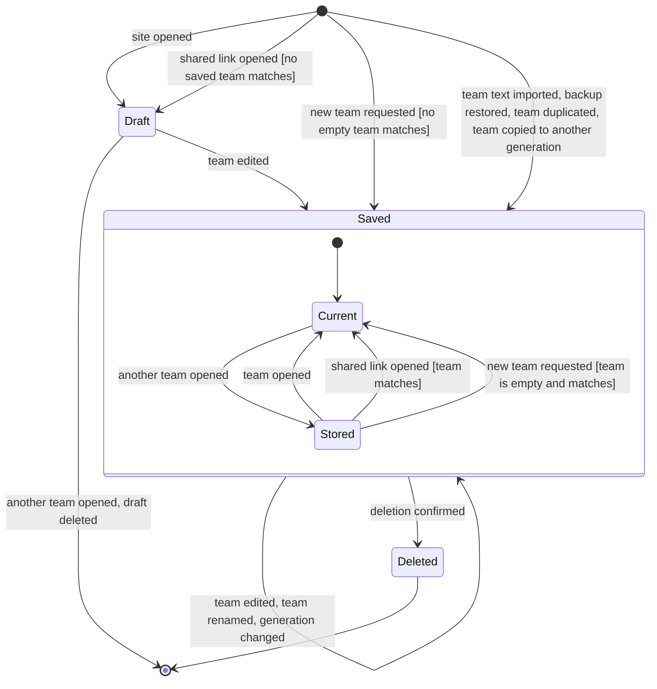
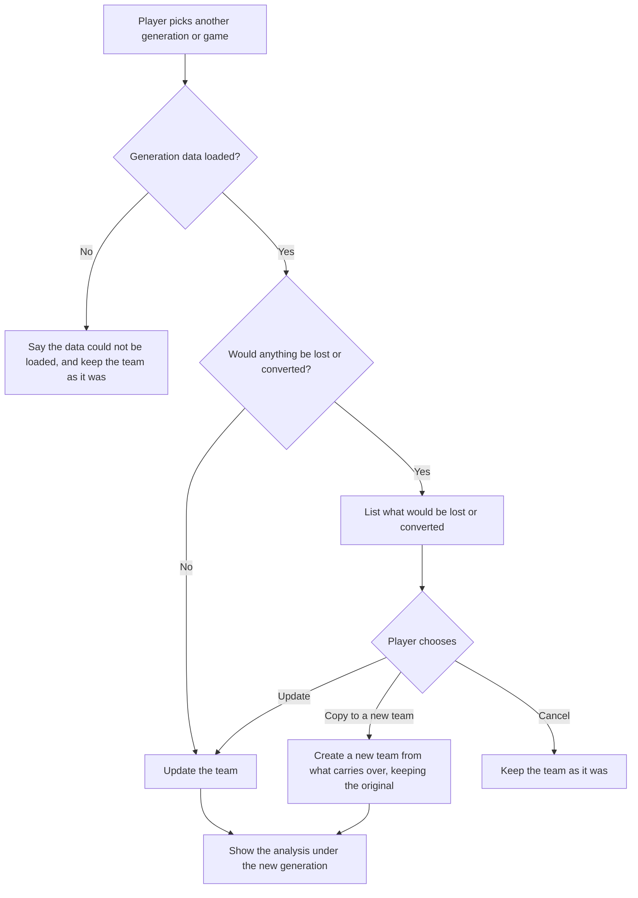
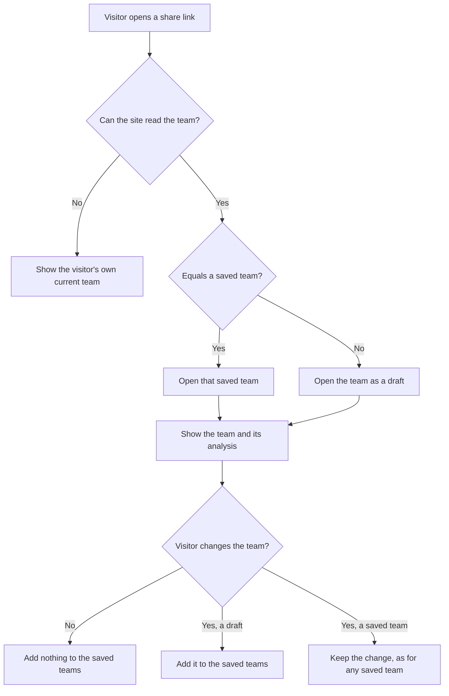
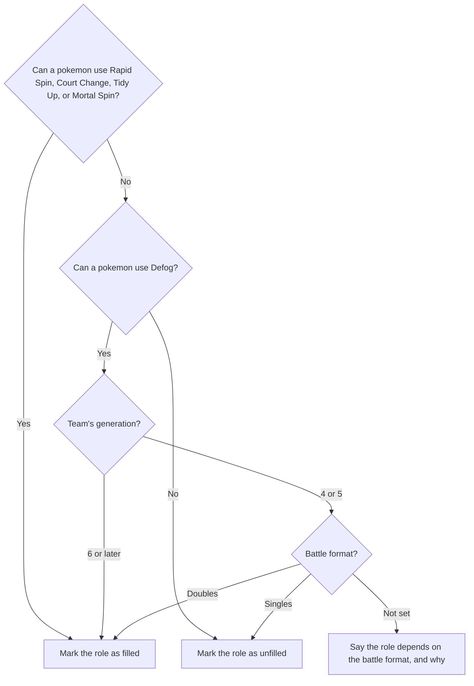
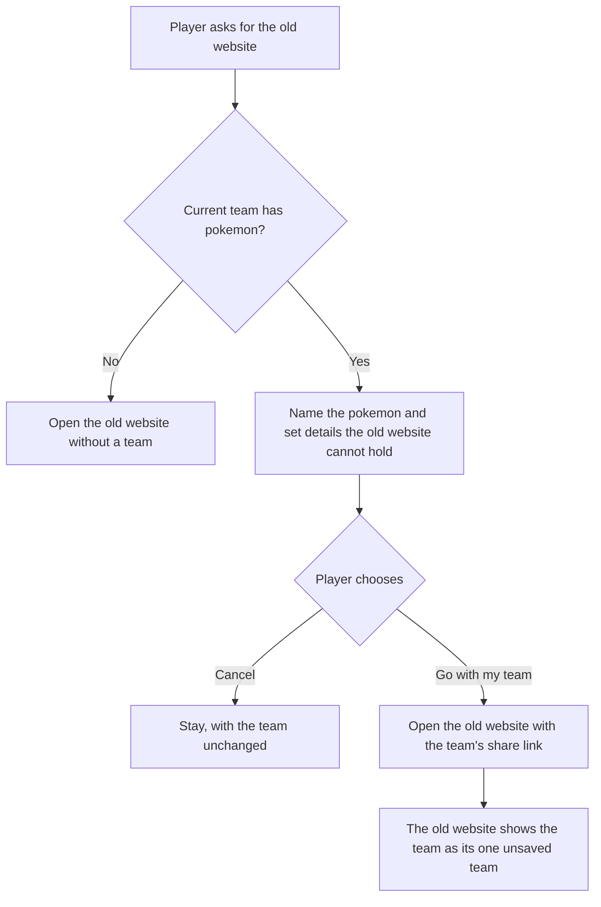

# 5. System Requirements Specification (SyRS)

The site's requirements, each with its importance and status. The functional requirements are grouped by use case, each with the user story it serves and the acceptance criteria that its requirement rows do not already state.

## 1) Introduction

### 1.1) Scope

In this document "the site" means the My Pokemon Team website at `mypokemonteam.com` as a browser runs it, together with the feedback function that emails a player's message to the Site Owner and the scripts that refresh its game data and translations. A requirement that concerns only one part names that part: the data update tooling, the translation update tooling, or the feedback function.

The business requirements these requirements serve (BR-1 to BR-9), and what is not part of the plan, are in Sections 1.2 and 1.3 of [01-vision-and-scope.md](01-vision-and-scope.md).

### 1.2) Definitions

| Term               | Definition                                                                                                                                                                                                                  |
| ------------------ | --------------------------------------------------------------------------------------------------------------------------------------------------------------------------------------------------------------------------- |
| Ability            | A passive trait of a pokemon that can change type matchups, such as Levitate.                                                                                                                                               |
| Backup file        | A file the site writes that holds every saved team, the unsaved draft, and each team's settings.                                                                                                                            |
| Battle format      | Whether a team is for singles or doubles battles. It is not the team's format.                                                                                                                                              |
| BDSP               | Pokemon Brilliant Diamond and Shining Pearl.                                                                                                                                                                                |
| Checklist          | The list of roles a competitive team usually fills, such as an entry hazard or reliable recovery, each marked as present or absent for the team.                                                                            |
| Coverage           | How hard a team's damaging moves hit each type. A type is covered by a move that is super effective against it.                                                                                                             |
| Current team       | The team the Player is editing.                                                                                                                                                                                             |
| Defence            | How hard each attacking type hits the pokemon of a team.                                                                                                                                                                    |
| Draft              | A current team that is not yet in the saved teams: a fresh team, or one opened from a share link, before its first edit.                                                                                                    |
| Format             | A set of rules that bans some pokemon, also called a tier: Smogon's tiers and the Pokemon Champions regulation.                                                                                                             |
| Generation profile | The set of games a team is built for: one of Generations 1 to 9, Generations 6 to 9 combined, or Pokemon Champions.                                                                                                         |
| Matrix             | A table of every type against every pokemon of the team, for defence or for coverage.                                                                                                                                       |
| Saved team         | A named team kept in the browser with its generation profile, format, and filters.                                                                                                                                          |
| Set details        | A pokemon's nickname, level, gender, shiny flag, happiness, tera type, nature, and training values.                                                                                                                         |
| Share link         | A web address that holds a whole team and its generation profile.                                                                                                                                                           |
| Slot               | One of a team's six positions, holding at most one pokemon.                                                                                                                                                                 |
| STAB               | Same-type attack bonus: the extra power of a move whose type matches its user's.                                                                                                                                            |
| Team text          | A team written in Pokemon Showdown's export format.                                                                                                                                                                         |
| Training values    | The numbers that adjust a pokemon's stats: DVs (determinant values) and stat experience in Generations 1 and 2, IVs (individual values) and EVs (effort values) in Generations 3 to 9, or stat points in Pokemon Champions. |
| Type               | One of the eighteen elemental types of pokemon and moves.                                                                                                                                                                   |

## 2) References

- [01-vision-and-scope.md](01-vision-and-scope.md): the business requirements, the business rules (RULE-n), and the scope.
- [`AGENTS.md`](../../AGENTS.md): the project's conventions, and how the site is built, tested, and released.
- The project's GitHub issues: the work still to do, each naming the requirements it covers ([README.md](README.md#issues-and-priorities)).
- Pokemon Showdown's team export format and data files, at `github.com/smogon/pokemon-showdown`.
- Web Content Accessibility Guidelines (WCAG) 2.1.

## 3) System requirements

Each requirement has an identifier, an importance, and a status.

- Importance: **E** essential (the product is unacceptable without it), **C** conditional (it improves the product, which is acceptable without it), **O** optional (it may or may not be worthwhile).
- Status: **Proposed**, **Approved** (agreed, not built yet), **Implemented**, or **Rejected**, as defined in [README.md](README.md#statuses).
- **[A-n]** marks a requirement that rests on an open question in [08-assumptions-and-interview.md](08-assumptions-and-interview.md#82-open-questions).

### 3.1) Functional requirements

#### Team lifecycle

- **Draft**: the team is the current team and is not kept. Nothing is written to the browser for it until its first edit.
- **Saved**: the team is one of the saved teams and is written to the browser after each change. It is **Current** while it is the team being edited and **Stored** otherwise.
- **Deleted**: the team has been removed from the saved teams. Deleting the last saved team creates a new empty saved team, so the collection is never empty.

A new team request matches an empty team with the current team's generation profile and format. Where the current team is such a team, whether a draft or saved, it stays the current team.

#### UC1 Build Team

US1. As a player, I want to choose the pokemon, moves, item, and ability for each of my team's six slots from the ones that exist in my game, so that the team I plan is one I can actually use.

| ID          | Requirement                                                                                                                                                   | Imp. | Status      |
| ----------- | ------------------------------------------------------------------------------------------------------------------------------------------------------------- | ---- | ----------- |
| REQ-TEAM-1  | The site shall hold a current team of six slots, each with at most one pokemon, four moves, one held item, and one ability.                                   | E    | Implemented |
| REQ-TEAM-2  | The site shall offer for a slot only the pokemon that are available in the current team's generation profile and that match the current team's filters.       | E    | Implemented |
| REQ-TEAM-3  | The site shall offer for a pokemon only the moves that the pokemon can learn in the current team's generation profile.                                        | E    | Implemented |
| REQ-TEAM-4  | The site shall offer for a pokemon only the abilities that the pokemon can have in the current team's generation profile, marking a hidden ability as hidden. | E    | Implemented |
| REQ-TEAM-5  | The site shall offer for a pokemon only the items that are available in the current team's generation profile.                                                | E    | Implemented |
| REQ-TEAM-6  | The site shall match text typed into a slot's input against both the name in the site's language and the English name of each option.                         | E    | Implemented |
| REQ-TEAM-7  | The site shall record the required item of a newly selected pokemon that has exactly one applicable required item, such as Blastoisinite for Mega Blastoise.  | C    | Implemented |
| REQ-TEAM-8  | The site shall record the ability of a newly selected pokemon that has exactly one possible ability.                                                          | C    | Implemented |
| REQ-TEAM-9  | The site shall remove the moves and set details of a slot whose pokemon is replaced or removed.                                                               | E    | Implemented |
| REQ-TEAM-10 | The site shall reject the selection of a move that the same pokemon already has.                                                                              | E    | Implemented |
| REQ-TEAM-11 | The site shall allow the Player to move a pokemon, with its moves, item, ability, and set details, to any other slot.                                         | C    | Implemented |
| REQ-TEAM-12 | The site shall present the pokemon options as a list, a grid of sprites, or a grid of large sprites with names, as last chosen by the Player.                 | C    | Implemented |
| REQ-TEAM-13 | The site shall show the types of each pokemon and of each selected move, unless the Player has asked for types to be hidden.                                  | C    | Approved    |
| REQ-TEAM-14 | The site shall inform the Player that no pokemon match the current filters on a request that yields no pokemon option.                                        | E    | Implemented |
| REQ-TEAM-15 | The site shall inform the Player that the move lists could not be loaded, and how to try again, after a failure to load them.                                 | E    | Implemented |

#### UC2 Set Pokemon Details

US2. As a competitive player, I want to set each pokemon's nickname, level, gender, shiny flag, tera type, nature, and training values, so that the team I exchange with Pokemon Showdown is complete.

**Acceptance criteria (verify that...)**

- The details offered are those that exist in the team's generation profile: for example, no tera type before Generation 9, and DVs in place of IVs in Generations 1 and 2.
- A training value outside its game's limits cannot be entered: at most 252 EVs in one stat and 510 in total, IVs from 0 to 31, and at most 32 stat points in one stat and 66 in total in Pokemon Champions.

| ID        | Requirement                                                                                                                                                                               | Imp. | Status      |
| --------- | ----------------------------------------------------------------------------------------------------------------------------------------------------------------------------------------- | ---- | ----------- |
| REQ-DET-1 | The site shall allow the Player to set a pokemon's nickname, level, gender, shiny flag, happiness, tera type, nature, and training values.                                                | C    | Implemented |
| REQ-DET-2 | The site shall offer for a pokemon only the set details that exist in the current team's generation profile.                                                                              | E    | Implemented |
| REQ-DET-3 | The site shall accept training values only in the system of the current team's generation profile (RULE-5) and within that system's limit for one stat and for the total.                 | E    | Implemented |
| REQ-DET-4 | The site shall show the total of a pokemon's training values together with the limit for that total.                                                                                      | C    | Implemented |
| REQ-DET-5 | The site shall accept a level only from 1 to 100.                                                                                                                                         | E    | Implemented |
| REQ-DET-6 | The site shall accept a nickname only up to the length the current team's generation allows in the site's language, such as 12 characters in English and 6 in Japanese from Generation 6. | E    | Implemented |
| REQ-DET-7 | The site shall show the effect of each nature on the two stats it changes.                                                                                                                | O    | Implemented |
| REQ-DET-8 | The site shall allow the Player to return all of a pokemon's set details to their defaults in one request.                                                                                | O    | Implemented |

#### UC3 Randomize Team

US3. As a player looking for ideas, I want the site to fill my team, or one slot, with random pokemon and sets, so that I can try combinations I would not have thought of.

**Acceptance criteria (verify that...)**

- A random team can be undone in one step.

| ID         | Requirement                                                                                                                                                  | Imp. | Status      |
| ---------- | ------------------------------------------------------------------------------------------------------------------------------------------------------------ | ---- | ----------- |
| REQ-RAND-1 | The site shall fill all six slots of the current team, on the Player's request, with six different pokemon chosen at random from those matching the filters. | C    | Implemented |
| REQ-RAND-2 | The site shall give each randomly chosen pokemon moves it can learn, an ability it can have, and an item no earlier slot of the team holds.                  | C    | Implemented |
| REQ-RAND-3 | The site shall complete the missing moves, item, ability, and details of a slot whose set is incomplete, on the Player's request to randomize that slot.     | O    | Implemented |
| REQ-RAND-4 | The site shall replace an empty or complete slot with a random pokemon and set, on the Player's request to randomize that slot.                              | O    | Implemented |
| REQ-RAND-5 | The site shall tell the Player what a randomization changed.                                                                                                 | O    | Implemented |

#### UC4 Undo Change

US4. As a player, I want to step back and forward through the changes I made to my team, so that a mistake or an experiment costs me nothing.

**Acceptance criteria (verify that...)**

- The site says what each undo or redo did, such as "Undo replace Earthquake with Surf for Swampert".

| ID         | Requirement                                                                                                                           | Imp. | Status      |
| ---------- | ------------------------------------------------------------------------------------------------------------------------------------- | ---- | ----------- |
| REQ-UNDO-1 | The site shall return the current team, on the Player's request, to its state before the most recent change that has not been undone. | C    | Implemented |
| REQ-UNDO-2 | The site shall reapply, on the Player's request, the most recently undone change to the current team.                                 | C    | Implemented |
| REQ-UNDO-3 | The site shall keep the 50 most recent changes to the current team available to undo.                                                 | C    | Implemented |
| REQ-UNDO-4 | The site shall describe to the Player the change that each undo and each redo made.                                                   | O    | Implemented |
| REQ-UNDO-5 | The site shall start an empty history of changes each time a team becomes the current team.                                           | C    | Implemented |

#### UC5 Narrow Pokemon Choices

US5. As a player choosing a pokemon, I want to limit the pokemon offered by format, type, region, and ability, to limit the moves offered to the viable ones, and to put the options in an order that suits me, so that I can find a pokemon that fills the gap in my team without scrolling through more than a thousand names.

| ID          | Requirement                                                                                                                                                        | Imp. | Status      |
| ----------- | ------------------------------------------------------------------------------------------------------------------------------------------------------------------ | ---- | ----------- |
| REQ-FIND-1  | The site shall limit the pokemon offered to those allowed in the format set as the current team's format filter.                                                   | E    | Implemented |
| REQ-FIND-2  | The site shall limit the pokemon offered to those having the type set as the current team's type filter.                                                           | E    | Implemented |
| REQ-FIND-3  | The site shall limit the pokemon offered to those from the region set as the current team's region filter.                                                         | C    | Implemented |
| REQ-FIND-4  | The site shall limit the pokemon offered to those able to have the ability set as the current team's ability filter.                                               | C    | Implemented |
| REQ-FIND-5  | The site shall offer as type filters and ability filters only the types and abilities that exist among the pokemon of the current team's generation and format.    | E    | Implemented |
| REQ-FIND-6  | The site shall offer as format filters only the formats that exist in the current team's generation.                                                               | E    | Implemented |
| REQ-FIND-7  | The site shall limit the moves offered, for a Player who has asked for viable moves only, to the moves Pokemon Showdown's teambuilder treats as useful.            | C    | Implemented |
| REQ-FIND-8  | The site shall order the pokemon offered by name, pokedex number, format, base stat total, or one base stat, in ascending or descending order, as the Player sets. | C    | Implemented |
| REQ-FIND-9  | The site shall order the moves offered by name or by type, in ascending or descending order, as the Player sets.                                                   | O    | Implemented |
| REQ-FIND-10 | The site shall keep each saved team's filters with that team.                                                                                                      | C    | Implemented |
| REQ-FIND-11 | The site shall remove all of the current team's filters on a single request from the Player.                                                                       | C    | Implemented |
| REQ-FIND-12 | The site shall offer the filters and the pokemon sort order in the list of pokemon for a slot, and the move sort order in the list of moves, without a setting.    | C    | Implemented |

#### UC6 Analyze Team

US6. As a player, I want to see how hard each type hits my team and how hard my team hits each type, with my pokemon's abilities, items, and moves counted, so that I can find the weaknesses and gaps before a battle does.

**Acceptance criteria (verify that...)**

- An ability or item that changes a matchup changes the score: a Bronzong with Levitate scores +1.5 against Ground.
- A move whose effectiveness differs from its type's changes the score: Freeze-Dry counts as super effective against Water.

| ID          | Requirement                                                                                                                                                                                                                      | Imp. | Status      |
| ----------- | -------------------------------------------------------------------------------------------------------------------------------------------------------------------------------------------------------------------------------- | ---- | ----------- |
| REQ-ANLY-1  | The site shall present, for each type of the current team's generation, a defence score equal to the sum over the team's pokemon of +1.5 (0x or 0.25x), +1 (0.5x), 0 (1x), -1 (2x), or -1.5 (4x).                                | E    | Implemented |
| REQ-ANLY-2  | The site shall present, for each type of the current team's generation, a coverage score equal to the sum, over each pokemon's damaging moves of distinct types, of +1 for a super effective move and +1 more for one with STAB. | E    | Implemented |
| REQ-ANLY-3  | The site shall compute each defensive multiplier from the pokemon's types, ability, and held item under the type chart and rules of the current team's generation.                                                               | E    | Implemented |
| REQ-ANLY-4  | The site shall compute each move's effectiveness from the move's own rules, the user's ability, and the user's held item under the rules of the current team's generation.                                                       | E    | Implemented |
| REQ-ANLY-5  | The site shall present the current team's analysis within the same interaction as each change to the team, without a request from the Player.                                                                                    | E    | Implemented |
| REQ-ANLY-6  | The site shall mark each of nine checklist roles as filled or unfilled by the current team: entry hazard, spinner or defogger, reliable recovery, cleric, status move, phazer, boosting move, volt-turn move, and choice item.   | C    | Implemented |
| REQ-ANLY-7  | The site shall present, on the Player's request for a type's score, each pokemon of the team that the score counts together with the multiplier or move counted.                                                                 | E    | Implemented |
| REQ-ANLY-8  | The site shall present a defence matrix and a coverage matrix of every type against every pokemon of the current team, each with a team score per type.                                                                          | C    | Implemented |
| REQ-ANLY-9  | The site shall present, on the Player's request for a matrix cell, the type, pokemon, multiplier, and the ability, item, or move that determine the cell.                                                                        | C    | Implemented |
| REQ-ANLY-10 | The site shall inform the Player that a pokemon must be selected first, in place of the scores of a team with no pokemon.                                                                                                        | C    | Implemented |
| REQ-ANLY-11 | The site shall judge a checklist role from the moves a pokemon can use with its held item and ability, so that a move blocked by Assault Vest is not counted.                                                                    | C    | Implemented |
| REQ-ANLY-20 | The site shall mark the reliable recovery role as filled for a team with a pokemon that has Wish together with Protect or Detect.                                                                                                | C    | Implemented |

#### UC7 Change Generation

US7. As a player of several games, I want to move my team to another generation or game and be told beforehand what will not carry over, so that I do not lose a pokemon or a move without knowing.

| ID         | Requirement                                                                                                                                                                                                                                             | Imp. | Status      |
| ---------- | ------------------------------------------------------------------------------------------------------------------------------------------------------------------------------------------------------------------------------------------------------- | ---- | ----------- |
| REQ-GEN-1  | The site shall allow the Player to set a team's generation profile to Generations 6 to 9 combined, one of Generations 1 to 9, or Pokemon Champions.                                                                                                     | E    | Implemented |
| REQ-GEN-2  | The site shall give a new visitor's first team the generation profile Generations 6 to 9 combined.                                                                                                                                                      | C    | Implemented |
| REQ-GEN-3  | The site shall offer in Generations 6 to 9 combined every pokemon, ability, move, and held item available in any game of those generations, with the mechanics and stats of Generation 9.                                                               | E    | Implemented |
| REQ-GEN-4  | The site shall apply to a team in one of Generations 1 to 8 the abilities, base stats, type chart, and move rules of that generation.                                                                                                                   | E    | Implemented |
| REQ-GEN-5  | The site shall present, before changing the generation profile of a team that would lose or have converted any part of it, each pokemon unavailable in the new profile and each move, item, ability, and set detail that would be removed or converted. | E    | Implemented |
| REQ-GEN-6  | The site shall change the generation profile of a team that would lose or have converted any part of it only after the Player confirms the changes presented under REQ-GEN-5.                                                                           | E    | Implemented |
| REQ-GEN-7  | The site shall offer the Player, in place of changing the team, a copy of the team in the new generation profile that leaves the original team unchanged.                                                                                               | C    | Implemented |
| REQ-GEN-8  | The site shall convert a team's training values to the training system of its new generation profile, telling the Player which conversions are approximate.                                                                                             | C    | Implemented |
| REQ-GEN-9  | The site shall clear the format of a team whose new generation has no such format.                                                                                                                                                                      | E    | Implemented |
| REQ-GEN-10 | The site shall list games that are not yet supported as coming soon, without allowing their selection.                                                                                                                                                  | O    | Implemented |
| REQ-GEN-11 | The site shall allow the Player to set a team's generation profile to Let's Go, Pikachu! and Let's Go, Eevee!, to Legends: Arceus, and to Legends: Z-A.                                                                                                 | O    | Approved    |
| REQ-GEN-12 | The site shall offer, for a team none of whose pokemon are available in the new generation profile, to clear the team or to create an empty team in the new profile, in place of updating or copying it.                                                | C    | Implemented |

**Flow.** The site asks only when something would be lost or converted.

When no pokemon of the team carries over, the two choices are named for what they do: Clear existing team (the update) and Create empty team (the copy).

#### UC8 Manage Saved Teams

US8. As a player with several teams in progress, I want each one kept in my browser under a name, with its own generation, format, and filters, so that I can leave and come back to any of them.

**Acceptance criteria (verify that...)**

- Besides a new empty team, a new random team can be created in the current generation and format.

| ID          | Requirement                                                                                                                                                                               | Imp. | Status      |
| ----------- | ----------------------------------------------------------------------------------------------------------------------------------------------------------------------------------------- | ---- | ----------- |
| REQ-COLL-1  | The site shall keep each team in the Player's browser from the team's first change, without a save request from the Player.                                                               | E    | Implemented |
| REQ-COLL-2  | The site shall keep with each saved team its name, generation profile, format, and filters.                                                                                               | E    | Implemented |
| REQ-COLL-3  | The site shall present the saved teams with their names, pokemon, generation profiles, and formats, identifying the current team.                                                         | E    | Implemented |
| REQ-COLL-4  | The site shall make any saved team the current team on the Player's request.                                                                                                              | E    | Implemented |
| REQ-COLL-5  | The site shall create, on the Player's request, an empty saved team with the generation profile and format of the current team, unless such an empty team exists, which it opens instead. | E    | Implemented |
| REQ-COLL-6  | The site shall allow the Player to rename any saved team.                                                                                                                                 | C    | Implemented |
| REQ-COLL-7  | The site shall create, on the Player's request, a copy of a saved team that has at least one pokemon, under a name no other saved team has.                                               | C    | Implemented |
| REQ-COLL-8  | The site shall delete a saved team only after the Player confirms a prompt stating that the deletion cannot be undone.                                                                    | E    | Implemented |
| REQ-COLL-9  | The site shall inform the Player that the browser could not save the teams, and that a backup will keep them, after a failed attempt to save.                                             | E    | Implemented |
| REQ-COLL-10 | The site shall hold at least one saved team at all times, creating an empty one after the deletion of the last.                                                                           | E    | Implemented |
| REQ-COLL-11 | The site shall take into each open tab the teams that the site's other tabs in the same browser save, merging team by team so that no tab discards another's changes.                     | E    | Implemented |
| REQ-COLL-12 | The site shall keep saved teams without an expiry date.                                                                                                                                   | E    | Implemented |
| REQ-COLL-13 | The site shall restore, after a reload of the page, the team that was the current team before the reload.                                                                                 | C    | Implemented |

#### UC9 Back Up Teams and UC10 Restore Teams

US9. As a player who keeps many teams, I want to save all of them to a file, so that clearing my browser does not lose them.

US10. As a player with two devices, I want to add the teams from a backup file to the teams I already have, so that I can carry my collection from one device to the other.

Backups stay a separate action, Team backups in the Teams dialog. Folding them into Export All and Import Team is not part of the plan.

**Acceptance criteria (verify that...)**

- Restoring the same backup twice adds nothing the second time, and the Player is told the teams are already there.
- A backup with too many teams to add is refused with a message, and the saved teams are unchanged.

| ID         | Requirement                                                                                                                                                       | Imp. | Status      |
| ---------- | ----------------------------------------------------------------------------------------------------------------------------------------------------------------- | ---- | ----------- |
| REQ-BKUP-1 | The site shall write, on the Player's request, a backup file holding every saved team and the draft, each with its name, generation profile, format, and filters. | E    | Implemented |
| REQ-BKUP-2 | The site shall add the teams of a backup file to the saved teams without changing or removing any saved team or the current team.                                 | E    | Implemented |
| REQ-BKUP-3 | The site shall add no team from a backup file that equals a team already among the saved teams.                                                                   | E    | Implemented |
| REQ-BKUP-4 | The site shall refuse a file that is not a backup written by the site, informing the Player that the file could not be read.                                      | E    | Implemented |
| REQ-BKUP-5 | The site shall inform the Player of the number of teams in a backup file before adding them.                                                                      | C    | Implemented |
| REQ-BKUP-6 | The site shall keep in a backup file every set value of every pokemon, including values that are not legal in the team's game.                                    | C    | Implemented |
| REQ-BKUP-7 | The site shall accept a backup file of up to 10 megabytes.                                                                                                        | C    | Implemented |
| REQ-BKUP-8 | The site shall include in a backup file the teams that the site's other tabs in the same browser have saved up to the moment of the request.                      | C    | Implemented |

#### UC11 Share Team by Link and UC12 Open Shared Team

US11. As a player, I want a link that holds my whole team, so that I can post it or bookmark it and anyone who opens it sees the same team.

US12. As someone who was sent a team link, I want the team and its analysis shown as soon as I open the link, without it replacing or duplicating any team I already keep, so that I can look at a friend's team safely.

**Acceptance criteria (verify that...)**

- With a team that has no pokemon, the share action says there is nothing to copy.

| ID          | Requirement                                                                                                                                                     | Imp. | Status      |
| ----------- | --------------------------------------------------------------------------------------------------------------------------------------------------------------- | ---- | ----------- |
| REQ-LINK-1  | The site shall hold in the page's address, at all times, the current team and its generation profile.                                                           | E    | Implemented |
| REQ-LINK-2  | The site shall copy the current team's share link to the Player's clipboard on request, informing the Player of the outcome.                                    | E    | Implemented |
| REQ-LINK-3  | The site shall provide the share link of any saved team on the Player's request.                                                                                | C    | Implemented |
| REQ-LINK-4  | The site shall present, to a visitor who opens a share link, the team the link holds as the current team.                                                       | E    | Implemented |
| REQ-LINK-5  | The site shall make a saved team the current team for a share link whose team equals that saved team, adding no team.                                           | E    | Implemented |
| REQ-LINK-6  | The site shall keep a team opened from a share link out of the saved teams until the visitor changes it.                                                        | E    | Implemented |
| REQ-LINK-7  | The site shall use the generation profile Generations 6 to 9 combined for a share link that names no generation profile.                                        | E    | Implemented |
| REQ-LINK-8  | The site shall ignore the team of a share link that it cannot read or that is longer than 16 kilobytes, presenting the visitor's own current team in its place. | E    | Implemented |
| REQ-LINK-9  | The site shall present the team that the address held, after the Player moves back or forward in the browser's history.                                         | C    | Implemented |
| REQ-LINK-10 | The site shall leave out of a team opened from a share link each pokemon, move, item, and ability that does not exist in the link's generation profile.         | E    | Implemented |
| REQ-LINK-11 | The site shall inform a visitor that a share link names a generation or game the site does not recognise, naming the generation profile used in its place.      | O    | Proposed    |

**Opening a share link.** The team in a link never replaces or duplicates a saved team.

A pokemon, move, item, or ability that the link's generation profile lacks, such as one a data update renamed, is left out without a word (REQ-LINK-10). REQ-INFO-8 would name it.

#### UC13 Import Team Text and UC14 Export Team Text

US13. As a Pokemon Showdown user, I want to paste a team, or several teams, in Showdown's format and have them become my teams here, so that I can analyse teams I built there.

US14. As a Pokemon Showdown user, I want my team as text in Showdown's format, so that I can paste it into Showdown or a pokepaste and battle with it.

On 14 October 2026 the Site Owner chose advisory parsing reports in the team-text editor over a check that blocks the update: an update applies the parser's result even when problems are reported. This does not change Import Team's refusal of text with no pokemon, or how old share links are read. REQ-USE-21 to 23 apply to Import Team and the team-text editor as well.

**Acceptance criteria (verify that...)**

- The team-text editor reports each parsing problem before an update, naming the pokemon and field, the value given, the reason, and what was left out or used in its place. An unrecognized pokemon is named by its team slot, and a move problem by its move slot, such as "Ho-Oh, move 4". No message gives a line number.
- The Player can update without fixing the reported problems and without a second confirmation.
- Updating text containing `- Iron Hed` leaves that move slot empty, keeps the later valid moves in their slots, and applies the other valid edits. A known move that the pokemon cannot learn under the team's generation profile and format is treated the same way, with that as the reason.
- A bare `-` is an intentional empty move slot and is not reported. A pokemon with fewer than four moves can be updated.
- Editing the text, or seeing a report, changes no team until the Player updates. Cancel leaves the current team unchanged. Unrecognized names are not corrected automatically.

| ID          | Requirement                                                                                                                                                                                                                       | Imp. | Status      |
| ----------- | --------------------------------------------------------------------------------------------------------------------------------------------------------------------------------------------------------------------------------- | ---- | ----------- |
| REQ-TEXT-1  | The site shall create one saved team for each team in team text that the Player provides for import.                                                                                                                              | E    | Implemented |
| REQ-TEXT-2  | The site shall read from team text each pokemon's name, nickname, gender, item, ability, level, shiny flag, happiness, tera type, training values, nature, and moves.                                                             | E    | Implemented |
| REQ-TEXT-3  | The site shall give an imported team the generation profile and format that its text names, and those of the current team for text that names none.                                                                               | C    | Implemented |
| REQ-TEXT-4  | The site shall inform the Player that no pokemon were found, changing no team, for imported text that holds no pokemon.                                                                                                           | E    | Implemented |
| REQ-TEXT-5  | The site shall provide the current team as team text that the Player can copy.                                                                                                                                                    | E    | Implemented |
| REQ-TEXT-6  | The site shall replace the current team with the team in text that the Player has edited in place.                                                                                                                                | C    | Implemented |
| REQ-TEXT-7  | The site shall provide all saved teams as one team text, as a file and as a copy to the clipboard.                                                                                                                                | C    | Implemented |
| REQ-TEXT-8  | The site shall write team text in Pokemon Showdown's export format with English names, in every site language.                                                                                                                    | E    | Implemented |
| REQ-TEXT-9  | The site shall write in team text only the set details that differ from their defaults.                                                                                                                                           | C    | Implemented |
| REQ-TEXT-10 | The site shall write team text that Pokemon Showdown's importer accepts without error.                                                                                                                                            | C    | Implemented |
| REQ-TEXT-11 | The site shall read back from team text that it wrote a team equal to the team it wrote, generation profile included.                                                                                                             | E    | Implemented |
| REQ-TEXT-13 | The site shall apply the parsed result of edited team text upon the Player's update request despite reported parsing problems, without requiring an additional confirmation.                                                      | C    | Approved    |
| REQ-TEXT-14 | The site shall leave an edited team's move slot empty for a supplied move that is unrecognized or cannot be learned under the team's generation profile and format.                                                               | C    | Implemented |
| REQ-TEXT-15 | The site shall report each parsing problem in edited team text before an update, identifying the affected pokemon (team-slot number for an unrecognized name), field, supplied value, reason, and resulting omission or fallback. | C    | Approved    |

#### UC15 Look Up Reference

US15. As a player who does not know every pokemon or every competitive term, I want to look up a pokemon's stats, abilities, and weaknesses, the type chart, and what the site's terms and scores mean, so that I can understand the analysis.

| ID        | Requirement                                                                                                                                                             | Imp. | Status      |
| --------- | ----------------------------------------------------------------------------------------------------------------------------------------------------------------------- | ---- | ----------- |
| REQ-REF-1 | The site shall present, for a pokemon of the current team, its types, abilities, base stats, base stat total, and the types it is weak to in the team's generation.     | C    | Implemented |
| REQ-REF-2 | The site shall link from a pokemon's information to that pokemon's page on Smogon's dex, Bulbapedia, Serebii, and the Showdown dex.                                     | O    | Implemented |
| REQ-REF-3 | The site shall present a type chart as a table, as a list, and as an infographic.                                                                                       | C    | Implemented |
| REQ-REF-4 | The site shall present a manual that states how the defence score and the coverage score are calculated and defines each checklist term that Smogon's dictionary lacks. | C    | Implemented |
| REQ-REF-5 | The site shall present an update log of the changes to pokemon data, features, and serious defects, newest first, showing the date of the newest entry.                 | C    | Implemented |
| REQ-REF-6 | The site shall present credits naming the sources of its data, sprites, and images.                                                                                     | E    | Implemented |

#### UC16 Change Language and UC17 Change Colour Scheme

US16. As a player whose game is not in English, I want the site and the names of pokemon, moves, items, and abilities in my language, so that I can use the names I know.

US17. As a player, I want to choose a light or dark colour scheme, or follow my device's, so that the site is comfortable to read where I am.

| ID          | Requirement                                                                                                                                                                             | Imp. | Status      |
| ----------- | --------------------------------------------------------------------------------------------------------------------------------------------------------------------------------------- | ---- | ----------- |
| REQ-LANG-1  | The site shall present its text in English, Japanese, Korean, Simplified Chinese, Traditional Chinese, Spanish, French, German, Italian, or Brazilian Portuguese, as the Player sets.   | E    | Implemented |
| REQ-LANG-2  | The site shall present its text, to a visitor who has set no language, in the first language of the visitor's browser that the site supports, and in English for none.                  | C    | Implemented |
| REQ-LANG-3  | The site shall present the names of pokemon, moves, items, abilities, natures, types, and regions in the site's language, in each language other than English and Brazilian Portuguese. | E    | Implemented |
| REQ-LANG-4  | The site shall present in English each name that has no translation in the site's language.                                                                                             | E    | Implemented |
| REQ-LANG-5  | The site shall keep the Player's chosen language for later visits.                                                                                                                      | C    | Implemented |
| REQ-LANG-6  | The site shall keep its previous language, informing the Player, after a failure to load the language the Player chose.                                                                 | E    | Implemented |
| REQ-LANG-7  | The site shall keep teams, share links, and team text in English names in every site language.                                                                                          | E    | Implemented |
| REQ-LANG-8  | The site shall present the names of pokemon, moves, items, abilities, natures, types, and regions in Brazilian Portuguese.                                                              | O    | Proposed    |
| REQ-THEME-1 | The site shall present itself in a light or a dark colour scheme, following the device's setting until the Player sets one.                                                             | C    | Implemented |
| REQ-THEME-2 | The site shall keep the Player's light or dark choice for 91 days after the Player's last visit.                                                                                        | O    | Implemented |

#### UC18 Send Feedback

US18. As a player who found something wrong or has an idea, I want to tell the site's owner from the page I am on, with my team and a picture of the page attached, so that I do not have to describe what I am looking at.

| ID          | Requirement                                                                                                                      | Imp. | Status      |
| ----------- | -------------------------------------------------------------------------------------------------------------------------------- | ---- | ----------- |
| REQ-FEED-1  | The site shall send to the Site Owner by email a message of up to 5000 characters that a Player submits as feedback.             | E    | Implemented |
| REQ-FEED-2  | The site shall attach to feedback the current team's share link and a picture of the page, each of which the Player can decline. | C    | Implemented |
| REQ-FEED-3  | The site shall accept with feedback up to three images provided by the Player.                                                   | O    | Implemented |
| REQ-FEED-4  | The site shall accept with feedback an optional reply address, refusing an address that is not a valid email address.            | C    | Implemented |
| REQ-FEED-5  | The site shall include with feedback the Player's browser name and version, operating system, and screen size.                   | C    | Implemented |
| REQ-FEED-6  | The site shall inform the Player whether the feedback was sent, giving an email address to write to after a failure.             | E    | Implemented |
| REQ-FEED-7  | The site shall keep the Player's message in the feedback form after a failure to send.                                           | C    | Implemented |
| REQ-FEED-8  | The site shall deliver feedback that carries a picture of the page and three screenshots taken on a phone.                       | C    | Implemented |
| REQ-FEED-9  | The site shall deliver the Site Owner's reply to a feedback message to the reply address that the Player gave.                   | C    | Implemented |
| REQ-FEED-11 | The site shall tell the Player, before sending feedback without a reply address, that the Site Owner cannot reply without one.   | C    | Implemented |
| REQ-FEED-12 | The site shall include in the picture of the page each pokemon sprite shown on the page.                                         | C    | Implemented |

REQ-FEED-9 and REQ-FEED-11 need no verified sending domain: the email's reply-to is the Player's address, whatever address it is sent from, and the form marks the email field "Only if you want a reply".

#### UC19 Switch Site Version

US19. As a player who knew the old website, I want a way back to it from the redesigned site, with a warning about what will not come with me, so that I can keep using what I am used to without losing my team by surprise.

**Acceptance criteria (verify that...)**

- The old website offers the way back.

| ID         | Requirement                                                                                                                                                              | Imp. | Status      |
| ---------- | ------------------------------------------------------------------------------------------------------------------------------------------------------------------------ | ---- | ----------- |
| REQ-SITE-1 | The site shall provide, from its header, a link to the old website.                                                                                                      | C    | Implemented |
| REQ-SITE-2 | The site shall open the old website for a Player whose current team has pokemon only after the Player confirms a prompt stating that the current team will not transfer. | E    | Implemented |

#### UC20 Update Game Data and UC21 Update Translations

US20. As the maintainer, I want one command to refresh the site's game data from Pokemon Showdown and to tell me what the update may have broken, so that a new game or regulation reaches players quickly and safely.

US21. As the maintainer, I want one command to refresh the translated names and to tell me which names stayed in English, so that new pokemon are named in every language.

| ID          | Requirement                                                                                                                                                                                                                         | Imp. | Status      |
| ----------- | ----------------------------------------------------------------------------------------------------------------------------------------------------------------------------------------------------------------------------------- | ---- | ----------- |
| REQ-DATA-1  | The data update tooling shall regenerate the site's pokemon, move, item, ability, learnset, format, and type chart data from Pokemon Showdown's data on a single command.                                                           | E    | Implemented |
| REQ-DATA-2  | The data update tooling shall combine learnsets from every generation and from the games Pokemon Showdown keeps apart: Pokemon Champions, Legends: Z-A, Legends: Arceus, and BDSP.                                                  | E    | Implemented |
| REQ-DATA-3  | The data update tooling shall derive the Pokemon Champions format's allowed pokemon from Pokemon Showdown's Champions data.                                                                                                         | E    | Implemented |
| REQ-DATA-4  | The data update tooling shall derive the viable moves from the usefulness rule of Pokemon Showdown's own teambuilder.                                                                                                               | C    | Implemented |
| REQ-DATA-5  | The data update tooling shall write to the site's data only the fields that the site reads.                                                                                                                                         | C    | Implemented |
| REQ-DATA-6  | The data update tooling shall report each pokemon, move, and item that an update renamed or removed.                                                                                                                                | E    | Implemented |
| REQ-DATA-7  | The data update tooling shall report each bundled icon sheet that differs from Pokemon Showdown's and each new pokemon whose sprite Pokemon Showdown does not host.                                                                 | C    | Implemented |
| REQ-DATA-8  | The translation update tooling shall regenerate, on a single command, the names of pokemon, moves, items, abilities, natures, types, and regions in eight languages from PokeAPI's tables.                                          | E    | Implemented |
| REQ-DATA-9  | The translation update tooling shall report, for each language, each name that it left in English.                                                                                                                                  | C    | Implemented |
| REQ-DATA-10 | The data update tooling shall generate the site's data for a newly released game from a source other than Pokemon Showdown, for a game whose data Pokemon Showdown has not published within 7 days of the game's release **[A-3]**. | C    | Proposed    |
| REQ-DATA-11 | The data update tooling shall replace data taken from another source with Pokemon Showdown's data once Pokemon Showdown publishes it.                                                                                               | C    | Proposed    |
| REQ-DATA-12 | The data update tooling shall notify the Maintainer within 1 day of Pokemon Showdown publishing a change to data the site uses.                                                                                                     | C    | Approved    |

REQ-DATA-10 to 12 come from the 2-day target of BR-3. Approving REQ-DATA-10 means rewording REQ-POL-4 (Section 3.10), which allows Pokemon Showdown as the only source, to allow the fallback source for a new game while still forbidding edits by hand.

#### UC22 Set Battle Format (planned)

US22. As a doubles player, or a player of Generations 4 and 5, I want to tell the site whether my team is for singles or doubles, so that the checklist judges moves such as Defog by the rules of the battles I play.

| ID          | Requirement                                                                                                                                    | Imp. | Status      |
| ----------- | ---------------------------------------------------------------------------------------------------------------------------------------------- | ---- | ----------- |
| REQ-ANLY-12 | The site shall allow the Player to set a team's battle format to singles, to doubles, or to unspecified.                                       | C    | Approved    |
| REQ-ANLY-13 | The site shall keep a team's battle format with the saved team and in the team's share link.                                                   | C    | Approved    |
| REQ-ANLY-14 | The site shall count Defog as filling the spinner or defogger role of a Generation 4 or 5 team only for a team whose battle format is doubles. | C    | Approved    |
| REQ-ANLY-15 | The site shall count Defog as filling the spinner or defogger role of a team of Generation 6 or later in every battle format.                  | E    | Implemented |
| REQ-ANLY-16 | The site shall identify, for a team whose battle format is unspecified, each checklist role whose result differs between singles and doubles.  | C    | Approved    |
| REQ-ANLY-17 | The site shall treat every saved team and share link that records no battle format as having an unspecified battle format.                     | E    | Approved    |

**Flow.** How the checklist would judge the Spinner/Defogger role. Today the site never counts Defog before Generation 6, which is wrong for doubles; only the battle format question and its "depends" answer are new.

Mock-up M1 shows the battle format set on the checklist: [m1-battle-format-on-checklist.svg](https://github.com/projeffboy/my-pokemon-team/blob/efdc7baec1e8232065a848c9f042e6046427fb63/docs/requirements/mockups/m1-battle-format-on-checklist.svg).

#### UC23 Transfer Team to Old Website (planned)

US23. As a player moving between the old website and the redesigned site, I want my current team to come with me, so that switching does not mean building it again.

| ID         | Requirement                                                                                                                                                   | Imp. | Status   |
| ---------- | ------------------------------------------------------------------------------------------------------------------------------------------------------------- | ---- | -------- |
| REQ-SITE-3 | The site shall open the old website with the Player's current team as the old website's current team.                                                         | C    | Approved |
| REQ-SITE-4 | The site shall add to its saved teams, on the Player's request, the team that the Player last had on the old website.                                         | O    | Rejected |
| REQ-SITE-5 | The site shall name, before opening the old website with the Player's current team, each pokemon and set detail of the team that the old website cannot hold. | C    | Approved |

REQ-SITE-4 was rejected in the interview: carrying the current team is enough, and the old website is in maintenance and gets no new features, so nothing is carried from the old website to the redesigned site.

**Flow.** The team crosses as its share link, which the old website already reads, so the old website is not changed (REQ-OPS-5). The old website covers Generations 6 to 9 only and does not read newer set details such as EVs and natures, so REQ-SITE-5 warns before the Player leaves.

Mock-up M5 shows today's confirmation next to the planned one: [m5-version-transfer.svg](https://github.com/projeffboy/my-pokemon-team/blob/efdc7baec1e8232065a848c9f042e6046427fb63/docs/requirements/mockups/m5-version-transfer.svg).

#### UC24 Check Team Legality (planned)

US24. As a competitive player, I want to be told which parts of my team break the rules of its game or format, so that I find out here and not when Pokemon Showdown rejects the team.

| ID          | Requirement                                                                                                                                                                                                                                                             | Imp. | Status   |
| ----------- | ----------------------------------------------------------------------------------------------------------------------------------------------------------------------------------------------------------------------------------------------------------------------- | ---- | -------- |
| REQ-ANLY-18 | The site shall present to the Player each rule of the current team's generation profile and format that the team breaks, naming the pokemon concerned and marking its slot.                                                                                             | O    | Approved |
| REQ-ANLY-19 | The site shall check a team against the species clause and the item clause, and each pokemon against its format's allowed pokemon, its possible abilities, its required item, repeated moves, its training limits, its nickname's length, its level, and its tera type. | O    | Approved |

Mock-up M3 shows the problems as a card in the analysis column: [m3-legality-warnings.svg](https://github.com/projeffboy/my-pokemon-team/blob/efdc7baec1e8232065a848c9f042e6046427fb63/docs/requirements/mockups/m3-legality-warnings.svg).

### 3.2) Usability requirements

The Site Owner rates speed as paramount: a visitor who waits, or who has to work before seeing a result, leaves. The random team (REQ-USE-10) is the Site Owner's own answer to that. Values marked **[A-16]** are proposed and have not been measured or agreed.

| ID         | Requirement                                                                                                                                                                                                                                                                        | Imp. | Status      |
| ---------- | ---------------------------------------------------------------------------------------------------------------------------------------------------------------------------------------------------------------------------------------------------------------------------------- | ---- | ----------- |
| REQ-USE-3  | The site shall present every function at viewport widths from 320 CSS pixels upward without horizontal scrolling of the page and without cutting off any control or its label.                                                                                                     | E    | Approved    |
| REQ-USE-4  | The site shall make every function operable with a keyboard alone.                                                                                                                                                                                                                 | C    | Approved    |
| REQ-USE-5  | The site shall give every input and every button an accessible name that states its slot and its purpose, such as "Pokemon 1's item".                                                                                                                                              | C    | Implemented |
| REQ-USE-6  | The site shall present text and controls at a contrast ratio of at least 4.5 to 1 against their background in both colour schemes, as WCAG 2.1 level AA requires **[A-16]**.                                                                                                       | C    | Approved    |
| REQ-USE-7  | The site shall state, in every message that reports a failure, what the Player can do next.                                                                                                                                                                                        | C    | Approved    |
| REQ-USE-10 | The site shall present an analysed team of six to a visitor after a single request, without the visitor choosing any pokemon.                                                                                                                                                      | E    | Implemented |
| REQ-USE-11 | The site shall show a text label beside the icon of every button, except standard icon buttons, which may show the icon alone: close and dismiss buttons, a saved team's options button, the Filters and Sort buttons inside the lists, and each slot's buttons beside its sprite. | E    | Proposed    |
| REQ-USE-12 | The site shall present each slot's pokemon sprite with no part covered by another element of the slot.                                                                                                                                                                             | E    | Proposed    |
| REQ-USE-14 | The site shall offer the actions on the current team apart from the actions on the other saved teams.                                                                                                                                                                              | C    | Approved    |
| REQ-USE-15 | The site shall present the accessibility settings apart from the actions on the current team.                                                                                                                                                                                      | C    | Approved    |
| REQ-USE-16 | The site shall present still sprites in place of animated ones to a Player who has asked for sprites not to be animated.                                                                                                                                                           | C    | Approved    |
| REQ-USE-17 | The site shall present every function to every Player, without a mode that the Player has to turn on.                                                                                                                                                                              | C    | Implemented |
| REQ-USE-19 | The site shall suppress browser and operating-system autofill suggestions for saved passwords, payment details, address or location records, and contact records whenever the Player focuses an editable form field on a phone or tablet.                                          | E    | Approved    |
| REQ-USE-20 | The site shall dismiss the on-screen keyboard when the Player closes a dropdown that opened it.                                                                                                                                                                                    | E    | Approved    |
| REQ-USE-21 | The site shall suppress spellcheck markings in all fields used to enter team data or Showdown text.                                                                                                                                                                                | E    | Approved    |
| REQ-USE-22 | The site shall preserve entered text in team-data and Showdown-text fields without automatic correction or capitalization.                                                                                                                                                         | E    | Approved    |
| REQ-USE-23 | The site shall keep a dialog's action buttons visible while its content scrolls.                                                                                                                                                                                                   | E    | Approved    |

REQ-USE-11 and REQ-USE-12 are Proposed again: the issue that tracked them was closed as not planned on 14 October 2026. The Site Owner's rule in [08](08-assumptions-and-interview.md#screens-and-editing) lets only the die and the info button on a slot's sprite show an icon alone. The other exceptions in REQ-USE-11, close and dismiss buttons, a saved team's options button, and the Filters and Sort buttons in the lists, are a suggestion he has not agreed to.

REQ-USE-14 keeps the toolbar about the current team, with the Teams button as the one way to the other saved teams. Import Team adds new teams rather than changing the current one, so it belongs behind the Teams button; today the toolbar's Manage menu offers it too. Editing the current team's text stays in the toolbar. The design the Site Owner chose for REQ-USE-14 to 16, a More button with a Manage team section and an Accessibility section for the still sprites (REQ-USE-16) and hidden types (REQ-TEAM-13) switches, is in [08](08-assumptions-and-interview.md#screens-and-editing).

**REQ-USE-19 acceptance criteria (verify that...)**

- On Safari for iOS and Chrome for Android, focusing any editable field opens no suggestions, pickers, or prompts for saved passwords, payment details, addresses, or contacts.
- This covers every slot's pokemon, move, item, ability, and set-detail inputs, the search and filter fields, team names, Import Team and the team-text editor, and the feedback fields, in dialogs too.
- The site's own option lists still work: typing, choosing an option, and pasting team text are unaffected.
- The check uses browser profiles that hold saved entries of each kind, and covers first focus, refocus, and moving between fields. A profile with no saved entries proves nothing.

**REQ-USE-20 acceptance criteria (verify that...)**

- Choosing an option, or dismissing a dropdown, while its on-screen keyboard is open closes both in the same tap.
- This holds for tapping outside the dropdown, for its close or toggle control, and for closing the dialog that holds it.
- A chosen option is applied as usual, and dismissing without choosing keeps the field's value as it does today.
- Reopening a field still allows typing, and moving straight to another field gives that field the focus.
- The check covers the pokemon, move, item, ability, and filter dropdowns, in dialogs too, on Safari for iOS and Chrome for Android with the on-screen keyboard open.

**REQ-USE-21 and REQ-USE-22 acceptance criteria (verify that...)**

- No spelling underline appears in the fields for pokemon, moves, items, abilities, set details, team names, or search and filter text, or in Import Team and the team-text editor.
- Typing or pasting pokemon names, Showdown lines, or deliberately mixed-case text is not corrected or capitalized automatically.
- The option lists and the parsing of imported text keep their current rules: these requirements cover text entry only.
- The check covers the supported desktop and mobile browsers, with the mobile keyboards' autocorrect and automatic capitalization turned on.

**REQ-USE-23 acceptance criteria (verify that...)**

- Scrolling any dialog from the beginning to the end of its content keeps its action buttons visible and usable.
- Long team text in Import Team or the team-text editor does not push the action buttons out of view.
- The check covers widths from 320 CSS pixels, both colour schemes, and mobile browsers with the on-screen keyboard open.

### 3.3) Performance requirements

The Site Owner gave no figures but rated every one of these as critical, so the values are proposals to measure against **[A-16]**. There is no throughput target: the site is served as static files, so that is the hosting platform's concern.

Each value is measured on a mid-range phone released within the last four years, over a 4G connection, with an empty browser cache for REQ-PERF-3 and REQ-PERF-4 and a warm one otherwise. Lighthouse's mobile profile emulates such a phone and is the measure for REQ-PERF-4. The advertising script and the sprites served by Pokemon Showdown are left out.

| ID         | Requirement                                                                                                                       | Imp. | Status      |
| ---------- | --------------------------------------------------------------------------------------------------------------------------------- | ---- | ----------- |
| REQ-PERF-1 | The site shall present the updated analysis within 100 ms of a change to the current team, in 95% of cases.                       | E    | Approved    |
| REQ-PERF-2 | The site shall present the first pokemon options within 200 ms of a request to list the pokemon for a slot, in 95% of cases.      | E    | Approved    |
| REQ-PERF-3 | The site shall present the team's pokemon and analysis within 3 s of the opening of a share link, in 95% of cases.                | E    | Approved    |
| REQ-PERF-4 | The site shall let a first-time visitor edit a team within 3 s of opening the site **[A-16]**.                                    | E    | Approved    |
| REQ-PERF-6 | The site shall save a change to a team to the Player's browser within 1 s of the change, and before the page is hidden.           | E    | Implemented |
| REQ-PERF-7 | The site shall be able to store a minimum of 500 saved teams in a browser that grants 5 megabytes of site storage **[A-16]**.     | C    | Proposed    |
| REQ-PERF-9 | The site shall download at most 20 kB on a repeat visit when nothing has been released since the visitor's last visit **[A-16]**. | C    | Approved    |

Design budget for REQ-PERF-4: at most 600 kB of gzip-compressed script before a team can be edited. The production build of 13 October 2026 downloads about 520 kB before editing, and defers the move lists, the generation transfer data, the sprite animation table, and each language.

### 3.4) Interface requirements

| ID          | Requirement                                                                                                                                                                                              | Imp. | Status      |
| ----------- | -------------------------------------------------------------------------------------------------------------------------------------------------------------------------------------------------------- | ---- | ----------- |
| REQ-INTF-1  | The site shall present, wherever it shows a picture of a pokemon, a picture of that same pokemon.                                                                                                        | E    | Implemented |
| REQ-INTF-2  | The site shall present, wherever it shows a picture of an item, a picture of that same item.                                                                                                             | E    | Implemented |
| REQ-INTF-3  | The site shall write the share link's team as the `team` parameter of the address, holding the base64url encoding of the team's text.                                                                    | E    | Implemented |
| REQ-INTF-4  | The site shall write the share link's generation profile as the `gen` parameter (a generation number, or `6-9`), and Pokemon Champions as `game=champions` with no `gen`.                                | E    | Implemented |
| REQ-INTF-5  | The site shall present the ad platform's top banner above the page content in production.                                                                                                                | E    | Implemented |
| REQ-INTF-8  | The site shall redirect requests for `ads.txt` to the ad platform's copy, and shall allow the ad platform's crawler in `robots.txt`.                                                                     | E    | Implemented |
| REQ-INTF-11 | The site shall write a backup file as JSON that identifies its format as `mypokemonteam` and its version as 1.                                                                                           | E    | Implemented |
| REQ-INTF-12 | The site shall operate in the current versions of Chrome and Safari on desktop, Chrome on Android, and Safari on iOS.                                                                                    | E    | Implemented |
| REQ-INTF-13 | The site shall operate in the current version of each browser that its maker still updates and that has at least 2% of browser usage **[A-18]**.                                                         | C    | Proposed    |
| REQ-INTF-14 | The site shall provide, for link previews, a title, a description, and a screenshot, and shall keep a replaced screenshot's address working while previews made before the replacement may still use it. | C    | Implemented |
| REQ-INTF-18 | The site shall present pokemon sprites to a visitor whose network blocks Pokemon Showdown's servers.                                                                                                     | E    | Approved    |

REQ-INTF-18: schools often block Pokemon Showdown and not this site, so the sprites fail there, and missing pictures are the third most common complaint in the feedback, after missing data and wrong results.

### 3.5) Operations

| ID        | Requirement                                                                                                              | Imp. | Status      |
| --------- | ------------------------------------------------------------------------------------------------------------------------ | ---- | ----------- |
| REQ-OPS-2 | The site shall present its newest release, images included, to a returning visitor on the first visit after the release. | C    | Implemented |
| REQ-REL-4 | The site shall meet or exceed 99.9% uptime in each calendar month **[A-16]**.                                            | C    | Proposed    |

### 3.6) Working when part of the site fails

| ID         | Requirement                                                                                                                                   | Imp. | Status      |
| ---------- | --------------------------------------------------------------------------------------------------------------------------------------------- | ---- | ----------- |
| REQ-MODE-1 | The site shall provide team building, analysis, and team exchange in a browser that provides no site storage, keeping nothing between visits. | E    | Implemented |
| REQ-MODE-2 | The site shall confine a failure of one part of the page to that part, presenting in its place a message and a way to reload.                 | E    | Implemented |
| REQ-MODE-3 | The site shall present a pokemon without its sprite, and with every other function available, for a sprite that could not be loaded.          | C    | Implemented |
| REQ-MODE-4 | The site shall provide team building and analysis to a visitor whose browser blocks the advertising script.                                   | E    | Implemented |

### 3.7) Security requirements

The site holds no accounts and no secrets of its players. What is worth protecting is the Site Owner's inbox and email quota, the hosting platform's bandwidth, the Player's saved teams, and the integrity of the page the Player sees.

| Misuse                                                                     | Requirements that counter it      |
| -------------------------------------------------------------------------- | --------------------------------- |
| Send spam to the Site Owner through the feedback function                  | REQ-SEC-1, REQ-SEC-2, REQ-SEC-3   |
| Make another site's visitors send feedback without knowing                 | REQ-SEC-1                         |
| Use the sprite address as a free proxy to another server                   | REQ-SEC-4                         |
| Craft a share link, team text, or backup file that runs script in the page | REQ-SEC-5                         |
| Craft a share link or backup file that destroys the visitor's saved teams  | REQ-SEC-5, REQ-LINK-6, REQ-BKUP-2 |
| Obtain the email delivery key                                              | REQ-SEC-6                         |

| ID        | Requirement                                                                                                                                                                                                                                                              | Imp. | Status      |
| --------- | ------------------------------------------------------------------------------------------------------------------------------------------------------------------------------------------------------------------------------------------------------------------------ | ---- | ----------- |
| REQ-SEC-1 | The feedback function shall accept only requests that carry JSON, rejecting those that the browser reports as coming from another site.                                                                                                                                  | E    | Implemented |
| REQ-SEC-2 | The feedback function shall accept a maximum of 5 messages from one network address in any 10 minutes.                                                                                                                                                                   | E    | Implemented |
| REQ-SEC-3 | The feedback function shall reject a message that is empty or longer than 5000 characters, a reply address that is not a valid email address, and any attachment that is not a JPEG image.                                                                               | E    | Implemented |
| REQ-SEC-4 | The site shall forward a sprite request to Pokemon Showdown's sprite server only for a request that the browser reports as coming from the site's own pages.                                                                                                             | E    | Implemented |
| REQ-SEC-5 | The site shall read from a share link, team text, a backup file, and its saved state only the fields of the expected kind, discarding every other part without executing or displaying it as markup.                                                                     | E    | Implemented |
| REQ-SEC-6 | The site shall hold the email delivery key only in the hosting environment, outside the repository and outside every file a browser downloads.                                                                                                                           | E    | Implemented |
| REQ-SEC-7 | The site shall send no saved team and no backup file to any server, other than the current team's share link, which the page's address carries to the hosting platform on each load (REQ-LINK-1) and which feedback attaches unless the Player declines it (REQ-FEED-2). | E    | Implemented |

REQ-SEC-2 is met on a best-effort basis: the count is kept by one running copy of the function, and the hosting platform may run several.

REQ-SEC-7 does not stop the page's address, with the current team in it, from leaving the browser in other ways: the site sets no Referrer-Policy, so each sprite request through the site's own address carries the full address in its Referer header, and the ad platform's script runs in the page, where it can read the address.

### 3.8) Information management requirements

Players keep teams and links for months or years. These requirements protect them across releases.

| ID         | Requirement                                                                                                                                    | Imp. | Status      |
| ---------- | ---------------------------------------------------------------------------------------------------------------------------------------------- | ---- | ----------- |
| REQ-INFO-1 | The site shall load, from every share link that any released version of the site or of the old website accepted, the team that version loaded. | E    | Implemented |
| REQ-INFO-2 | The site shall load every saved state that any released version of the site has written to the browser.                                        | E    | Implemented |
| REQ-INFO-3 | The site shall load every backup file that any released version of the site has written.                                                       | E    | Implemented |
| REQ-INFO-4 | The site shall keep whatever part of a saved team is well formed, discarding only the parts that are not.                                      | E    | Implemented |
| REQ-INFO-6 | The site shall forget the Player's dismissal of the slot reordering hint 91 days after the Player's last visit.                                | O    | Implemented |
| REQ-INFO-7 | The site shall keep the Player's sort order, option view, move type display, and language in the browser for later visits.                     | C    | Implemented |
| REQ-INFO-8 | The site shall name, to a visitor who opens a share link or a saved team, each pokemon, move, item, and ability that it left out of the team.  | C    | Approved    |

Mock-up M4 shows the notice for REQ-INFO-8: [m4-dropped-entries-notice.svg](https://github.com/projeffboy/my-pokemon-team/blob/efdc7baec1e8232065a848c9f042e6046427fb63/docs/requirements/mockups/m4-dropped-entries-notice.svg).

### 3.9) Policy and regulation requirements

| ID        | Requirement                                                                                                                                                                               | Imp. | Status      |
| --------- | ----------------------------------------------------------------------------------------------------------------------------------------------------------------------------------------- | ---- | ----------- |
| REQ-POL-1 | The site shall present a privacy policy that names the ad platform, states that it may collect aggregated and anonymized data for advertising, and links to the ad platform's own policy. | E    | Implemented |
| REQ-POL-2 | The site shall collect from a Player only what the Player submits as feedback.                                                                                                            | E    | Implemented |
| REQ-POL-3 | The site shall credit Pokemon Showdown, PokeAPI, the rights holders, and the source of each downloaded image.                                                                             | E    | Implemented |

### 3.10) Constraints

A constraint limits how the site is built, not what it does for the Player. The constraints on how the site is built, tested, and released are in [`AGENTS.md`](../../AGENTS.md) and the project's configuration. REQ-USE-8, REQ-INTF-7, 10, 17, REQ-OPS-1, REQ-POL-5, REQ-REL-1 to 3, and REQ-MAINT-1 and 3 to 5 repeated them and were deleted on 14 October 2026.

| ID         | Requirement                                                                                                                                | Imp. | Status      |
| ---------- | ------------------------------------------------------------------------------------------------------------------------------------------ | ---- | ----------- |
| REQ-PERF-8 | The site shall write the page's address a maximum of 100 times in any 30 seconds, the limit above which Safari stops accepting the writes. | E    | Implemented |
| REQ-POL-4  | The site's game data shall be changed only by regenerating it from Pokemon Showdown's data.                                                | E    | Implemented |
| REQ-OPS-4  | The old website shall remain available at its own address, deployed independently of the redesigned site.                                  | C    | Implemented |
| REQ-OPS-5  | The old website shall receive no new feature without the Site Owner's approval.                                                            | C    | Approved    |

## 4) Verification

The test suites were matched to requirement groups by their names and folders, not by reading each test, so a listed suite shows where verification belongs and is not proof that every requirement in the group is tested.

| Requirements                     | Method                    | Where                                                                                                                                                                                                                                                                                                                                           |
| -------------------------------- | ------------------------- | ----------------------------------------------------------------------------------------------------------------------------------------------------------------------------------------------------------------------------------------------------------------------------------------------------------------------------------------------- |
| REQ-TEAM                         | Test                      | `tests/component/main/pokemon-team/`, `tests/logic/learnsets.spec.ts`, `tests/logic/select-pokemon.spec.ts`                                                                                                                                                                                                                                     |
| REQ-DET                          | Test                      | `tests/component/dialogs/advanced-dialog/`, `tests/logic/set-details.spec.ts`, `tests/logic/nickname.spec.ts`                                                                                                                                                                                                                                   |
| REQ-RAND                         | Test                      | `tests/logic/random.spec.ts`, `tests/component/shared/use-dice-roll/`                                                                                                                                                                                                                                                                           |
| REQ-UNDO                         | Test                      | `tests/component/main/pokemon-team/shared/team-toolbar/history-integration-tests.spec.ts`, `tests/logic/team-change.spec.ts`                                                                                                                                                                                                                    |
| REQ-FIND                         | Test                      | `tests/logic/filtering.spec.ts`, `tests/logic/sorting.spec.ts`, `tests/logic/formats.spec.ts`, `tests/component/dialogs/filters-dialog/`, `tests/component/dialogs/sort-dialog/`; `tests/component/main/pokemon-team/shared/pokemon-inputs/pokemon-input/pokemon-input-select/virtualized-listbox/name-view-unit-tests.spec.ts` for REQ-FIND-12 |
| REQ-ANLY-1 to 11, 20             | Test                      | `tests/logic/effectiveness.spec.ts`, `tests/logic/coverage.spec.ts`, `tests/logic/matrix.spec.ts`, `tests/logic/checklist.spec.ts`, `tests/component/main/team-stats/`                                                                                                                                                                          |
| REQ-ANLY-12 to 19                | Test                      | To be written with the features. `tests/logic/validation.spec.ts` already covers the rules of REQ-ANLY-19.                                                                                                                                                                                                                                      |
| REQ-GEN                          | Test                      | `tests/logic/generation-transfer.spec.ts`, `tests/logic/generation-rules.spec.ts`, `tests/logic/combined-generations.spec.ts`, `tests/component/header/generation-select/`                                                                                                                                                                      |
| REQ-COLL                         | Test                      | `tests/logic/teams.spec.ts`, `tests/logic/teams-storage.spec.ts`, `tests/logic/team-sync.spec.ts`, `tests/component/dialogs/teams-dialog/`, `tests/e2e/synchronization-regression.spec.ts`                                                                                                                                                      |
| REQ-BKUP, REQ-INTF-11            | Test                      | `tests/logic/team-backup.spec.ts`, `tests/component/dialogs/teams-dialog/backup-integration-tests.spec.ts`                                                                                                                                                                                                                                      |
| REQ-LINK, REQ-INTF-3, REQ-INTF-4 | Test                      | `tests/component/team-link-sync/`, `tests/logic/team-link-game-values.spec.ts`, `tests/component/main/pokemon-team/shared/team-toolbar/share-link-*.spec.ts`                                                                                                                                                                                    |
| REQ-TEXT-1 to 11                 | Test                      | `tests/logic/parsing.spec.ts`, `tests/logic/storage-text-contracts.spec.ts`, `tests/component/main/pokemon-team/shared/team-toolbar/manage-team-menu/`; for REQ-TEXT-10, a test that reads the text with Pokemon Showdown's own parser, to be written                                                                                           |
| REQ-TEXT-13 to 15                | Test, Demonstration       | Parsing and team-text editor checks for advisory reports, updating despite problems without confirmation, invalid and unlearnable moves becoming empty slots, later valid moves keeping their slots, and cancelling.                                                                                                                            |
| REQ-REF                          | Test, Inspection          | `tests/component/footer/`, `tests/component/dialogs/pokemon-info-dialog/`, `tests/links/dex-links.spec.ts` (run by hand)                                                                                                                                                                                                                        |
| REQ-LANG, REQ-THEME              | Test                      | `tests/logic/translations.spec.ts`, `tests/component/header/language-select/`, `tests/component/shared/theme/`; for REQ-LANG-1, the type check fails on a text missing from a language                                                                                                                                                          |
| REQ-FEED, REQ-SEC-1 to 3         | Test, Demonstration       | `tests/logic/feedback.spec.ts`, `tests/component/header/feedback-dialog/`; sending is demonstrated on a preview deployment                                                                                                                                                                                                                      |
| REQ-SITE                         | Test                      | `tests/component/header/site-version-switch/`                                                                                                                                                                                                                                                                                                   |
| REQ-DATA                         | Test, Inspection          | `tests/logic/update-data.spec.ts`, `tests/logic/update-translations.spec.ts`; the update reports are inspected by the Maintainer                                                                                                                                                                                                                |
| REQ-USE-3 to 7, 11, 12           | Test, Inspection          | Layout tests in `tests/component/`; for REQ-USE-12, a test that no element of a slot overlaps its sprite, to be written; an accessibility review for REQ-USE-4 and REQ-USE-6                                                                                                                                                                    |
| REQ-USE-10                       | Test                      | `tests/component/shared/use-dice-roll/`, `tests/logic/random.spec.ts`                                                                                                                                                                                                                                                                           |
| REQ-USE-14 to 16                 | Test                      | To be written with the features                                                                                                                                                                                                                                                                                                                 |
| REQ-USE-17                       | Test                      | `tests/component/main/pokemon-team/shared/pokemon-inputs/pokemon-input/pokemon-input-select/virtualized-listbox/name-view-unit-tests.spec.ts` for Filters and Sort in the lists; `tests/component/main/pokemon-team/shared/pokemon-inputs/unit-tests.spec.ts` for the hidden ability marker                                                     |
| REQ-USE-19                       | Inspection, Demonstration | Inspect form-field autofill settings, and demonstrate the acceptance criteria on Safari for iOS and Chrome for Android with saved autofill entries.                                                                                                                                                                                             |
| REQ-USE-20                       | Demonstration             | Demonstrate dropdown selection, dismissal, dialog closing, and moving focus with the on-screen keyboard open on Safari for iOS and Chrome for Android.                                                                                                                                                                                          |
| REQ-USE-21, REQ-USE-22           | Inspection, Demonstration | Inspect text-entry settings, and demonstrate team-data fields, Import Team, and the team-text editor in the supported browsers, including mobile keyboards with automatic correction turned on.                                                                                                                                                 |
| REQ-USE-23                       | Test, Demonstration       | Check that dialog action buttons stay visible while long content scrolls, at the supported widths and with a mobile on-screen keyboard open.                                                                                                                                                                                                    |
| REQ-PERF-1 to 4, 6, 7, 9         | Test, Analysis            | Timing measurements to be added, with Lighthouse's mobile profile for REQ-PERF-4 and a deployment for REQ-PERF-9; build output for the script budget of REQ-PERF-4                                                                                                                                                                              |
| REQ-INTF-1, 2                    | Test, Inspection          | To be written: a test that every pokemon and item in the site's data has a picture of its own; the pictures are inspected after each data update                                                                                                                                                                                                |
| REQ-INTF-5, 8                    | Inspection                | The production site for REQ-INTF-5; `vercel.json` and `public/robots.txt` against the ad platform's documentation for REQ-INTF-8                                                                                                                                                                                                                |
| REQ-INTF-12                      | Test                      | The four browser projects of `playwright.config.ts`                                                                                                                                                                                                                                                                                             |
| REQ-INTF-13, 18                  | Test                      | To be written                                                                                                                                                                                                                                                                                                                                   |
| REQ-INTF-14                      | Inspection                | The link-preview tags of `index.html`, the screenshot they name, and the earlier screenshots kept in `public/`                                                                                                                                                                                                                                  |
| REQ-MODE                         | Test                      | `tests/smoke/production-smoke.spec.ts`, `tests/logic/teams-storage.spec.ts`                                                                                                                                                                                                                                                                     |
| REQ-SEC-4 to 7                   | Inspection, Test          | Review of `vercel.json` and of the repository for secrets; `tests/logic/storage-text-contracts.spec.ts` for REQ-SEC-5                                                                                                                                                                                                                           |
| REQ-INFO                         | Test                      | `tests/logic/storage-text-contracts.spec.ts`, `tests/logic/teams-storage.spec.ts`, `tests/logic/settings-expiry.spec.ts`                                                                                                                                                                                                                        |
| REQ-POL-1 to 3                   | Inspection                | Review of the privacy policy and the credits                                                                                                                                                                                                                                                                                                    |
| REQ-OPS-2                        | Demonstration             | A visit with a warm cache after a release                                                                                                                                                                                                                                                                                                       |
| REQ-REL-4                        | Analysis                  | The hosting platform's uptime reports                                                                                                                                                                                                                                                                                                           |
| Section 3.10                     | Inspection                | A review of the code and the data update script against each constraint, and of the old website's deployment                                                                                                                                                                                                                                    |
