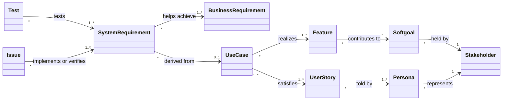

# 6. Requirements Management, Traceability, and Prioritization

This document says how the requirements are identified, changed, and traced, and in what order the planned ones should be done.

## 6.1 Identification

Every item has a symbolic identifier: a prefix for its kind and area, then a number. The numbers carry no order of importance, and an identifier is never reused once assigned, so a deleted requirement leaves a gap.

| Prefix          | Kind                            | Defined in                                            |
| --------------- | ------------------------------- | ----------------------------------------------------- |
| BR-             | Business requirement            | [01](01-vision-and-scope.md)                          |
| RULE-           | Business rule                   | [01](01-vision-and-scope.md)                          |
| RISK-           | Business risk                   | [01](01-vision-and-scope.md)                          |
| SH-             | Stakeholder                     | [02](02-stakeholders-and-personas.md)                 |
| P- (P-1 to P-5) | Persona                         | [02](02-stakeholders-and-personas.md)                 |
| PL, OW, MA      | Softgoal of a stakeholder actor | [03](03-goal-model.md)                                |
| F, C            | Feature, cross-tree constraint  | [04](04-feature-model.md)                             |
| P (PF1 to PF7)  | Planned feature                 | [04](04-feature-model.md)                             |
| UC, US          | Use case, user story            | [05](05-system-requirements-specification.md)         |
| REQ-_AREA_-     | System requirement              | [05](05-system-requirements-specification.md)         |
| Issue number    | Work to do                      | GitHub issues; Section 6.6 links them to requirements |
| M (M1 to M5)    | Mock-up                         | [10](10-mockups.md)                                   |
| M (M1 to M5)    | Mock-up                         | [10](10-mockups.md)                                   |
| A-              | Assumption                      | [08](08-assumptions-and-interview.md)                 |

Requirement areas: TEAM, DET, RAND, UNDO, FIND, ANLY, GEN, COLL, BKUP, LINK, TEXT, REF, LANG, THEME, FEED, SITE, DATA (functional); USE, PERF, INTF, OPS, MODE, SEC, INFO, POL, REL, MAINT (non-functional and interface).

## 6.2 Attributes and statuses

Only the attributes that are used are kept.

| Attribute            | Where it is kept                                                            | Values                                              |
| -------------------- | --------------------------------------------------------------------------- | --------------------------------------------------- |
| Identifier           | With the requirement                                                        | See 6.1                                             |
| Importance           | With the requirement                                                        | Essential, Conditional, Optional                    |
| Status               | With the requirement                                                        | See below                                           |
| Source               | The use case or section the requirement sits under, and the matrices in 6.4 | A business requirement, a user story, a stakeholder |
| Rationale            | The text around the requirement; the goal model for conflicts               | Free text                                           |
| Confidence           | The **[A-n]** marker on a requirement that rests on an assumption           | Marked (low) or unmarked (full)                     |
| Acceptance criteria  | The user story before the requirement                                       | "Verify that" statements                            |
| Verification method  | Section 4 of the SyRS                                                       | Test, Inspection, Analysis, Demonstration           |
| Version, last update | The repository's history of the file                                        | Commits                                             |

Statuses:

- **Proposed**: suggested by a stakeholder or by the analyst, not yet agreed.
- **Approved**: agreed by the Site Owner and part of the baseline; committed to be implemented.
- **Implemented**: designed and built. Every requirement that describes the baseline `629b75f` has this status.
- **Verified**: the tests named for it have been read and have passed. No requirement has this status yet, because the tests in Section 4 of the SyRS were matched by name only.
- **Rejected**: evaluated and declined, with the reason kept.
- **Deleted**: removed from the list; the identifier is not reused.

## 6.3 Baselines and change management

- **Baseline 0.1 (draft)**: these documents as first written, describing commit `629b75f` of `major-added-features`, 13 October 2026. It is a draft until the Site Owner has answered the interview in [08](08-assumptions-and-interview.md) and the assumptions have been corrected.
- **Baseline 1.0**: the documents after that review. From then on a change goes through the steps below.

Change management, sized for one maintainer:

1. A change request is a GitHub issue or a feedback email. It states what should change and why.
2. Impact analysis: find the requirement in the SyRS, then follow the matrices in 6.4 upward to the business requirement it serves and across to the use case, the feature, and the tests it touches.
3. Decision by the Site Owner: approve, defer (it stays Proposed), or reject (status Rejected, with the reason).
4. An approved change updates the requirement, its user story's acceptance criteria, and its tests in the same pull request as the code, so the documents cannot fall behind the site.
5. A change that players will notice gets an update log entry (REQ-MAINT-5).

## 6.4 Traceability

### Traceability information model

Which kinds of artefact are linked, and by what. The rows of the matrices below are these links.

Links are created by whoever has the information: the analyst links requirements upward, and the developer links tests to requirements when writing them. Links are kept at the level of requirement groups, not single requirements, because single-requirement links for more than two hundred requirements would not be maintained.

### Business requirements to system requirements

An X means the requirements of the row help achieve the business requirement of the column. Every row has at least one X, so no group of requirements is without a business reason, and every column has at least one, so no business requirement is without requirements.

| Requirements                   | BR-1 Revenue | BR-2 Links and teams keep loading | BR-3 Data within 2 or 7 days | BR-4 Ten languages | BR-5 Replace old website | BR-6 No backend | BR-7 Errors fixed in 7 days | BR-8 Providers' terms | BR-9 Non-competitive reach |
| ------------------------------ | :----------: | :-------------------------------: | :--------------------------: | :----------------: | :----------------------: | :-------------: | :-------------------------: | :-------------------: | :------------------------: |
| REQ-TEAM (UC1)                 |              |                                   |                              |         X          |            X             |                 |                             |                       |             X              |
| REQ-DET (UC2)                  |              |                                   |                              |                    |            X             |                 |                             |                       |                            |
| REQ-RAND (UC3)                 |              |                                   |                              |                    |            X             |                 |                             |                       |             X              |
| REQ-UNDO (UC4)                 |              |                                   |                              |                    |            X             |                 |                             |                       |                            |
| REQ-FIND (UC5)                 |              |                                   |                              |                    |            X             |                 |                             |           X           |             X              |
| REQ-ANLY-1 to 11 (UC6)         |              |                                   |                              |                    |            X             |                 |              X              |                       |             X              |
| REQ-ANLY-12 to 19 (UC22, UC24) |              |                                   |                              |                    |            X             |                 |              X              |                       |                            |
| REQ-GEN (UC7)                  |              |                                   |              X               |                    |            X             |                 |                             |                       |             X              |
| REQ-COLL (UC8)                 |              |                 X                 |                              |                    |            X             |        X        |                             |                       |             X              |
| REQ-BKUP (UC9, UC10)           |              |                 X                 |                              |                    |                          |        X        |                             |                       |                            |
| REQ-LINK (UC11, UC12)          |              |                 X                 |                              |                    |            X             |                 |                             |                       |                            |
| REQ-TEXT (UC13, UC14)          |              |                 X                 |                              |                    |                          |                 |                             |           X           |                            |
| REQ-REF (UC15)                 |              |                                   |                              |                    |            X             |                 |                             |           X           |             X              |
| REQ-LANG (UC16)                |              |                                   |                              |         X          |                          |                 |                             |                       |             X              |
| REQ-THEME (UC17)               |              |                                   |                              |                    |            X             |                 |                             |                       |                            |
| REQ-FEED (UC18)                |              |                                   |                              |                    |            X             |                 |              X              |                       |                            |
| REQ-SITE (UC19, UC23)          |              |                                   |                              |                    |            X             |                 |                             |                       |                            |
| REQ-DATA (UC20, UC21)          |              |                                   |              X               |         X          |                          |        X        |                             |           X           |                            |
| REQ-USE                        |              |                                   |                              |                    |            X             |                 |                             |                       |             X              |
| REQ-PERF                       |      X       |                                   |                              |                    |            X             |                 |                             |                       |             X              |
| REQ-INTF                       |      X       |                 X                 |                              |                    |                          |                 |                             |           X           |             X              |
| REQ-OPS                        |              |                                   |              X               |                    |                          |        X        |              X              |                       |                            |
| REQ-MODE                       |      X       |                                   |                              |                    |                          |        X        |                             |                       |             X              |
| REQ-SEC                        |              |                 X                 |                              |                    |                          |        X        |                             |           X           |                            |
| REQ-INFO                       |              |                 X                 |                              |                    |            X             |                 |                             |                       |                            |
| REQ-POL                        |      X       |                                   |                              |                    |                          |                 |                             |           X           |                            |
| REQ-REL                        |              |                                   |              X               |                    |            X             |        X        |              X              |                       |                            |
| REQ-MAINT                      |      X       |                                   |              X               |         X          |                          |        X        |              X              |                       |                            |

### Business requirements to softgoals

| Business requirement                           | Softgoals it serves                                     |
| ---------------------------------------------- | ------------------------------------------------------- |
| BR-1 Revenue covers costs and the owner's time | OW1 Cover running costs and my time                     |
| BR-2 Links and teams keep loading              | PL4 Keep my teams, OW3 Keep players' trust              |
| BR-3 Data within 2 or 7 days                   | MA2 Keep game data current, PL2 Trust the results       |
| BR-4 Ten languages                             | PL6 Use the site in my language and on my device, OW2   |
| BR-5 Replace the old website                   | OW2 Grow and keep the audience, PL1, PL3, PL5           |
| BR-6 No backend by preference, one maintainer  | MA1 Low maintenance effort, OW1                         |
| BR-7 Reported errors fixed in 7 days           | PL2 Trust the results, OW3, OW4 Learn what players need |
| BR-8 Providers' terms                          | OW1 (through its dependency on the ad platform), MA2    |
| BR-9 Non-competitive reach                     | OW2 Grow and keep the audience, PL3, PL6                |

### Personas, user stories, use cases, and requirements

| User story | Persona who tells it most | Use case                             | Requirements                 |
| ---------- | ------------------------- | ------------------------------------ | ---------------------------- |
| US1        | P-1 Maya, P-5 Leo         | UC1 Build Team                       | REQ-TEAM-1 to 15             |
| US2        | P-2 Daniel                | UC2 Set Pokemon Details              | REQ-DET-1 to 8               |
| US3        | P-1 Maya, P-5 Leo         | UC3 Randomize Team                   | REQ-RAND-1 to 5              |
| US4        | P-1 Maya, P-2 Daniel      | UC4 Undo Change                      | REQ-UNDO-1 to 5              |
| US5        | P-2 Daniel, P-3 Sofía     | UC5 Narrow Pokemon Choices           | REQ-FIND-1 to 12             |
| US6        | P-1 Maya, P-2 Daniel      | UC6 Analyze Team                     | REQ-ANLY-1 to 11             |
| US7        | P-4 Kenji                 | UC7 Change Generation                | REQ-GEN-1 to 11              |
| US8        | P-3 Sofía                 | UC8 Manage Saved Teams               | REQ-COLL-1 to 13             |
| US9        | P-3 Sofía                 | UC9 Back Up Teams                    | REQ-BKUP-1, 6, 8             |
| US10       | P-3 Sofía                 | UC10 Restore Teams                   | REQ-BKUP-2 to 5, 7           |
| US11       | P-2 Daniel, P-3 Sofía     | UC11 Share Team by Link              | REQ-LINK-1 to 3              |
| US12       | P-4 Kenji                 | UC12 Open Shared Team                | REQ-LINK-4 to 10, REQ-INFO-8 |
| US13       | P-2 Daniel                | UC13 Import Team Text                | REQ-TEXT-1 to 4              |
| US14       | P-2 Daniel                | UC14 Export Team Text                | REQ-TEXT-5 to 11             |
| US15       | P-1 Maya                  | UC15 Look Up Reference               | REQ-REF-1 to 6               |
| US16       | P-3 Sofía, P-4 Kenji      | UC16 Change Language                 | REQ-LANG-1 to 8              |
| US17       | P-1 Maya                  | UC17 Change Colour Scheme            | REQ-THEME-1, 2               |
| US18       | P-2 Daniel                | UC18 Send Feedback                   | REQ-FEED-1 to 9              |
| US19       | P-4 Kenji                 | UC19 Switch Site Version             | REQ-SITE-1, 2                |
| US20       | Maintainer (SH-2)         | UC20 Update Game Data                | REQ-DATA-1 to 7, 10 to 12    |
| US21       | Maintainer (SH-2)         | UC21 Update Translations             | REQ-DATA-8, 9                |
| US22       | P-3 Sofía, P-4 Kenji      | UC22 Set Battle Format (planned)     | REQ-ANLY-12 to 17            |
| US23       | P-4 Kenji                 | UC23 Transfer Teams Between Versions | REQ-SITE-3 to 5              |
| US24       | P-2 Daniel                | UC24 Check Team Legality (planned)   | REQ-ANLY-18, 19              |

The non-functional requirements are not derived from one use case. REQ-USE, REQ-PERF, REQ-MODE, and REQ-INFO relate to every use case; REQ-SEC-1 to 3 relate to UC18, and REQ-SEC-5 to UC10, UC12, and UC13.

Features to use cases are in Section 4.6 of the [feature model](04-feature-model.md). Requirements to tests are in Section 4 of the [SyRS](05-system-requirements-specification.md).

## 6.5 Prioritization

Requirements with status Implemented need no ordering. This section orders the work still to do on the requirements: the issues of Section 6.6.

### Prioritization scales

Importance is on every requirement. Urgency is added here for the planned work.

| Planned work                                           | Importance  | Urgency | Reason for the urgency                                                                                       |
| ------------------------------------------------------ | ----------- | ------- | ------------------------------------------------------------------------------------------------------------ |
| PF1 Battle format for the checklist                    | Conditional | Medium  | Corrects a known wrong result, but only for Generations 4 and 5.                                             |
| PF2 Team transfer between versions                     | Conditional | Medium  | Matters most while players are moving from the old website.                                                  |
| PF3 Let's Go and the Legends games                     | Optional    | Low     | Already announced as coming soon; large.                                                                     |
| PF4 Portuguese data names                              | Optional    | Low     | Cannot start until PokeAPI has the names.                                                                    |
| PF5 Verified sender domain                             | Conditional | High    | Until it is done the feedback function can reach only the owner's own address.                               |
| PF6 Team legality warnings                             | Optional    | Medium  | The rules are already written and tested.                                                                    |
| PF7 Notice of entries dropped from a link              | Conditional | Medium  | Every data update can silently change old links.                                                             |
| Keyboard operation and contrast (REQ-USE-4, REQ-USE-6) | Conditional | Medium  | Needs a review before its size is known.                                                                     |
| Browsers by usage share (REQ-INTF-13)                  | Conditional | Low     | Which browsers qualify is not yet known; no failure has been reported.                                       |
| Notice of Showdown data changes (REQ-DATA-12)          | Conditional | High    | Without it the 2-day target of BR-3 depends on the Maintainer noticing a change by chance.                   |
| Fallback data source for a new game (REQ-DATA-10, 11)  | Conditional | Medium  | Needed only when a new game is released and Pokemon Showdown is late; the next new game is expected in 2027. |

### Wiegers' prioritization

Each item is an issue of Section 6.6. Its benefit, the penalty of not having it, and its risk are rated from 1 to 9. Its cost is the issue's Size on the project board, a relative estimate of how long it will take, on the same scale: XXS 1, XS 2, S 3, M 4, L 5, XL 6, XXL 7, 3XL 9. The weights are 2 for benefit, 1 for penalty, 1 for cost, and 0.5 for risk. Priority is `value % / (cost % x cost weight + risk % x risk weight)`. The ratings and sizes are the analyst's estimates **[A-20]** and are meant to be replaced by the Site Owner's.

The priority value sets the issue's Priority on the board: P1 from 1.2, P2 from 0.6, and P3 below 0.6. P0 is kept for outages. A blocked issue is P3 until it is unblocked. Each percentage is a share of its column, so adding or removing an item shifts every value; the levels are checked again whenever the table changes.

| Item                                                           | Relative benefit | Relative penalty | Total value | Value % | Size | Relative cost | Cost % | Relative risk | Risk % | Priority | Level       |
| -------------------------------------------------------------- | ---------------- | ---------------- | ----------- | ------- | ---- | ------------- | ------ | ------------- | ------ | -------- | ----------- |
| Relative weights:                                              | 2                | 1                |             |         |      | 1             |        | 0.5           |        |          |             |
| PF5 Verified sender domain (REQ-FEED-9)                        | 3                | 5                | 11          | 5.6     | XS   | 2             | 2.9    | 1             | 2.1    | 1.431    | P1          |
| Notice of Showdown data changes (REQ-DATA-12)                  | 5                | 6                | 16          | 8.2     | S    | 3             | 4.3    | 2             | 4.3    | 1.273    | P1          |
| Sprites where Pokemon Showdown is blocked (REQ-INTF-18)        | 6                | 6                | 18          | 9.2     | M    | 4             | 5.7    | 3             | 6.4    | 1.031    | P2          |
| PF4 Portuguese data names (REQ-LANG-8)                         | 3                | 1                | 7           | 3.6     | XS   | 2             | 2.9    | 1             | 2.1    | 0.911    | P3, blocked |
| PF6 Team legality warnings (REQ-ANLY-18, 19)                   | 6                | 2                | 14          | 7.1     | M    | 4             | 5.7    | 2             | 4.3    | 0.911    | P2          |
| Wish with Protect or Detect as reliable recovery (REQ-ANLY-20) | 3                | 2                | 8           | 4.1     | S    | 3             | 4.3    | 1             | 2.1    | 0.763    | P2          |
| PF7 Notice of entries dropped from a link (REQ-INFO-8)         | 4                | 5                | 13          | 6.6     | M    | 4             | 5.7    | 3             | 6.4    | 0.745    | P2          |
| PF1 Battle format for the checklist (REQ-ANLY-12 to 17)        | 4                | 6                | 14          | 7.1     | L    | 5             | 7.1    | 3             | 6.4    | 0.691    | P2          |
| Keyboard operation and contrast (REQ-USE-4, 6)                 | 5                | 4                | 14          | 7.1     | L    | 5             | 7.1    | 3             | 6.4    | 0.691    | P2          |
| Browsers by usage share (REQ-INTF-13)                          | 3                | 3                | 9           | 4.6     | M    | 4             | 5.7    | 2             | 4.3    | 0.586    | P3          |
| Measure the speed targets (REQ-PERF-1 to 3)                    | 3                | 3                | 9           | 4.6     | M    | 4             | 5.7    | 2             | 4.3    | 0.586    | P3          |
| PF2 Team transfer to the old website (REQ-SITE-3, 5)           | 5                | 4                | 14          | 7.1     | L    | 5             | 7.1    | 5             | 10.6   | 0.573    | P3          |
| Unrecognised generation or game in a link (REQ-LINK-11)        | 2                | 2                | 6           | 3.1     | S    | 3             | 4.3    | 1             | 2.1    | 0.572    | P3          |
| Check which requirements have tests (Implemented requirements) | 3                | 3                | 9           | 4.6     | L    | 5             | 7.1    | 1             | 2.1    | 0.560    | P3          |
| Recheck the dex links on a schedule (REQ-REF-2)                | 2                | 2                | 6           | 3.1     | S    | 3             | 4.3    | 2             | 4.3    | 0.477    | P3          |
| PF3 Let's Go and the Legends games (REQ-GEN-11)                | 6                | 3                | 15          | 7.7     | XXL  | 7             | 10.0   | 7             | 14.9   | 0.439    | P3          |
| Fallback data source for a new game (REQ-DATA-10, 11)          | 5                | 3                | 13          | 6.6     | XXL  | 7             | 10.0   | 8             | 17.0   | 0.358    | P3          |
| Totals                                                         | 68               | 60               | 196         | 100     |      | 70            | 100    | 47            | 100    |          |             |

### Reading the result

- **The Site Owner's decision (interview, Q16) is to follow this ranking.** The ratings behind it are still the analyst's, so a rating the Site Owner disagrees with changes the order.
- **PF5 first.** It is among the cheapest items and removes a limit on a feature that is already live.
- **The notice of Showdown data changes second.** It was added after the interview set a 2-day target for major data: it is cheap, and the target cannot be met reliably without it.
- **Sprites where Pokemon Showdown is blocked third.** Players at schools that block Pokemon Showdown see no sprites at all, so both its benefit and its penalty are high.
- **PF4 ranks fourth by arithmetic only.** It is cheap, but it is blocked until 2027 and cannot be scheduled, so it stays P3.
- **PF6 before PF1.** Legality warnings rank above the battle format because their rules already exist and they are the smaller task, although the battle format corrects a known defect. The Site Owner has confirmed that the warnings are wanted.
- **Measuring the speed targets and browsers by usage share sit just under the P2 cutoff.** A small change to a rating would move them to P2.
- **PF3 and the fallback data source last.** Each has a cost and a risk several times most other items'. The goal model reaches the same conclusion about PF3 from the Maintainer's side. The fallback source ranks last although the Site Owner asked for it, because nobody yet knows which sources would serve; its first step, choosing them, is cheap and should be done before the next new game, not after the other items.
- The verification items (keyboard and contrast, browsers by usage share, the speed targets, and which requirements have tests) are investigations before they are features. Their sizes are the most uncertain in the table.

### Calibration

The weights are the ones in the course's example and are meant to be calibrated. The Site Owner has noted (13 October 2026) that cost may deserve less weight, because coding agents do much of the implementation, and that the cost weight could be halved from 1 to 0.5 if the ranking proves unsatisfying. It has not been changed. With today's ratings, halving it raises every priority value, which would put most items above the P1 cutoff, so the cutoffs would have to be set again. It would also move two items up: checking which requirements have tests from 14th to 10th, and the notice of an unrecognised generation or game from 13th to 11th, because their risk is low and their cost would count for less.

Other techniques the course teaches would add to this once players can be asked: a Kano survey would show which planned features players take for granted and which would delight them, and a 100-dollar test would let the Site Owner and a few players each spread 100 points over the list.

## 6.6 Requirements and GitHub issues

Work to do is kept in the project's GitHub issues, not in these documents. An issue names the requirements it implements or verifies; this table is the same link from the requirements' side. An issue tied to no requirement carries the label `no requirement` and is not in this table. The planned work is in the order of Section 6.5. Priority is the Priority field of the project board "My Pokemon Team Development" (P0 highest to P3 lowest), the milestone "Ash" holds the tasks left before the redesign is released, and "Brock" holds the release after it. Planned features are named PF1 to PF7 so that they are not mistaken for those priorities.

| Work                                             | Requirements                              | Issue                                                           | Priority    |
| ------------------------------------------------ | ----------------------------------------- | --------------------------------------------------------------- | ----------- |
| PF5 Verified sender domain                       | REQ-FEED-9                                | [115](https://github.com/projeffboy/my-pokemon-team/issues/115) | P1          |
| Notice of Showdown data changes                  | REQ-DATA-12                               | [116](https://github.com/projeffboy/my-pokemon-team/issues/116) | P1          |
| Sprites where Pokemon Showdown is blocked        | REQ-INTF-18                               | [76](https://github.com/projeffboy/my-pokemon-team/issues/76)   | P2          |
| PF4 Portuguese data names                        | REQ-LANG-8                                | [124](https://github.com/projeffboy/my-pokemon-team/issues/124) | P3, blocked |
| PF6 Team legality warnings                       | REQ-ANLY-18, 19                           | [117](https://github.com/projeffboy/my-pokemon-team/issues/117) | P2          |
| Wish with Protect or Detect as reliable recovery | REQ-ANLY-20                               | [141](https://github.com/projeffboy/my-pokemon-team/issues/141) | P2          |
| PF7 Notice of entries dropped from a link        | REQ-INFO-8                                | [119](https://github.com/projeffboy/my-pokemon-team/issues/119) | P2          |
| PF1 Battle format for the checklist              | REQ-ANLY-12 to 17                         | [118](https://github.com/projeffboy/my-pokemon-team/issues/118) | P2          |
| Keyboard operation, accessible names, contrast   | REQ-USE-4 to 6                            | [77](https://github.com/projeffboy/my-pokemon-team/issues/77)   | P2          |
| Browsers by usage share                          | REQ-INTF-13                               | [121](https://github.com/projeffboy/my-pokemon-team/issues/121) | P3          |
| Measure the speed targets                        | REQ-PERF-1 to 3                           | [17](https://github.com/projeffboy/my-pokemon-team/issues/17)   | P3          |
| PF2 Team transfer to the old website             | REQ-SITE-3, 5                             | [111](https://github.com/projeffboy/my-pokemon-team/issues/111) | P3          |
| Unrecognised generation or game in a link        | REQ-LINK-11                               | [113](https://github.com/projeffboy/my-pokemon-team/issues/113) | P3          |
| Check which requirements have tests              | Every requirement with status Implemented | [120](https://github.com/projeffboy/my-pokemon-team/issues/120) | P3          |
| Recheck the dex links on a schedule              | REQ-REF-2                                 | [47](https://github.com/projeffboy/my-pokemon-team/issues/47)   | P3          |
| PF3 Let's Go and the Legends games               | REQ-GEN-11                                | [122](https://github.com/projeffboy/my-pokemon-team/issues/122) | P3          |
| Fallback data source for a new game              | REQ-DATA-10, 11                           | [123](https://github.com/projeffboy/my-pokemon-team/issues/123) | P3          |

Issues with no requirement yet, because the feature is not planned:

| Idea                                               | Issue                                                         | State                                          |
| -------------------------------------------------- | ------------------------------------------------------------- | ---------------------------------------------- |
| Suggestions of teammates, moves, and items         | [37](https://github.com/projeffboy/my-pokemon-team/issues/37) | Wanted for a later release (milestone "Later") |
| Analysis beyond types                              | [44](https://github.com/projeffboy/my-pokemon-team/issues/44) | Wanted for a later release                     |
| Usage chart                                        | [36](https://github.com/projeffboy/my-pokemon-team/issues/36) | Wanted for a later release                     |
| Filter for viable items                            | [43](https://github.com/projeffboy/my-pokemon-team/issues/43) | Low priority; may be closed                    |
| Quick type, such as "hpfire" for Hidden Power Fire | [40](https://github.com/projeffboy/my-pokemon-team/issues/40) | Low priority                                   |
| CAP pokemon                                        | [39](https://github.com/projeffboy/my-pokemon-team/issues/39) | Undecided                                      |

Work that has no issue because it recurs: running the data and translation updates after each Pokemon Showdown change (BR-3), and reviewing the weekly dependency update (REQ-MAINT-3). Two pieces of requirements work are deferred and have no issue: usability sessions and surveys of players (REQ-USE-1, 2, 9), which the Site Owner set aside on 13 October 2026 as useful later for gauging the audience.
