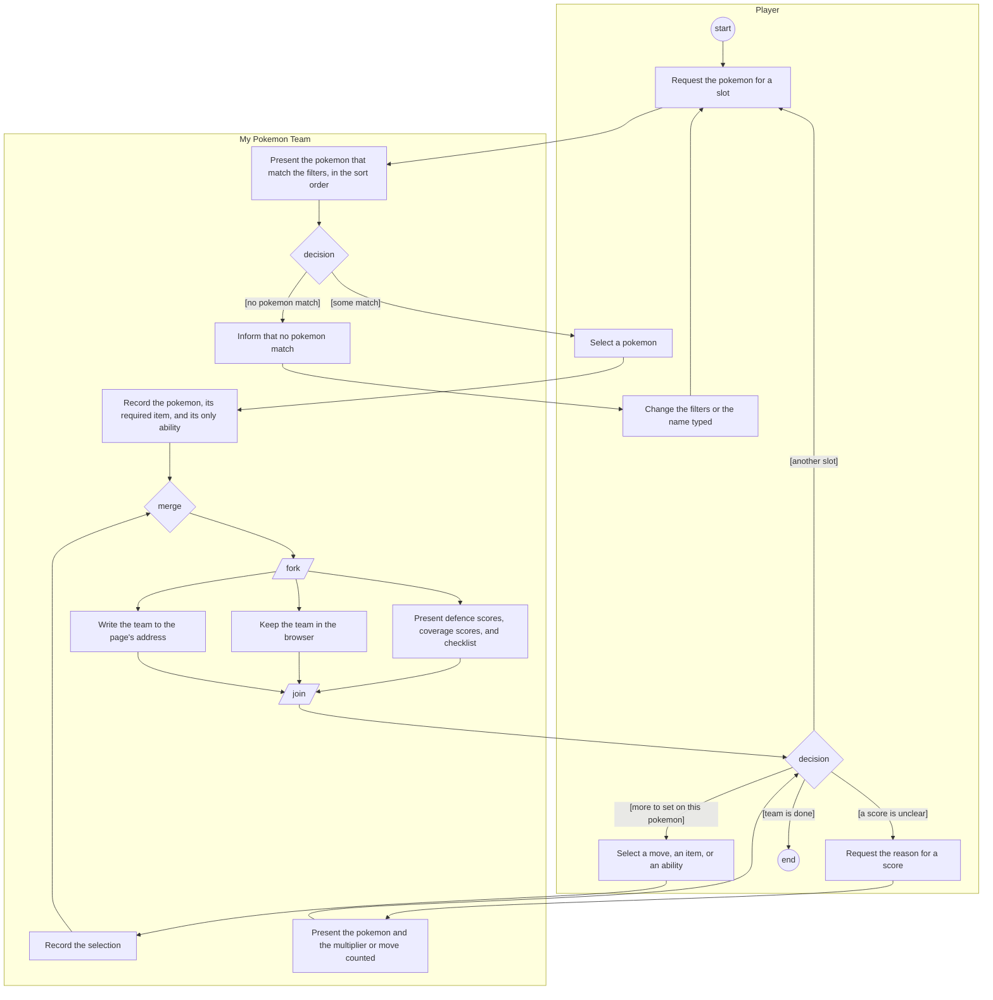
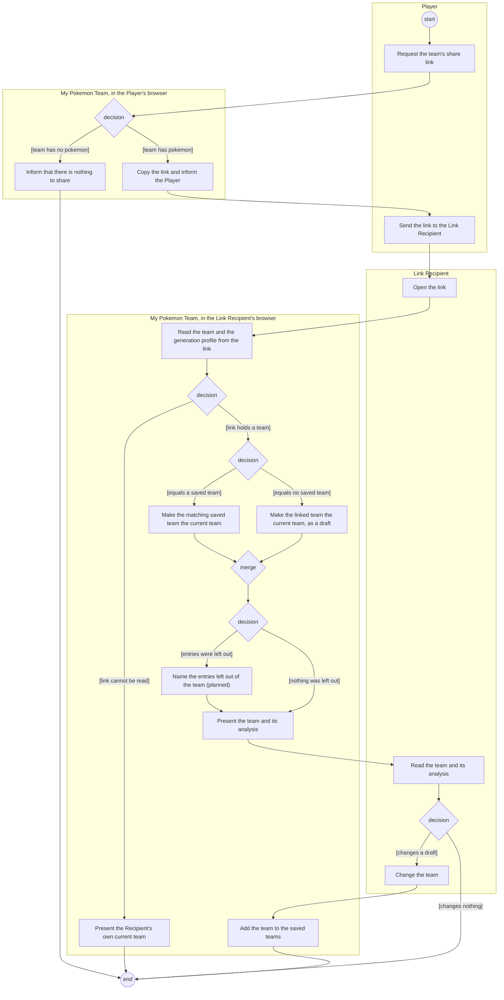
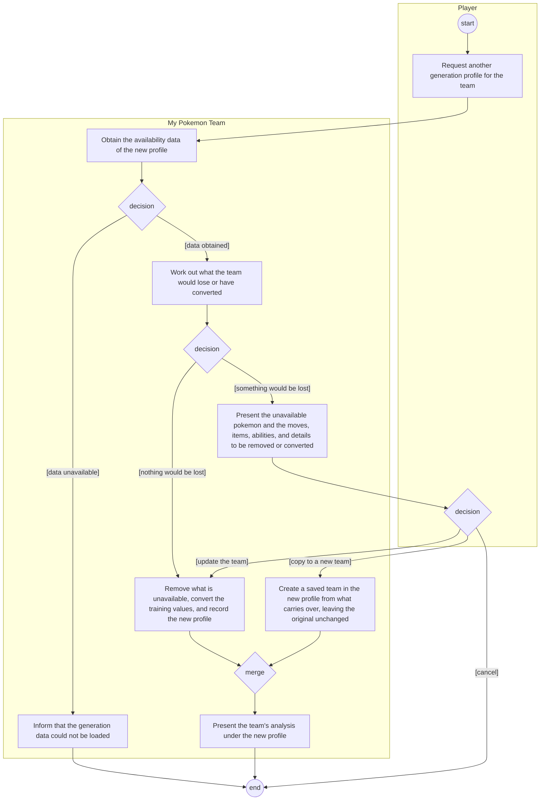
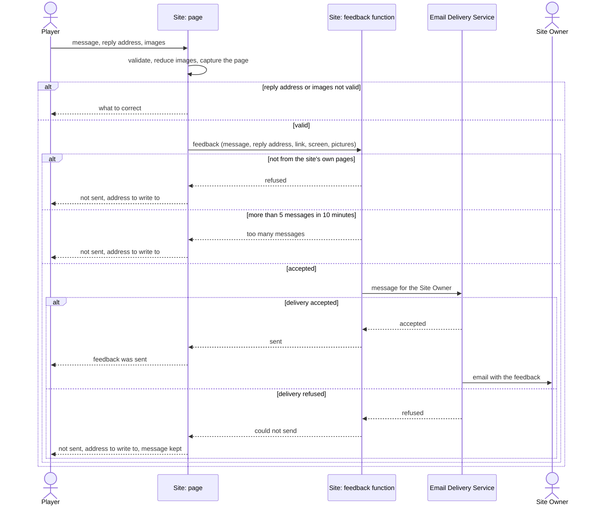
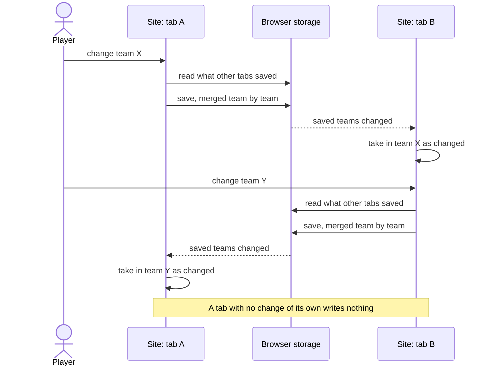
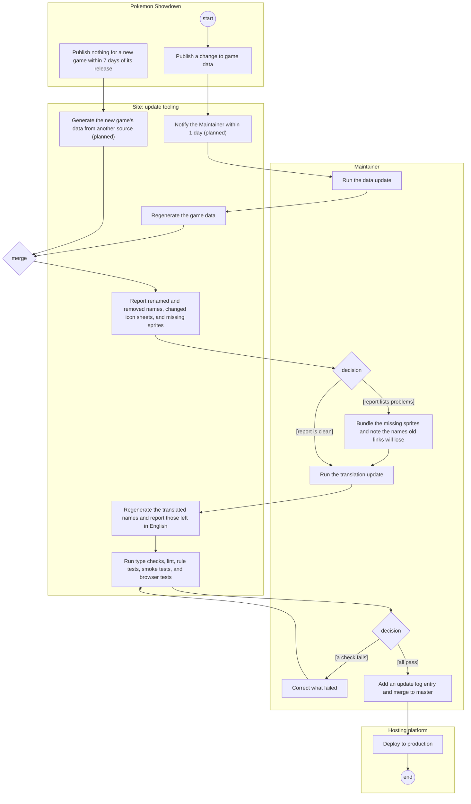
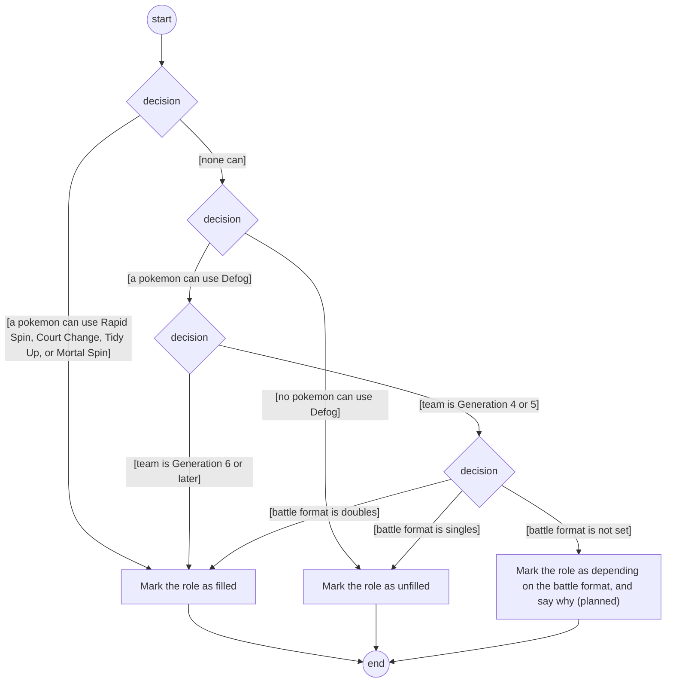
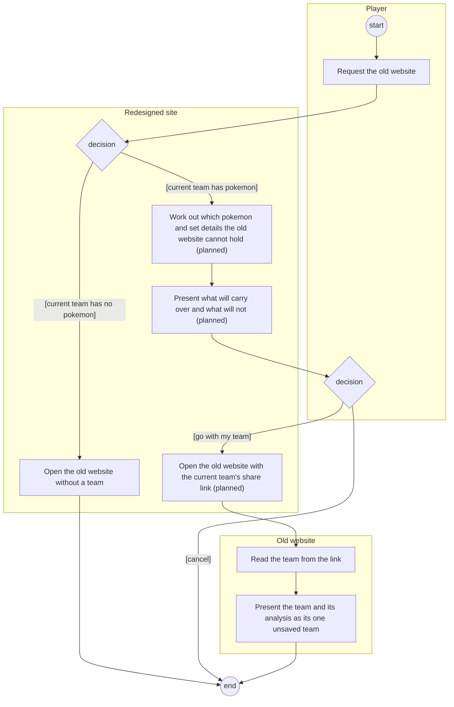

# 9. Scenario Models

Requirement level: user and system. The use cases in the [SyRS](05-system-requirements-specification.md) describe each flow in words, one use case at a time. These diagrams show the same flows as pictures and show what a single use case cannot: several use cases in one flow, work done at the same moment, and messages between the site's major parts.

The course models scenarios with Use Case Maps in the jUCMNav tool, and also teaches UML activity diagrams for workflows and UML sequence diagrams for requirements-level interactions. These are the UML ones, drawn in Mermaid so that they render with the documents. They add no requirements; where a diagram and a use case disagree, the use case is right and the diagram is to be corrected.

## 9.1 Notation

Mermaid has no activity diagram, so each one is a flowchart read as follows:

- A frame is a **partition** (swimlane): who does the work inside it.
- A circle labelled start or end is the **start** or the **activity final** node.
- A rectangle is an **action**.
- A diamond is a **decision** (one flow in, guarded flows out) or a **merge** (several flows in, one out). Guards are in square brackets.
- A slanted box labelled fork or join is a **fork** bar (the flows after it happen concurrently) or a **join** bar (the flow continues once all of them are done).
- An action marked "(planned)" belongs to a requirement with status Proposed or Approved, not Implemented.

The sequence diagrams follow the course's advice for the requirements level: the participants are only actors and major system components, with no internal objects.

## 9.2 Activity: build a team and read its analysis

Covers UC1 Build Team, UC5 Narrow Pokemon Choices, and UC6 Analyze Team. It shows why the site needs no save action: every recorded choice forks into presenting the analysis, keeping the team in the browser, and writing it to the address.

## 9.3 Activity: share a team and open the link

Covers UC11 Share Team by Link and UC12 Open Shared Team. The second partition of the site is the same site running in the Link Recipient's browser, with the Recipient's own saved teams.

A change to a team that was already saved is kept as any other change is; only a draft is added to the saved teams by its first change. The action marked "(planned)" is REQ-INFO-8 (PF7); today the entries are left out without a word. Mock-up M4 in [10-mockups.md](10-mockups.md) shows the notice.

## 9.4 Activity: change a team's generation

Covers UC7 Change Generation. The decision that matters is the second one: the site asks only when something would be lost.

When no pokemon of the team is available in the new profile, the two choices are named for what they do: Clear existing team (the update) and Create empty team (the copy).

## 9.5 Sequence: send feedback

Covers UC18 Send Feedback and the security requirements REQ-SEC-1 to REQ-SEC-3. The participants are the two actors, the two parts of the site that the context diagram already separates (the page in the browser and the feedback function on the hosting platform), and the email delivery service.

## 9.6 Sequence: two tabs keep the same saved teams

Covers REQ-COLL-11 of UC8 Manage Saved Teams: a Player with the site open twice does not lose in one tab what was done in the other.

## 9.7 Activity: update game data

Covers UC20 Update Game Data and UC21 Update Translations, with the timing that BR-3 sets. The actions marked "(planned)" are REQ-DATA-10 to REQ-DATA-12.

From Publish to Deploy the flow has 2 days for a major change and 7 days for a minor one (BR-3). Data that came through the fallback path is replaced by running the flow again from Publish once Pokemon Showdown has the game (REQ-DATA-11).

## 9.8 Activity (planned): judge the Spinner/Defogger role

Covers UC22 Set Battle Format (PF1) and REQ-ANLY-14 to REQ-ANLY-16. This is the rule the battle format exists for, drawn as the decisions the site makes for one team. Today the site stops at the generation: before Generation 6 it never counts Defog, which is wrong for doubles.

The three decisions below the first are new. Mock-ups M1 and M2 in [10-mockups.md](10-mockups.md) show two places the battle format could be set.

## 9.9 Activity (planned): take the current team to the old website

Covers UC19 Switch Site Version and UC23 Transfer Team to Old Website (PF2). It assumes the team crosses as a share link (A-14), because the two versions are at different addresses and neither can read the other's saved teams.

The flow runs from the redesigned site to the old website only: the old website is in maintenance and is not changed (REQ-OPS-5), so the way back carries no team. The old website's part is UC12 Open Shared Team, which it already does, so what is new is on the leaving side. The old website holds one unsaved team and covers Generations 6 to 9 only, so a team from another generation, or with set details the old website does not read, cannot arrive whole. Mock-up M5 shows the confirmation.

## 9.10 Planned features without a flow diagram

- **PF6 Team legality warnings**: the site already computes the rules; the feature is a display of them, shown in mock-up M3. There is no new flow.
- **PF5 Verified sender domain** and **PF4 Portuguese data names**: neither changes a flow. PF5 changes the address in the "message for the Site Owner" step of 9.5; PF4 changes the data that the translation step of 9.7 produces.
- **PF3 More games**: each game adds choices to the generation profile, and its flow is 9.4.
- **The notice of Showdown data changes and the fallback data source**: both are in 9.7.

## 9.11 Scenarios and use cases

| Diagram                                                | Use cases     | Requirements shown most directly                              |
| ------------------------------------------------------ | ------------- | ------------------------------------------------------------- |
| 9.2 Build a team and read its analysis                 | UC1, UC5, UC6 | REQ-TEAM-2, REQ-TEAM-14, REQ-ANLY-5, REQ-COLL-1, REQ-LINK-1   |
| 9.3 Share a team and open the link                     | UC11, UC12    | REQ-LINK-2, REQ-LINK-4 to REQ-LINK-8, REQ-LINK-10, REQ-INFO-8 |
| 9.4 Change a team's generation                         | UC7           | REQ-GEN-5 to REQ-GEN-8                                        |
| 9.5 Send feedback                                      | UC18          | REQ-FEED-1, REQ-FEED-6, REQ-FEED-7, REQ-SEC-1 to REQ-SEC-3    |
| 9.6 Two tabs keep the same saved teams                 | UC8           | REQ-COLL-11                                                   |
| 9.7 Update game data                                   | UC20, UC21    | REQ-DATA-1, REQ-DATA-6 to REQ-DATA-12, REQ-MAINT-1, REQ-OPS-1 |
| 9.8 Judge the Spinner/Defogger role (planned)          | UC22          | REQ-ANLY-14 to REQ-ANLY-16                                    |
| 9.9 Take the current team to the old website (planned) | UC19, UC23    | REQ-SITE-2, REQ-SITE-3, REQ-SITE-5                            |
