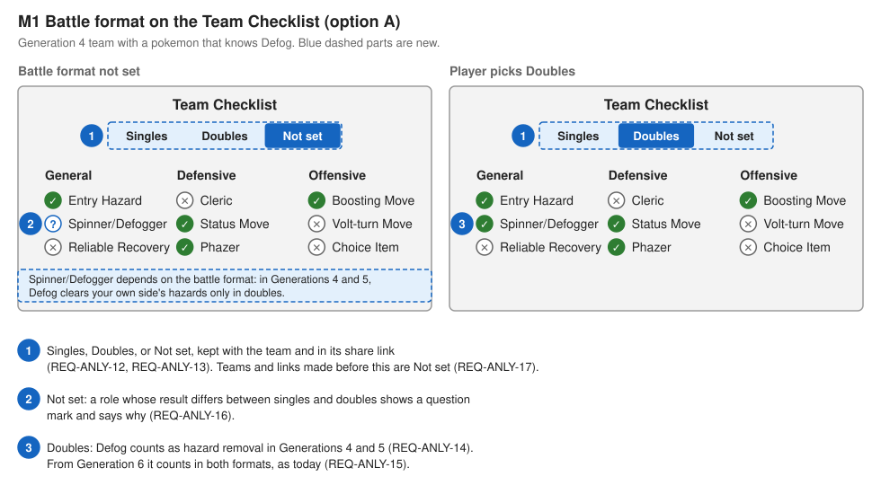
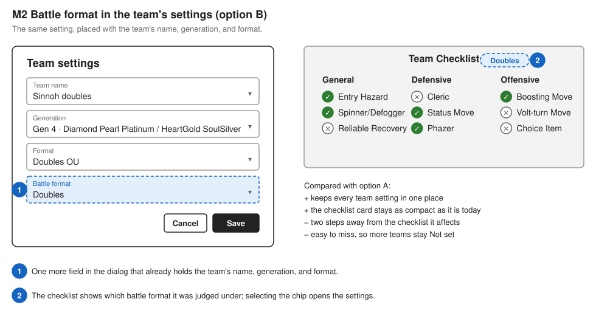
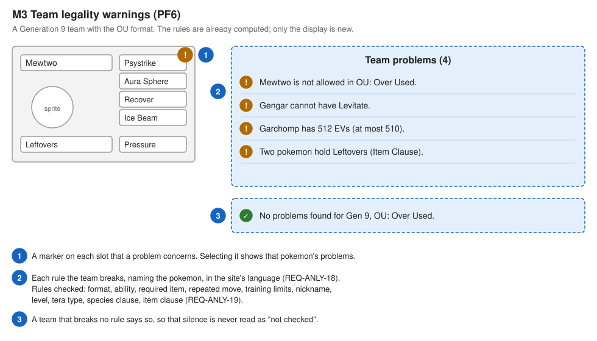
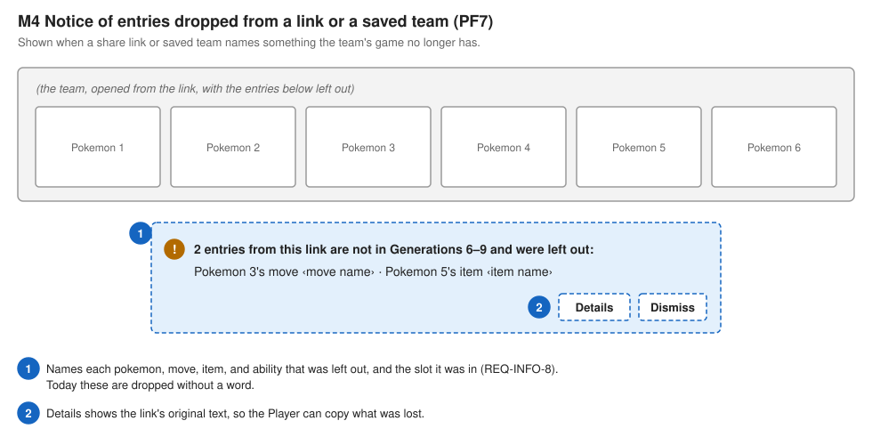
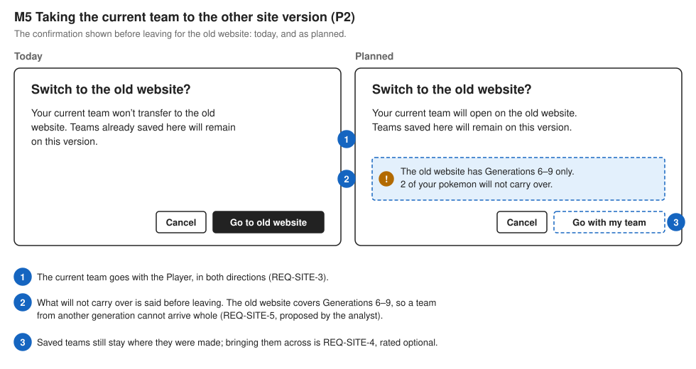

# 10. Mock-ups of the Planned Features

Requirement level: user and system. These are low-fidelity mock-ups: boxes and labels, with no colours, sprites, or exact sizes. Their purpose is to make each planned requirement concrete enough to agree or disagree with, and to put the open design decisions in front of the Site Owner. They are not designs to build from; the built feature follows Material Design 2 and the site's existing components (REQ-USE-8).

In every mock-up, a blue dashed outline marks what is new, and a numbered circle refers to the note below the drawing. The layout of the existing parts was taken from the site running at the baseline commit.

Only the planned features that change what a player sees have a mock-up. PF5 (verified sender domain), PF4 (Portuguese data names), the notice of Showdown data changes, and the fallback data source change nothing on the page. PF3 (more games) only removes "Coming soon" from three entries of the generation menu.

The drawings are generated by [`mockups/generate-mockups.py`](mockups/generate-mockups.py); change the script and run it with the `mockups` folder as its argument to redraw them.

## M1 and M2: where the battle format is set (PF1)

Requirements: REQ-ANLY-12 to REQ-ANLY-17. Use case: UC22 Set Battle Format. Flow: Section 9.8 of [09-scenario-models.md](09-scenario-models.md).

Issue 118 leaves one decision open: whether the battle format is set with the checklist or with the team's other settings. The two mock-ups show one option each, with the same Generation 4 team.

| Question                                                     | M1: on the checklist                    | M2: in the team's settings                            |
| ------------------------------------------------------------ | --------------------------------------- | ----------------------------------------------------- |
| Is the setting next to what it changes?                      | Yes                                     | No, two steps away                                    |
| Will a player who never opens the settings find it?          | Yes                                     | Only through the chip on the checklist                |
| Does the checklist card grow?                                | By one row                              | No                                                    |
| Are all of a team's settings in one place?                   | No: generation and format are elsewhere | Yes                                                   |
| Does it suggest the setting affects more than the checklist? | No                                      | Yes, which fits if the analysis later uses it as well |

The analyst's recommendation is M1. The battle format changes only the checklist today, the problem it corrects is one a player meets on the checklist, and the "Not set" state needs its explanation beside the control. M2 becomes the better choice if the battle format is later meant to change the defence or coverage analysis too. This decision belongs to issue 118.

## M3: team legality warnings (PF6)

Requirements: REQ-ANLY-18, REQ-ANLY-19. Use case: UC24 Check Team Legality.

The four messages are the site's existing texts for those rules. Open decisions (issue 117):

- Where the list sits: as a card in the analysis column, as shown, or as a tab beside the checklist and the matrix.
- Whether the list shows for every team or only for a team that has a format set. Without a format, only the rules that hold in every format apply (abilities, required items, repeated moves, training limits).
- Whether an empty slot or an incomplete set counts as a problem. The mock-up assumes it does not.

## M4: notice of entries dropped from a link or a saved team (PF7)

Requirement: REQ-INFO-8. Use case: UC12 Open Shared Team, alternative 2c. Flow: Section 9.3 of [09-scenario-models.md](09-scenario-models.md).

Open decisions (issue 119):

- Whether the notice stays until dismissed, as shown, or disappears by itself as the site's other messages do. A message that reports lost data is a reason to make it stay.
- Whether a saved team that lost an entry to a data update shows the same notice when it is next opened, and how the site remembers that the Player has already seen it.

## M5: taking the current team to the other site version (PF2)

Requirements: REQ-SITE-3, REQ-SITE-4, REQ-SITE-5. Use cases: UC19 Switch Site Version, UC23 Transfer Teams Between Versions. Flow: Section 9.9 of [09-scenario-models.md](09-scenario-models.md).

The warning in the planned dialog is REQ-SITE-5, which the analyst proposed while drawing this mock-up **[A-22]**: the old website covers Generations 6 to 9 only, so a team from another generation cannot arrive whole, and a player should hear that before leaving. Open decisions (issue 111):

- How the team crosses. The mock-up assumes a share link (A-14), which both versions can already read.
- Decided in the interview: the old website is in maintenance and is not changed, so the team crosses to the old website only, and saved teams do not cross at all.

## Mock-ups and requirements

| Mock-up | Planned feature | Requirements             | Decision it supports |
| ------- | --------------- | ------------------------ | -------------------- |
| M1      | PF1             | REQ-ANLY-12 to 17        | issue 118            |
| M2      | PF1             | REQ-ANLY-12 to 17        | issue 118            |
| M3      | PF6             | REQ-ANLY-18, REQ-ANLY-19 | issue 117            |
| M4      | PF7             | REQ-INFO-8               | issue 119            |
| M5      | PF2             | REQ-SITE-3 to 5          | issue 111            |
