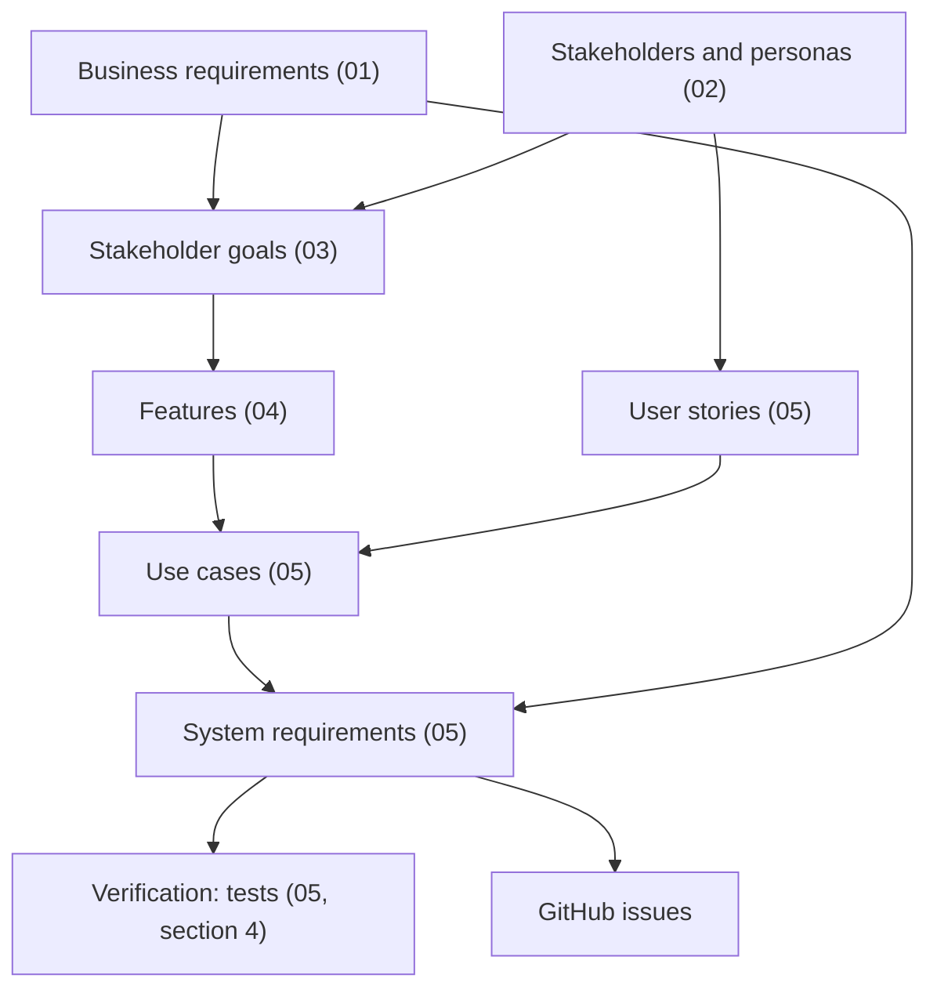

# My Pokemon Team: Requirements

The goals, stakeholders, requirements, and specification for [mypokemonteam.com](https://mypokemonteam.com), written with the methods and templates of McGill's ECSE 326 (Software Requirements Engineering).

- **Baseline**: 0.1 (draft), describing branch `major-added-features` at commit `629b75f`, 13 October 2026.
- **Scope**: the site as it is at that commit, and the work planned after it.
- **State**: drafted from the repository, then corrected with the Site Owner's answers to sixteen of the nineteen interview questions and part of a seventeenth, an analysis of competing products, and an analysis of player feedback. Every statement still marked **[A-n]** is an assumption. See [08-assumptions-and-interview.md](08-assumptions-and-interview.md).

## Documents

Read them in order: each refines the one before it.

| Document                                                                                              | Requirement level | What it holds                                                                                                                                                                    |
| ----------------------------------------------------------------------------------------------------- | ----------------- | -------------------------------------------------------------------------------------------------------------------------------------------------------------------------------- |
| [01 Vision and scope](01-vision-and-scope.md)                                                         | Business          | Business opportunity, problem statement, business requirements and rules, vision statement, scope, context diagram, business risks.                                              |
| [02 Stakeholders and personas](02-stakeholders-and-personas.md)                                       | Business, user    | Stakeholders in the onion model with their values, user classes, five personas.                                                                                                  |
| [03 Goal model](03-goal-model.md)                                                                     | Business, user    | Stakeholders' softgoals, the features' contributions to them, dependencies, and the evaluation of the old website, the redesign, and the next release.                           |
| [04 Feature model](04-feature-model.md)                                                               | User              | The feature tree with its constraints, the planned features, and four configurations.                                                                                            |
| [05 System requirements specification](05-system-requirements-specification.md)                       | System            | Use case model, domain model, state machine; for each use case a user story, acceptance criteria, the use case, and its requirements; non-functional requirements; verification. |
| [06 Requirements management, traceability, and prioritization](06-traceability-and-prioritization.md) | All               | Identifiers, attributes, statuses, baselines, change management, traceability matrices, and how the planned work is prioritized.                                                 |
| [08 Assumptions and interview](08-assumptions-and-interview.md)                                       | All               | Every assumption made, the interview script that settles them, and the record of answers.                                                                                        |
| [09 Scenario models](09-scenario-models.md)                                                           | User, system      | Activity and sequence diagrams of the main flows (build, share, change generation, feedback, two tabs, update data) and of the planned features.                                 |
| [10 Mock-ups](10-mockups.md)                                                                          | User, system      | Low-fidelity mock-ups of the planned features that change the page, with the design decisions each leaves open.                                                                  |
| [11 Analysis of existing systems](11-existing-systems-analysis.md)                                    | Business, user    | Six competing products, their features with an assessment of each, and what sets the site apart.                                                                                 |
| [12 Analysis of player feedback](12-feedback-analysis.md)                                             | User              | What about 105 player emails from 2021 to 2026 asked for and complained about, and what that changes.                                                                            |

## How the levels connect

## Conventions

- "The site" is the system under discussion: the website, its feedback function, and its data update scripts.
- A requirement is one sentence whose subject is the site (or a named part of it) and whose verb is "shall". It says what the site does, not how.
- A goal says what a stakeholder intends and is not a requirement. Goals are in [03](03-goal-model.md).
- Pokemon terms are defined in Section 1.4 of the [SyRS](05-system-requirements-specification.md), and abbreviations in its Section 5.2.
- Diagrams are Mermaid, which GitHub renders. The course's goal and feature models were built in the jUCMNav tool; here they are text, so that they can be reviewed and versioned with the code.
- Identifiers and statuses are explained in Sections 6.1 and 6.2 of [06](06-traceability-and-prioritization.md).

## Where the work is tracked

Work to do is only in the project's GitHub issues and on its project board, each issue naming the requirements it covers. These documents hold no task list and no ranking of tasks; Sections 6.5 and 6.6 of [06](06-traceability-and-prioritization.md) give the method and the rules.

## What is not in this repository

Traffic figures, advertising arrangements, and offers made to the Site Owner are kept in `private/`, which is git-ignored. Nothing in these documents identifies a player who wrote in.

## Keeping these documents true

A pull request that changes what the site does changes the requirement, its acceptance criteria, and its tests together (Section 6.3 of [06](06-traceability-and-prioritization.md)). `AGENTS.md` remains the source for code conventions; these documents are the source for what the site is for and what it shall do.
